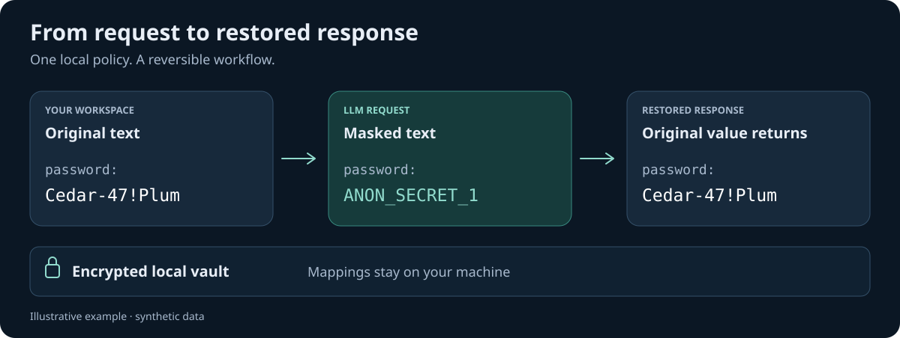

# Kaponir

**English · [Русский](README.ru.md)**

Local processing · Rust · [Apache-2.0](LICENSE)

### Useful context for AI. Sensitive values stay under your control.

Mask sensitive values before an LLM request and restore them in the response.
Kaponir is an **extensible anonymization system with a modular Rust core and built-in
AI-agent integration**. Its engine, recognizers, rule policy, packs, and encrypted vault
power a CLI, Web UI, LLM proxy, and document discovery worker. Use shared rules with an
agent, in a shell pipeline, or behind your own API.

[Quick start](#quick-start) · [Features](#what-kaponir-does) ·
[Comparison](#kaponir-and-presidio) · [Documentation](#documentation)



*Illustrative workflow with synthetic data. Restoration uses mappings in your local vault.*

## Project goals

Give an AI agent useful configurations, document excerpts, and support history while replacing
sensitive fragments. Kaponir preserves supported text and configuration syntax, then restores
known tokens returned by the model—including in streaming responses and tool arguments.

**Start locally:** basic masking needs no model or provider account. Add your own rules,
connect an LLM provider, or use document discovery when your workflow needs them.
Detection depends on your policy and data; review representative examples before deployment.

## What Kaponir does

| Workflow | What you can use today |
|---|---|
| **Mask text and files** | Secrets, infrastructure identifiers, personal data, and custom values; text, JSON, YAML, TOML, ENV, and INI; CLI pipelines, preview, and explanations. |
| **Restore original values** | Stable tokens, DNS-compatible forms, HMAC pseudonyms, and IP surrogates; encrypted mappings; text, escaped JSON, and streaming restoration. An irreversible mode is also available. |
| **Set your own policy** | Exact values, regex, Composite DSL templates, MASK/KEEP, per-kind strategies, and Personal/Team/Global scopes with enforced global rules. Language/domain packs and custom dictionaries extend detection. |
| **Connect an AI agent** | OpenAI Chat Completions and Anthropic Messages; supported message text, tool results and arguments, buffered responses, SSE, and session memory. |
| **Manage provider connections** | Up to 64 connections with encrypted keys, custom compatible endpoints, model pools, session affinity, and opt-in HTTP 429 retry. |
| **Build rules from documents** | Local discovery plus optional Xiaomi model-based candidates; text, images, PDF, and exported sessions; persistent worker queue, review, and explicit rule confirmation. |
| **Operate and integrate** | English/Russian Web UI, sidecar REST, Docker Compose, settings transfer, sanitized events, JSON metrics, and Prometheus. |

Optional **S1** scores already detected uncertain candidates using a local model or HTTP service.
It complements rules; it does not find entities missed by detectors. [How S1 works](docs/S1.md).

## Quick start

You need a stable Rust toolchain with Cargo. No external model or provider account is needed
for the first mask → restore check. Linux x64 is the primary verified platform.

### 1. Build and initialize

```bash
cargo build --locked --release -p kaponir-cli
export PATH="$PWD/target/release:$PATH"
kaponir init --corp-domain mycompany.ru
```

This creates the local configuration, keys, encrypted vault, and rule files in
`~/.config/kaponir`. Back up `vault.key`: without it, saved mappings cannot be restored.

### 2. Mask and restore the actual result

```bash
masked=$(printf '%s\n' 'password: Cedar-47!Plum' | kaponir mask)
printf 'Masked:   %s\n' "$masked"
printf 'Restored: %s\n' "$masked" | kaponir restore
```

Expected result: the first line contains an `ANON_...` token instead of the password; the
second restores `password: Cedar-47!Plum`. Use the actual output rather than a hardcoded token:
numbers depend on the current vault.

### 3. Open the Web UI

```bash
kaponir ui --no-open
# Open http://127.0.0.1:8787/ui/
```

The same UI is available after `kaponir serve`. `kaponir ui` without `--no-open` also tries to
open a browser. For a real provider connection, open **Providers and API**, save a provider,
and verify the route with synthetic data first.

For file processing, `--dry-run`, proxy client setup, OCR, and Docker, see the examples below
and the [CLI reference](docs/COMMANDS.md). Every native worker needs Python 3.12+, including
for text files. Images/PDF and Xiaomi mode need additional dependencies; the regular
mask/restore CLI and proxy do not require Python.

### Proxy for an existing client

```bash
kaponir serve

# Example for an Anthropic client:
ANTHROPIC_BASE_URL=http://127.0.0.1:8787 claude

# Example for an OpenAI-compatible client:
OPENAI_BASE_URL=http://127.0.0.1:8787/v1 my-script
```

When a connection is saved, Kaponir injects the provider key. Without a matching profile, it uses
direct upstream mode with the client's credentials. Do not send real requests until you have
verified the address, route, and rules with synthetic data.

<a id="screenshots"></a>

## Web UI

The built-in panel includes a masking laboratory, rules and decision review, provider
connections, traffic metrics, document discovery, and worker controls. Switch to **EN**
in the header for English labels. [Panel guide](docs/CONTROL_PANEL.md).

<!-- Add only genuine English-interface captures here. See docs/images/README.md. -->

<a id="kaponir-and-microsoft-presidio"></a>

## Kaponir and Presidio

Both projects have extensible detection and anonymization components. Kaponir combines a
**modular Rust engine with built-in integration across the AI-agent request/response cycle**:
custom detection and policy, encrypted mappings, session handling, and streaming restoration.
Presidio provides Python detection and anonymization components, configurable NLP engines,
additional data-processing modules, and gateway integrations.

| Capability | Kaponir | Presidio |
|---|---|---|
| **Core components** | Separate Rust crates for the engine/policy, recognizers, packs, vault, S1, and proxy; shared engine behavior across CLI, Web UI, and REST. | Separate analyzer/anonymizer packages, recognizer and operator extension interfaces, and additional image/structured-data modules. |
| **Custom detection** | Recognizers, exact values, regex, Composite DSL templates, language/domain packs, and dictionaries. | Predefined/custom recognizers, regex, context, checksums, NLP/NER engines, and external models. |
| **Policy and exceptions** | MASK/KEEP, Personal/Team/Global priority, enforced global rules, and per-kind strategies. | Entity selection, score thresholds, allow-lists, recognizer configuration, and per-entity operators; application-level policy is assembled by the integrator. |
| **Replacement strategies** | Numbered tokens, HMAC pseudonyms, DNS forms, IP surrogates, and irreversible HMAC mode. | Replace, redact, mask, hash, encrypt, and custom operators. The operator sets are not identical. |
| **Reversible processing** | Encrypted local vault, stable mappings, session memory, and restoration built into CLI/API/proxy. | Encrypt/decrypt operators and mapping-based pseudonymization examples; persistence and session lifecycle depend on the integration. |
| **LLM requests and responses** | Built-in Chat Completions/Anthropic proxy, SSE restoration, and supported tool arguments/results. | Documented gateway integrations, including LiteLLM; protocol handling, streaming, and restoration depend on the chosen integration. |
| **Gateway integration and routing** | Sidecar REST with per-session streaming restoration, up to 64 provider connections, model pools, session affinity, and opt-in HTTP 429 retry. | Analyzer/anonymizer HTTP services; provider routing, keys, and session handling are supplied by the gateway or application integration. |
| **Files and structured data** | CLI pipelines, configuration formats, and REST; discovery over text and extracted document content. | Python/REST, batch processing, and a dedicated structured/semi-structured data package. |
| **Images and PDF** | Worker extracts text for discovery and review; optional Xiaomi candidate discovery. Does not redact source pixels. | Image-redactor uses OCR and detection to redact image pixels. |
| **Review and adaptation** | Web laboratory, decision review, saved suggestions → confirmed rules; optional S1 scoring and local training on confirmed decisions. | Analyzer decision explanations and configurable recognizers/models; a review and rule-approval workflow can be built around the APIs. |
| **Running the workflow** | CLI + bilingual Web UI + proxy in one Rust binary; optional Python worker and Compose; provider pools and metrics. | Python packages, HTTP services, Docker/Kubernetes deployment examples, and ecosystem integrations. |

**Kaponir's strength for AI-agent workflows is the combination of extensible components and
built-in protocol, session, and restoration support.** You can customize detection and policy,
connect an existing agent, or integrate through REST and CLI while using the same engine and vault.
Provider routing and document-to-rule discovery are part of that system as well.

Presidio is a strong fit for Python/NLP pipelines, its anonymization operator model,
dedicated structured-data processing, and image-pixel redaction. The table distinguishes
built-in capabilities from integration-dependent ones; it does not rank detection quality.
Neither project guarantees complete detection on arbitrary data.

Sources: Presidio [analyzer](https://presidio.dataprivacystack.org/analyzer/),
[anonymizer](https://presidio.dataprivacystack.org/anonymizer/),
[structured data](https://presidio.dataprivacystack.org/structured/),
[image redactor](https://presidio.dataprivacystack.org/image-redactor/), and
[integration examples](https://presidio.dataprivacystack.org/samples/).
This compares documented capabilities, not measured accuracy or speed.
Presidio, originally developed at Microsoft, is now a
[community-owned project](https://presidio.dataprivacystack.org/project_transition/) under Data Privacy Stack.

## Use cases

### 1. Share a configuration with a chat safely

Use the CLI or the **Laboratory** in the Web UI. The laboratory shows candidates, decisions, and
reasons; its preview does not save vault or journal entries. The save button records mappings
for later restoration.

### 2. Connect an AI agent without manually processing every message

Start `kaponir serve`, configure a provider, and point the SDK or agent to the Kaponir address.
The proxy processes supported text fields, while session memory masks values again when they
reappear in conversation history. Tool schemas and signed `thinking` blocks are not modified.

### 3. Create rules from corporate documents

```bash
kaponir discover contract.txt invoice.yaml --json
kaponir discover contract.txt --remember
kaponir discover --saved --json
kaponir discover --saved --select SUGGESTION_ID --scope team
kaponir discover --saved --reject OTHER_SUGGESTION_ID
```

A normal preview is local: it does not call S1, save the collection, or change rules. `--select`
creates only the selected exact MASK rules. `--reject` saves a negative training label but does
not create a KEEP rule or change current masking.

### 4. Analyze a directory, scans, or PDF files

```bash
kaponir worker --input-root /absolute/path/to/documents run .
kaponir discover --saved --json
```

For a persistent queue, run `kaponir worker serve` alongside `kaponir serve`. The worker extracts
text, passes it to discover, and stores suggestions; OCR model output does not become rules.
Q4/Q5 downloads, job management, and Compose are described in the [worker guide](docs/WORKER.md).

For model-based candidate discovery, select **Xiaomi candidates + local discovery** in the UI.
Findings are checked against source text and require confirmation before becoming rules.
Saved TXT/Markdown/JSON/JSONL session exports can be submitted as files; automatic session
capture and directory watching are not implemented. [Worker setup and modes](docs/WORKER.md).

### 5. Integrate processing into a custom gateway

```bash
curl -s http://127.0.0.1:8787/api/v1/anonymize \
  -H 'content-type: application/json' \
  -d '{"text":"password: Cedar-47!Plum","session":"example-session"}'

curl -s http://127.0.0.1:8787/api/v1/deanonymize \
  -H 'content-type: application/json' \
  -d '{"text":"password: ANON_SECRET_1","session":"example-session"}'
```

For streaming, use `/api/v1/deanonymize/stream` with `session` and `stream` identifiers, a `chunk`
fragment, the `done` flag, and optional `json_escape`. See the [architecture](docs/DESIGN.md#9-прокси-для-агентов-этап-2-kaponir-proxy-kaponir-serve)
for the contract and boundaries.

### 6. Run with Docker Compose

```bash
cp deploy/compose.env.example .env
# Set two different long tokens and the source directory in .env.
mkdir -p documents

docker compose up -d --build kaponir                 # proxy only
docker compose --profile analysis up -d --build      # proxy + worker
```

Compose stores the vault, keys, queue, and models in volumes; the document directory is mounted
read-only. Do not use `docker compose down -v` for a routine update: it deletes data and keys.
See [worker and Compose](docs/WORKER.md#3-docker-compose) for details.

## Rules, packs, and discover

### Three rule scopes

- **Personal** — the workspace owner's private values.
- **Team** — rules shared by a team.
- **Global** — global policy; `enforced = true` cannot be overridden by a lower-priority scope.

Scopes organize rule priority and distribution, but they are not a ready-made multi-user RBAC
model. Exact values, regex, Composite DSL templates, MASK/KEEP, types, categories, and strategies
are supported. After rule changes, the Web UI rebuilds the engine without restarting and clears
affected masking caches.

```bash
kaponir rule add --value 'Example Client' --kind CLIENT
kaponir rule add --keep --value ingress-nginx
kaponir rule add --scope global --enforced --value 'Internal Project' --kind PROJ
kaponir rule list
kaponir rule check
```

Uncertain decisions can be converted into rules:

```bash
kaponir review --group
kaponir review mask 3 4 --kind SVC --scope team
kaponir review keep --shape 'x-x'
kaponir review template '{env:prod|stage}-{SVC}-{hash}'
```

### Language and domain packs

The built-in packs are `lang-en`, `lang-ru`, `domain-tech`, `domain-web`, and `region-ru`. They add
dictionaries, validators, and language rules; the core contains no Russian or regional logic.
A custom data pack is a directory containing `pack.toml` and `words.txt`, loaded via `pack_dirs`.

```bash
kaponir pack list
kaponir pack test ./packs/lang-en
```

`pack test` checks a pack's detectors against its labeled corpus without S1. It is not a quality
measurement on an independent production corpus.

## S1: optional candidate scoring

S1 scores **already detected uncertain candidates**. Choose deterministic processing (`none`,
the default), a local `ngram` model, or an HTTP service. Confirmed labels can train the local
model; explicit rules and hard masks are not reevaluated. Start in shadow mode.

L0 sends features without the source string; L1 includes the value; L2 adds limited context.
L1/L2 disclose data to the selected service even in shadow mode. Credentials are restricted
to L0; new SECRET candidates from discover are not sent to S1. [Configuration and limits](docs/S1.md).

## Data and security

- Local data lives in `KAPONIR_HOME`, then `$XDG_CONFIG_HOME/kaponir`, otherwise `~/.config/kaponir`.
- Vault values and provider keys use ChaCha20-Poly1305 encryption and blind indexes.
  Exact values in `rules/*.toml` are plain text.
- Back up the vault **and `vault.key`**: restoration requires both. Settings export is not a vault backup.
- `--irreversible` does not save mappings. A shared `token.key` can make HMAC pseudonyms consistent across a team.
- The server binds to loopback by default. Non-local binding requires an API token; external access also needs TLS and network controls.

[Trust model and backups](docs/SECURITY.md) · [Settings transfer](docs/SETTINGS_TRANSFER.md)

## Limitations

Understand these boundaries before using Kaponir with real data:

- **Detection completeness is not guaranteed.** A secret unknown to the detectors can remain exposed; S1 does not search for it.
- **Uncertain does not always mean secret.** Extra masks are possible; review them through rules and review.
- **Reversibility requires the vault and keys.** Regular `--strategy hmac` restores through the vault;
  `--irreversible` does not save new mappings. Losing the vault or its key prevents restoration.
- **The proxy does not support the OpenAI Responses API.** Supported interfaces are Chat Completions, Anthropic Messages, and sidecar REST.
- **Not every model will preserve meaning.** Substitutions change the text visible to the model; exact restoration is possible only for tokens returned without distortion.
- **In-memory traffic is not an audit log.** The overview and events are bounded and lost on restart.
- **Xiaomi findings need review.** The model can miss values or propose unnecessary ones; it does not automatically make mask/keep decisions.
- **Team/Global are not RBAC.** Separate user roles and a shared multi-server vault are not implemented.
- **The server trusts the workspace owner.** Kaponir does not protect data from a host administrator who controls the process, memory, keys, and vault.
- **Synthetic regressions are not a production evaluation.** Saved corpora verify known scenarios, not universal completeness and accuracy.

## Architecture

```text
CLI ───────────────┐
Web UI ────────────┤
OpenAI/Anthropic ──┼──→ Engine ─→ Recognizers + Packs + Rules ─→ masked text
Sidecar REST ──────┤       │                    │
Worker → Discover ─┘       ├─→ optional S1      │
                           └─→ Vault ←──────────┘
                                  │
                                  └─→ response restoration
```

[Crates, contracts, and design decisions](docs/DESIGN.md).

## Verification and development

```bash
cargo fmt --all -- --check
cargo clippy --locked --workspace --all-targets -- -D warnings
cargo test --locked --workspace
python3 -m unittest discover -s scripts -p 'test_*.py'
node --check crates/kaponir-proxy/assets/app.js
node --check crates/kaponir-proxy/assets/panel.js
node --check crates/kaponir-proxy/assets/i18n.js
python3 scripts/check_docs.py
```

The regression test uses 64 synthetic documents, 1,344 labeled values, and 8,808 occurrences;
it checks public terms and byte-for-byte restoration. It preserves known behavior but is not an
independent quality evaluation on arbitrary data. See [OPERATIONS.md](docs/OPERATIONS.md) for the
methodology, benchmark, CI, and release verification, and [CONTRIBUTING.md](CONTRIBUTING.md) for
development guidelines.

## Documentation

Start with the [documentation index](docs/README.md). Main routes:

- [CLI reference](docs/COMMANDS.md) — commands, flags, formats, and examples.
- [Control panel](docs/CONTROL_PANEL.md) — UI, providers, pools, and events.
- [Discover](docs/DISCOVERY.md) — suggestions, collection, confirmations, and API.
- [Worker](docs/WORKER.md) — queue, OCR, PDF, and Docker Compose.
- [S1](docs/S1.md) — L0/L1/L2 disclosure, shadow/active modes, HTTP, and training.
- [Security](docs/SECURITY.md) — trust model, keys, networking, and backups.
- [Operations](docs/OPERATIONS.md) — quality, metrics, benchmark, CI, and release.
- [Settings transfer](docs/SETTINGS_TRANSFER.md) — shared JSON for CLI and Web.
- [Architecture](docs/DESIGN.md) — internal contracts and decisions.

Research and historical reports are listed separately in the [documentation index](docs/README.md#исследования-и-история).
They describe specific runs and do not replace the current guides. The detailed guides are
currently written in Russian; the Russian project overview is available in [README.ru.md](README.ru.md).

## License

[Apache-2.0](LICENSE). The project is named **Kaponir**; the `ANON` token prefix and historical
cryptographic labels are retained for compatibility.
