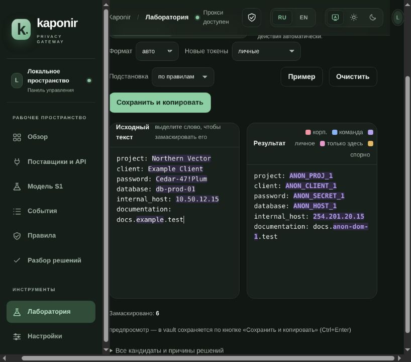
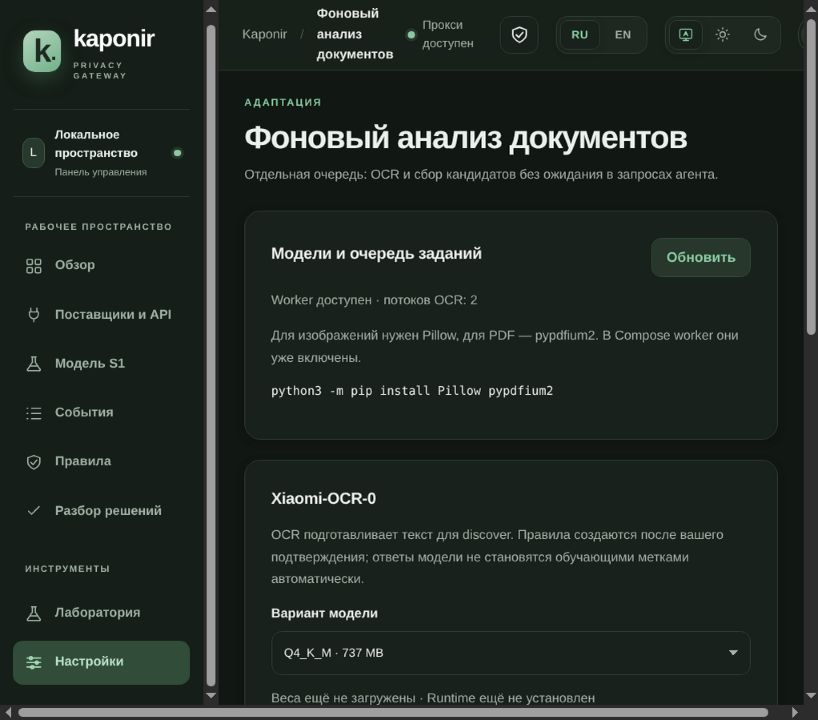

# Kaponir

**[English](README.md) · Русский**

**Скрывайте чувствительные значения перед запросом к LLM и возвращайте их в ответе.**

Kaponir — локальный обратимый анонимайзер текста и LLM-прокси. Он находит и заменяет
чувствительные значения по детекторам и вашим правилам, а затем восстанавливает
оригиналы из известных токенов в ответе модели.
CLI, Web UI, прокси и фоновый анализ документов используют одно локальное пространство
правил и зашифрованное хранилище.

- **Для работы с агентом:** маскирование и восстановление текста, потоковых ответов и аргументов инструментов.
- **Для настройки по своим данным:** каталог документов → кандидаты Xiaomi и локального поиска → подтверждённые правила.
- **Для удобного запуска:** один бинарник для CLI и веба; фоновый анализ — отдельным worker или через Compose.

[Быстрый старт](#быстрый-старт) ·
[Возможности](#что-умеет-kaponir) ·
[Документация](docs/README.md) ·
[Безопасность](docs/SECURITY.md) ·
[Участие](CONTRIBUTING.md)

```text
Исходный запрос                      Внешняя LLM                       Ответ пользователю

Проект: Северный Вектор       →      Проект: ANON_PROJ_1        →      Проект: Северный Вектор
password: Cedar-47!Plum       →      password: ANON_SECRET_1    →      password: Cedar-47!Plum
10.50.12.15                   →      248.131.59.15              →      10.50.12.15
                                  ↑
                    Соответствия остаются в локальном vault
```

Схема показывает пример замен при настроенных правилах; номер токена и IP-суррогат
зависят от пространства, ключей и стратегии.

> **Главная идея:** передавать модели рабочий контекст с заменами найденных чувствительных значений.
> Обратимость обеспечивается локальным хранилищем, а не памятью модели.

## Содержание

- [Задача проекта](#задача-проекта)
- [Что умеет Kaponir](#что-умеет-kaponir)
- [Быстрый старт](#быстрый-старт)
- [Скриншоты](#скриншоты)
- [Kaponir и Microsoft Presidio](#kaponir-и-microsoft-presidio)
- [Сценарии использования](#сценарии-использования)
- [Правила, пакеты и discover](#правила-пакеты-и-discover)
- [S1: необязательная оценка кандидатов](#s1-необязательная-оценка-кандидатов)
- [Данные и безопасность](#данные-и-безопасность)
- [Ограничения](#ограничения)
- [Архитектура](#архитектура)
- [Проверка и разработка](#проверка-и-разработка)
- [Документация](#документация)

## Задача проекта

AI-агентам полезны реальные конфигурации, фрагменты документов и история обращений, но в них
могут быть пароли, адреса внутренних систем, имена клиентов, реквизиты и коммерческие условия.
Обычная замена всего текста случайными символами разрушает структуру и мешает модели рассуждать.

Kaponir решает две связанные задачи:

1. **Перед запросом** находит чувствительные фрагменты и заменяет их стабильными плейсхолдерами
   или суррогатами, сохраняя синтаксис текста, JSON, YAML, конфигураций и вызовов инструментов.
2. **После ответа** находит известные токены и возвращает соответствующие оригиналы — в том числе
   внутри потокового SSE и JSON-аргументов инструментов.

Проект ориентирован на локальную работу. По умолчанию S1 выключен, интерфейс и прокси слушают
loopback-адрес, а внешний LLM-провайдер получает только обработанный запрос. Это не универсальный
DLP и не гарантия обнаружения любого секрета: политику и правила нужно настроить под свои данные.

## Что умеет Kaponir

| Область | Реализованные возможности |
|---|---|
| **Маскирование** | Секреты и учётные данные, IP, email, домены и URL, пути, имена сервисов, идентификаторы, персональные данные и пользовательские значения. Решение зависит от детекторов, пакетов, правил и политики. |
| **Обратимость** | Стабильные токены `ANON_<KIND>_<N>`, DNS-совместимые формы, HMAC-псевдонимы и IP-суррогаты; восстановление обычного текста и экранированных JSON-строк. |
| **CLI** | `mask`, `restore`, `discover`, разбор спорных решений, правила, пакеты, статистика, S1 и перенос настроек. Работает с файлами и shell-пайпами. |
| **LLM-прокси** | OpenAI Chat Completions и Anthropic Messages; текст, `tool_result`, аргументы инструментов, обычные и потоковые ответы. |
| **Поставщики** | До 64 подключений с отдельными зашифрованными ключами, отдельные endpoint, общий пул по модели, привязка сессий и явно включаемый retry при HTTP 429. |
| **Web UI** | Обзор трафика, подключения, события, правила, разбор решений, лаборатория маскирования, discover, настройки S1 и фонового анализа. Интерфейс на русском и английском. |
| **Discover** | Локальный анализ документов, примеры вхождений, стабильные ID, зашифрованная подборка и явное подтверждение выбранных MASK-правил. |
| **Фоновый анализ и Xiaomi** | Каталоги, текстовые экспорты сессий, изображения и PDF; OCR и дополнительный поиск кандидатов моделью. Отдельный worker, очередь, пауза и продолжение; находки поступают в подборку. |
| **Интеграции** | Sidecar REST для собственных шлюзов и потоковое восстановление по сессии; Docker Compose для прокси и worker. |
| **Наблюдаемость** | Обезличенные события, технические JSON-метрики и Prometheus без содержимого сообщений и исходных значений. |

Подробная схема полей запросов и ответов — в [архитектуре](docs/DESIGN.md#9-прокси-для-агентов-этап-2-kaponir-proxy-kaponir-serve),
устройство панели — в [руководстве по панели](docs/CONTROL_PANEL.md).

## Быстрый старт

Нужен стабильный Rust toolchain с Cargo. Для первой проверки mask → restore не требуются
внешние модели или аккаунт у LLM-провайдера. Основная проверенная платформа — Linux x64.

### 1. Соберите и инициализируйте

```bash
cargo build --locked --release -p kaponir-cli
export PATH="$PWD/target/release:$PATH"
kaponir init --corp-domain mycompany.ru
```

Команда создаёт локальные настройки, ключи, зашифрованный vault и файлы правил в
`~/.config/kaponir`. Сохраните резервную копию `vault.key`: без него старые соответствия
нельзя восстановить.

### 2. Восстановите фактический результат маскирования

```bash
masked=$(printf '%s\n' 'password: Cedar-47!Plum' | kaponir mask)
printf 'Masked:   %s\n' "$masked"
printf 'Restored: %s\n' "$masked" | kaponir restore
```

Ожидаемый результат: первая строка содержит токен `ANON_...` вместо пароля, вторая —
исходное `password: Cedar-47!Plum`. Используйте именно полученный токен: его номер зависит
от текущего vault.

### 3. Откройте Web UI

```bash
kaponir ui --no-open
# Откройте http://127.0.0.1:8787/ui/
```

Тот же интерфейс доступен после `kaponir serve`. Команда `kaponir ui` без `--no-open` также
пытается открыть браузер. Для реального подключения откройте **Поставщики и API**, сохраните
провайдера и сначала проверьте маршрут на синтетических данных.

Обработка файлов, `--dry-run`, настройка клиентов прокси, OCR и Docker описаны ниже и в
[справочнике CLI](docs/COMMANDS.md). Нативному worker нужен Python 3.12+, даже для текстовых
файлов. Для изображений/PDF и режима Xiaomi нужны дополнительные зависимости; обычным
CLI mask/restore и прокси Python не требуется.

### Прокси для существующего клиента

```bash
kaponir serve

# Пример для клиента Anthropic:
ANTHROPIC_BASE_URL=http://127.0.0.1:8787 claude

# Пример для OpenAI-совместимого клиента:
OPENAI_BASE_URL=http://127.0.0.1:8787/v1 my-script
```

При сохранённом подключении ключ поставщика подставляет Kaponir. Без подходящего профиля
сохраняется режим прямого upstream с учётными данными клиента. Не отправляйте реальные запросы,
пока не проверили адрес, маршрут и правила на синтетических данных.

## Скриншоты

Снимки ниже сделаны в реальной панели с изолированным пространством и синтетическими
значениями; обращений к провайдеру или внешней модели не было.

| Лаборатория маскирования | Фоновый анализ документов |
|---|---|
|  |  |

Лаборатория объясняет замены и позволяет впоследствии восстановить значения. Worker скачивает
Xiaomi-OCR-0 по запросу и обрабатывает документы отдельно от LLM-трафика. Переключатель **EN**
в шапке включает английский интерфейс.

## Kaponir и Microsoft Presidio

[Microsoft Presidio](https://github.com/microsoft/presidio) и Kaponir пересекаются в поиске
и анонимизации чувствительных данных, но решают разные основные задачи. Это сравнение
архитектуры и сценариев, а не бенчмарк точности распознавания.

| Аспект | Kaponir | Microsoft Presidio |
|---|---|---|
| **Основной процесс** | Локальный цикл mask → внешняя LLM → restore с CLI, Web UI и OpenAI/Anthropic-совместимым прокси. | Python-сервисы и библиотеки для поиска PII и применения настраиваемых операторов анонимизации. |
| **Восстановление и состояние** | Vault хранит зашифрованные соответствия и известные значения сессий. Буфер незавершённого потока находится в памяти процесса. | Anonymizer предоставляет операторы replace, mask, redact, encrypt/decrypt; состояние обратимого приложения и его хранение проектирует интегратор. |
| **Поиск данных** | Детерминированные recognizer, языковые и предметные пакеты, точные MASK/KEEP-правила, необязательная оценка уже найденных спорных кандидатов. | Встроенные и пользовательские recognizer на основе шаблонов, контрольных сумм, NER/NLP-движков и другой логики. |
| **Изображения и документы** | Worker извлекает текст и может искать кандидатов через Xiaomi-OCR-0. Подтверждения создают текстовые MASK-правила; пиксели исходного изображения не закрашиваются. | Отдельный пакет image-redactor находит и закрашивает PII в пикселях изображения. Очередь подготовки правил, как в Kaponir, он не предоставляет. |
| **Когда особенно подходит** | Передать LLM рабочий контекст, оставить оригиналы локально и восстановить поддерживаемые токены в ответе. | Встроить поиск и редактирование PII в Python-пайплайны, API и обработку структурированных данных. |

Presidio — развитый расширяемый выбор, если приложению подходят API analyzer/anonymizer и модель
операторов. Kaponir сфокусирован на сквозном LLM-шлюзе, локальных обратимых соответствиях и
правилах с проверкой человеком. Ни один проект не гарантирует полноту обнаружения на произвольных
данных; оценивайте оба на репрезентативных примерах. Официальная документация Presidio:
[analyzer](https://microsoft.github.io/presidio/analyzer/),
[anonymizer](https://microsoft.github.io/presidio/anonymizer/) и
[image redactor](https://microsoft.github.io/presidio/image-redactor/).

## Сценарии использования

### 1. Безопасно передать конфигурацию в чат

Используйте CLI или **Лабораторию** в Web UI. Лаборатория показывает кандидатов, вердикты
и причины; предпросмотр не сохраняет записи vault и журнал. Кнопка сохранения фиксирует соответствия
для дальнейшего восстановления.

### 2. Подключить AI-агента без ручной обработки каждого сообщения

Запустите `kaponir serve`, настройте поставщика и направьте SDK/агента на адрес Kaponir.
Прокси обрабатывает поддерживаемые текстовые поля, а сессионная память повторно скрывает значения,
которые вернулись в истории диалога. Схемы инструментов и подписанные блоки `thinking` не изменяются.

### 3. Подготовить правила по корпоративным документам

```bash
kaponir discover contract.txt invoice.yaml --json
kaponir discover contract.txt --remember
kaponir discover --saved --json
kaponir discover --saved --select SUGGESTION_ID --scope team
kaponir discover --saved --reject OTHER_SUGGESTION_ID
```

Обычный предпросмотр локальный: он не вызывает S1, не сохраняет подборку и не меняет правила.
`--select` создаёт только выбранные точные MASK-правила. `--reject` сохраняет отрицательную
обучающую метку, но не создаёт KEEP-правило и не меняет текущее маскирование.

### 4. Разобрать каталог, сканы или PDF

```bash
kaponir worker --input-root /absolute/path/to/documents run .
kaponir discover --saved --json
```

Для постоянной очереди запустите `kaponir worker serve` рядом с `kaponir serve`. Worker извлекает
текст, передаёт его discover и сохраняет предложения; решения модели OCR не становятся правилами.
Загрузка Q4/Q5, управление заданиями и Compose описаны в [руководстве worker](docs/WORKER.md).

Xiaomi-OCR-0 помогает формировать базу секретов по документам. Выберите в UI
**«Поиск кандидатов Xiaomi + локальный поиск»** или выполните:

```bash
kaponir worker submit contracts --mode xiaomi --s1
```

**Документ → текст → поиск Xiaomi + discover → подборка → подтверждение правил.**
Модель предлагает значения, в том числе пропущенные локальными распознавателями.
Kaponir сверяет их с текстом и объединяет повторы; необязательный S1 выставляет оценки.
Подтверждённые значения становятся правилами для следующих запросов. Метки можно
использовать при отдельном запуске `kaponir s1 train`; веса Xiaomi не меняются.

Режим работает и с текстовыми файлами: они отображаются страницами для модели.
Нужны Q4/Q5, Pillow и DejaVu Sans; Compose worker включает зависимости и шрифт.
В обычном режиме `local` модель используется только для OCR сканов.
[Возможности, ограничения и запуск](docs/WORKER.md#поиск-кандидатов-моделью).

**Проверено на CPU:** в двух синтетических текстах Q4 добавила 3 точных кандидата
при 0 предложений локального поиска. В отдельном OCR-тесте Q4 прочитала 18/18
контрольных значений на двух чистых страницах EN/RU. Это небольшие проверки разных
задач; были пропуски и ошибки типов. [Результаты и условия](docs/XIAOMI_OCR_EVALUATION.md#результаты-практических-проверок).

**Сессии:** сохранённый TXT/Markdown/JSON/JSONL-экспорт можно подать как обычный файл.
Автоматической записи диалога и анализа после его завершения пока нет;
worker также не следит за появлением новых файлов в каталоге.
[Как передать экспорт сессии](docs/WORKER.md#анализ-сессий-что-доступно).

### 5. Встроить обработку в собственный шлюз

```bash
curl -s http://127.0.0.1:8787/api/v1/anonymize \
  -H 'content-type: application/json' \
  -d '{"text":"password: Cedar-47!Plum","session":"example-session"}'

curl -s http://127.0.0.1:8787/api/v1/deanonymize \
  -H 'content-type: application/json' \
  -d '{"text":"password: ANON_SECRET_1","session":"example-session"}'
```

Для потока используйте `/api/v1/deanonymize/stream` с идентификаторами `session` и `stream`,
фрагментом `chunk`, флагом `done` и при необходимости `json_escape`. Контракт и границы —
в [архитектуре](docs/DESIGN.md#9-прокси-для-агентов-этап-2-kaponir-proxy-kaponir-serve).

### 6. Запустить через Docker Compose

```bash
cp deploy/compose.env.example .env
# Задайте два разных длинных токена и каталог исходников в .env.
mkdir -p documents

docker compose up -d --build kaponir                 # только прокси
docker compose --profile analysis up -d --build      # прокси + worker
```

Compose хранит vault, ключи, очередь и модели в volumes; каталог документов монтируется read-only.
Не используйте `docker compose down -v` как обычное обновление: это удалит данные и ключи.
Подробности — в [worker и Compose](docs/WORKER.md#3-docker-compose).

## Правила, пакеты и discover

### Три контура правил

- **Personal** — личные значения владельца пространства.
- **Team** — общие правила команды.
- **Global** — глобальная политика; `enforced = true` нельзя перекрыть младшим контуром.

Контуры организуют приоритет и распространение правил, но не являются готовой
многопользовательской RBAC-моделью. Поддерживаются точные значения, regex, шаблоны Composite DSL,
MASK/KEEP, типы, категории и стратегии. После изменения правил Web UI пересобирает движок без
перезапуска и очищает затронутые кэши маскирования.

```bash
kaponir rule add --value 'Рога и Копыта' --kind CLIENT
kaponir rule add --keep --value ingress-nginx
kaponir rule add --scope global --enforced --value 'Internal Project' --kind PROJ
kaponir rule list
kaponir rule check
```

Спорные решения можно превращать в правила:

```bash
kaponir review --group
kaponir review mask 3 4 --kind SVC --scope team
kaponir review keep --shape 'x-x'
kaponir review template '{env:prod|stage}-{SVC}-{hash}'
```

### Языковые и предметные пакеты

Встроены `lang-en`, `lang-ru`, `domain-tech`, `domain-web`, `region-ru`. Они добавляют словари,
валидаторы и языковые правила; ядро не содержит русской или региональной логики. Собственный
пакет-данные — каталог с `pack.toml` и `words.txt`, подключаемый через `pack_dirs`.

```bash
kaponir pack list
kaponir pack test ./packs/lang-en
```

`pack test` проверяет детекторы пакета на его размеченном корпусе без S1. Это не измерение качества
на независимом production-корпусе.

## S1: необязательная оценка кандидатов

S1 оценивает вероятность конфиденциальности **уже найденных спорных кандидатов**. Он не сканирует
документ в поиске новых сущностей и не исправляет пропуски детекторов. Жёсткие маски и явные правила
не переоцениваются моделью.

| Провайдер | Назначение |
|---|---|
| `none` | Значение по умолчанию: только детерминированные детекторы, правила и политика. |
| `ngram` | Локальная модель по признакам L0; обучается вручную на подтверждённых решениях. |
| `http` | Внешний сервис `probabilities` или SystemOne в пределах выбранного уровня раскрытия. |

Уровни раскрытия: **L0** — признаки без исходной строки и контекста; **L1** — плюс значение;
**L2** — плюс ограниченный контекст с заменой других найденных кандидатов. L0 — не шифрование.
L1/L2 раскрывают данные выбранному сервису даже в теневом режиме. Credentials ограничены L0,
а новые SECRET-кандидаты discover вообще не отправляются на оценку S1.

Начинайте с теневого режима:

```toml
[s1]
provider = "ngram"
shadow = true

[s1.http]
# Используется только при provider = "http".
disclosure = "l0"
timeout_ms = 200
```

```bash
kaponir s1 train       # минимум по 3 разных подтверждённых значения каждого класса
kaponir s1 status
kaponir s1 rollback
```

Обучение не включает `ngram` автоматически. `shadow = false` разрешает оценке влиять на спорные
решения, но не доказывает качество калибровки. При сбое S1 сохраняются локальные решения; дальше
действует `[policy] uncertain`, по умолчанию `mask`. Полные контракты, профиль L2 и ограничения —
в [документе S1](docs/S1.md).

## Данные и безопасность

По умолчанию данные находятся в `KAPONIR_HOME`, иначе `$XDG_CONFIG_HOME/kaponir`, иначе
`~/.config/kaponir`:

```text
config.toml             настройки, без необходимости хранить ключи поставщиков открытым текстом
vault.db                зашифрованные соответствия, журнал, сессии и подборка discover
vault.key               мастер-ключ vault
token.key               необязательный общий ключ HMAC/суррогатов
rules/*.toml            Personal, Team и Global
s1/                     локальные модели ngram
worker/                 очередь и checkpoints, если worker настроен здесь
models/                 веса и runtime OCR, если выбран этот каталог
```

- Значения vault и ключи поставщиков шифруются ChaCha20-Poly1305; поиск использует слепые индексы.
  Файлы правил `rules/*.toml`, включая точные значения, хранятся открытым текстом.
- `vault.key` необходим для восстановления. Потеря ключа делает старые соответствия недоступными.
- `token.key` / `KAPONIR_TOKEN_KEY` позволяет команде получать одинаковые HMAC-псевдонимы.
- `mask --irreversible` не сохраняет соответствия и не позволяет восстановить оригиналы.
- Нелокальный `listen` требует API-токен; для доступа извне дополнительно нужны TLS и контроль сети.
- UI не использует frontend build step, внешние шрифты, трекеры или JS-зависимости.

Полная модель доверия, хранение, backup и экспорт секретов: [SECURITY.md](docs/SECURITY.md).
Перенос настроек не равен резервной копии vault: [SETTINGS_TRANSFER.md](docs/SETTINGS_TRANSFER.md).

## Ограничения

Важно учитывать эти границы до использования на реальных данных:

- **Нет гарантии полноты.** Неизвестный детекторам секрет может остаться открытым. S1 не ищет его.
- **Спорное не всегда означает секрет.** Возможны лишние маски; их разбирают через правила и review.
- **Обратимость требует vault и ключей.** Обычный `--strategy hmac` восстанавливается через vault;
  `--irreversible` не сохраняет новых соответствий. Потеря vault или его ключа лишает восстановления.
- **Прокси не поддерживает OpenAI Responses API.** Поддерживаются указанные Chat Completions,
  Anthropic Messages и sidecar REST.
- **Не всякая модель сохранит смысл.** Подстановки меняют видимый модели текст; точное восстановление
  возможно только для токенов, которые модель вернула без искажения.
- **Трафик в памяти — не аудит.** Обзор и события ограничены и теряются при перезапуске.
- **Находки Xiaomi требуют проверки.** Модель может пропускать значения и предлагать лишние; она не решает mask/keep автоматически.
- **Team/Global — не RBAC.** Отдельные пользовательские роли и общий многосерверный vault не реализованы.
- **Сервер доверен владельцу пространства.** Kaponir не защищает данные от администратора хоста,
  который контролирует процесс, память, ключи и vault.
- **Синтетические регрессии — не production-оценка.** Сохранённые корпуса проверяют известные сценарии,
  а не универсальную полноту и точность.

## Архитектура

```text
CLI ───────────────┐
Web UI ────────────┤
OpenAI/Anthropic ──┼──→ Engine ─→ Recognizers + Packs + Rules ─→ замаскированный текст
Sidecar REST ──────┤       │                    │
Worker → Discover ─┘       ├─→ необязательный S1│
                           └─→ Vault ←──────────┘
                                  │
                                  └─→ восстановление ответа
```

Rust workspace состоит из девяти crate:

| Crate | Ответственность |
|---|---|
| `kaponir-core` | Движок, токены, политика, правила, discover, сессии и интерфейсы. |
| `kaponir-recognizers` | Детерминированные детекторы и разрешение кандидатов. |
| `kaponir-lang-ru` | Русская морфология и словоформы. |
| `kaponir-region-ru` | Региональные валидаторы и реквизиты. |
| `kaponir-packs` | Загрузка языковых, предметных и региональных пакетов. |
| `kaponir-vault` | SQLite, шифрование, blind index, журнал и хранение настроек. |
| `kaponir-s1` | Локальный ngram и HTTP/SystemOne-адаптеры. |
| `kaponir-proxy` | Прокси, REST, SSE, Web UI, метрики и подключения. |
| `kaponir-cli` | Единый бинарник `kaponir`, конфигурация, worker и сборка движка. |

Архитектурные решения и форматы: [DESIGN.md](docs/DESIGN.md).

## Проверка и разработка

```bash
cargo fmt --all -- --check
cargo clippy --locked --workspace --all-targets -- -D warnings
cargo test --locked --workspace
python3 -m unittest discover -s scripts -p 'test_*.py'
node --check crates/kaponir-proxy/assets/app.js
node --check crates/kaponir-proxy/assets/panel.js
node --check crates/kaponir-proxy/assets/i18n.js
python3 scripts/check_docs.py
```

Регрессионный тест использует 64 синтетических документа, 1344 размеченных значения и 8808
вхождений, проверяет публичные термины и побайтное восстановление. Он закрепляет известное поведение,
но не является независимой оценкой качества на произвольных данных. Методика, benchmark, CI и
release-проверка — в [OPERATIONS.md](docs/OPERATIONS.md), правила разработки — в
[CONTRIBUTING.md](CONTRIBUTING.md).

## Документация

Начните с [карты документации](docs/README.md). Основные маршруты:

- [Справочник CLI](docs/COMMANDS.md) — команды, флаги, форматы и примеры.
- [Панель управления](docs/CONTROL_PANEL.md) — UI, поставщики, пул и события.
- [Discover](docs/DISCOVERY.md) — предложения, подборка, подтверждения и API.
- [Worker](docs/WORKER.md) — очередь, OCR, PDF и Docker Compose.
- [S1](docs/S1.md) — раскрытие L0/L1/L2, shadow/active, HTTP и обучение.
- [Безопасность](docs/SECURITY.md) — модель доверия, ключи, сеть и резервные копии.
- [Эксплуатация](docs/OPERATIONS.md) — качество, метрики, benchmark, CI и release.
- [Перенос настроек](docs/SETTINGS_TRANSFER.md) — общий JSON для CLI и Web.
- [Архитектура](docs/DESIGN.md) — внутренние контракты и решения.

Исследования и исторические отчёты собраны отдельно в [карте документации](docs/README.md#исследования-и-история);
они описывают конкретные прогоны и не заменяют актуальные руководства.

## Лицензия

[Apache-2.0](LICENSE). Проект называется **Kaponir**; префикс токенов `ANON` и исторические
криптографические обозначения сохранены для совместимости.
