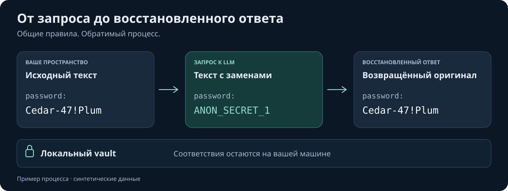
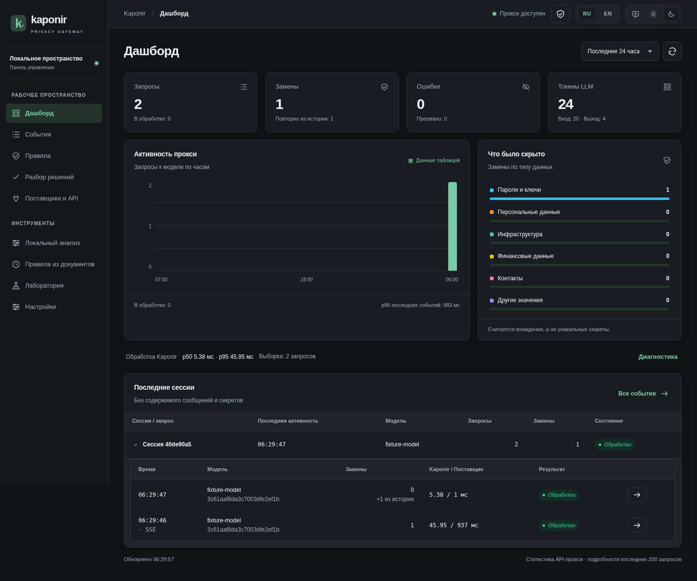
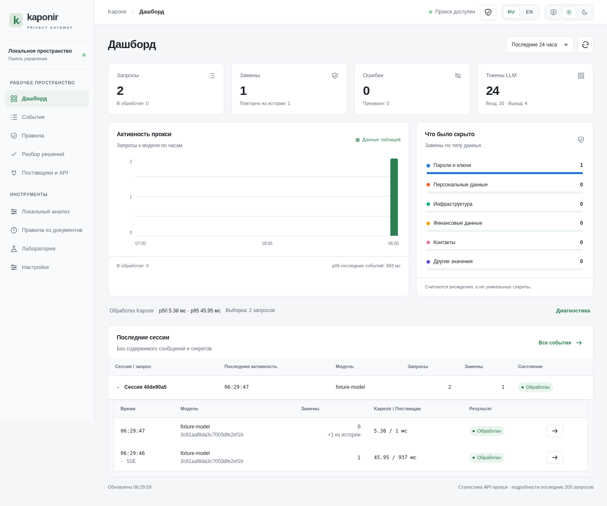
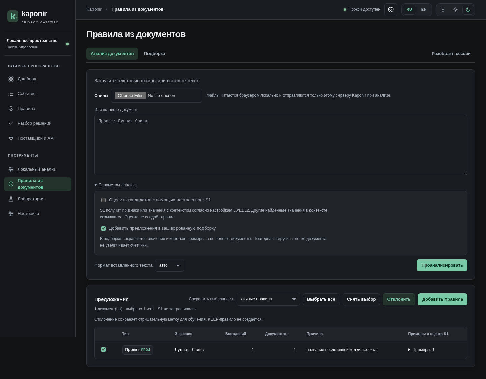

# Kaponir

**[English](README.md) · Русский**

Локальная обработка · Rust · [Apache-2.0](LICENSE)

### Рабочий контекст для AI. Чувствительные значения — под вашим контролем.

Скрывайте чувствительные значения перед запросом к LLM и возвращайте их в ответе.
Kaponir — **расширяемая система маскирования с модульным Rust-ядром и встроенной
интеграцией с AI-агентами**. Движок, распознаватели, политика правил, пакеты и зашифрованный
vault обеспечивают работу CLI, Web UI, LLM-прокси и фонового поиска по документам.
Используйте общие правила с агентом, в shell-пайплайне или за собственным API.

[Быстрый старт](#быстрый-старт) · [Возможности](#что-умеет-kaponir) ·
[Сравнение](#kaponir-и-presidio) · [Документация](#документация)



*Пример процесса на синтетических данных. Восстановление использует соответствия из локального vault.*

## Задача проекта

Передавать AI-агенту полезные конфигурации, фрагменты документов и историю обращений,
заменяя чувствительные фрагменты. Kaponir сохраняет поддерживаемый синтаксис текста
и конфигураций, а затем восстанавливает известные токены, возвращённые моделью,
в том числе в потоковых ответах и аргументах инструментов.

**Начните локально:** для обычного маскирования не нужны модель или аккаунт у провайдера.
Добавляйте свои правила, LLM-подключения и поиск по документам по мере необходимости.
Результат зависит от политики и данных; перед внедрением проверьте характерные примеры.

## Что умеет Kaponir

| Задача | Что уже доступно |
|---|---|
| **Скрывать данные в тексте и файлах** | Секреты, инфраструктурные идентификаторы, персональные и пользовательские значения; текст, JSON, YAML, TOML, ENV и INI; shell-пайпы, предпросмотр и объяснения решений. |
| **Восстанавливать оригиналы** | Стабильные токены, DNS-совместимые формы, HMAC-псевдонимы и IP-суррогаты; зашифрованные соответствия; текст, экранированный JSON и потоки. Есть и необратимый режим. |
| **Настраивать свою политику** | Точные значения, regex, шаблоны Composite DSL, MASK/KEEP, стратегии по типам и контуры Personal/Team/Global с обязательными глобальными правилами. Языковые и предметные пакеты, собственные словари. |
| **Подключать AI-агента** | OpenAI Chat Completions и Anthropic Messages; поддерживаемый текст сообщений, результаты и аргументы инструментов, обычные ответы, SSE и сессионная память. |
| **Управлять подключениями** | До 64 подключений с зашифрованными ключами, произвольные совместимые endpoint, пулы моделей, привязка сессий и явно включаемый повтор при HTTP 429. |
| **Готовить правила по документам** | Локальный поиск и необязательные кандидаты от локальной Qwen; текст, изображения, PDF и экспорты сессий; сохраняемая очередь worker, разбор и явное подтверждение правил. |
| **Встраивать и обслуживать** | Web UI на русском и английском, sidecar REST, Docker Compose, перенос настроек, обезличенные события, JSON-метрики и Prometheus. |

Необязательный **S1** оценивает уже найденных спорных кандидатов локальной моделью или HTTP-сервисом.
Он дополняет правила, но не находит пропущенные детекторами сущности. [Как работает S1](docs/S1.md).

## Быстрый старт

Нужен стабильный Rust toolchain с Cargo. Для первой проверки mask → restore не требуются
внешние модели или аккаунт у LLM-провайдера. Основная проверенная платформа — Linux x64.

### 1. Соберите и инициализируйте

```bash
cargo build --locked --release -p kaponir-cli
export PATH="$PWD/target/release:$PATH"
kaponir init --corp-domain mycompany.ru
```

Команда создаёт локальные настройки, ключи, зашифрованный vault и файлы правил в
`~/.config/kaponir`. Сохраните резервную копию `vault.key`: без него старые соответствия
нельзя восстановить.

### 2. Восстановите фактический результат маскирования

```bash
masked=$(printf '%s\n' 'password: Cedar-47!Plum' | kaponir mask)
printf 'Masked:   %s\n' "$masked"
printf 'Restored: %s\n' "$masked" | kaponir restore
```

Ожидаемый результат: первая строка содержит токен `ANON_...` вместо пароля, вторая —
исходное `password: Cedar-47!Plum`. Используйте именно полученный токен: его номер зависит
от текущего vault.

### 3. Откройте Web UI

```bash
kaponir ui --no-open
# Откройте http://127.0.0.1:8787/ui/
```

Тот же интерфейс доступен после `kaponir serve`. Команда `kaponir ui` без `--no-open` также
пытается открыть браузер. Для реального подключения откройте **Поставщики и API**, сохраните
провайдера и сначала проверьте маршрут на синтетических данных.

Обработка файлов, `--dry-run`, настройка клиентов прокси, OCR и Docker описаны ниже и в
[справочнике CLI](docs/COMMANDS.md). Нативному worker нужен Python 3.12+, даже для текстовых
файлов. Для изображений/PDF и режима Qwen нужны дополнительные зависимости; обычным
CLI mask/restore и прокси Python не требуется.

### Прокси для существующего клиента

```bash
kaponir serve

# Пример для клиента Anthropic:
ANTHROPIC_BASE_URL=http://127.0.0.1:8787 claude

# Пример для OpenAI-совместимого клиента:
OPENAI_BASE_URL=http://127.0.0.1:8787/v1 my-script
```

При сохранённом подключении ключ поставщика подставляет Kaponir. Без подходящего профиля
сохраняется режим прямого upstream с учётными данными клиента. Не отправляйте реальные запросы,
пока не проверили адрес, маршрут и правила на синтетических данных.

## Скриншоты

Дашборд показывает статистику прокси и сессии. Настройки S1 и включение воркера находятся
в **Локальном анализе**; документы и подборка остаются отдельным инструментом.
Снимки сделаны на синтетическом трафике локального тестового поставщика.



<details>
<summary>Светлая тема и анализ документов</summary>





</details>

[Руководство по панели](docs/CONTROL_PANEL.md) · [Worker и OCR](docs/WORKER.md)

<a id="kaponir-и-microsoft-presidio"></a>

## Kaponir и Presidio

Оба проекта имеют расширяемые компоненты поиска и анонимизации. Kaponir сочетает
**модульный Rust-движок со встроенной интеграцией на всём пути запроса и ответа AI-агента**:
настраиваемый поиск и политику, зашифрованные соответствия, обработку сессий и восстановление
потоков. Presidio предоставляет Python-компоненты поиска и анонимизации, настраиваемые
NLP-движки, дополнительные модули обработки данных и интеграции со шлюзами.

| Возможность | Kaponir | Presidio |
|---|---|---|
| **Компоненты ядра** | Отдельные Rust-crate для движка и политики, распознавателей, пакетов, vault, S1 и прокси; общая логика движка для CLI, Web UI и REST. | Отдельные пакеты analyzer/anonymizer, интерфейсы расширения распознавателей и операторов, дополнительные модули изображений и структурированных данных. |
| **Собственный поиск данных** | Распознаватели, точные значения, regex, шаблоны Composite DSL, языковые и предметные пакеты, словари. | Встроенные и пользовательские распознаватели, regex, контекст, контрольные суммы, NLP/NER и внешние модели. |
| **Политика и исключения** | MASK/KEEP, приоритеты Personal/Team/Global, обязательные глобальные правила и стратегии по типам. | Выбор типов, пороги оценок, allow-list, настройка распознавателей и операторы по типам; политику приложения собирает интегратор. |
| **Способы замены** | Нумерованные токены, HMAC-псевдонимы, DNS-формы, IP-суррогаты и необратимый HMAC-режим. | Replace, redact, mask, hash, encrypt и собственные операторы. Наборы операций не идентичны. |
| **Обратимая обработка** | Зашифрованный локальный vault, стабильные соответствия, сессионная память и восстановление в CLI/API/прокси. | Операторы encrypt/decrypt и примеры псевдонимизации по таблице соответствий; хранение и жизненный цикл сессий зависят от интеграции. |
| **Запросы и ответы LLM** | Встроенный Chat Completions/Anthropic-прокси, восстановление SSE и поддерживаемых аргументов/результатов инструментов. | Документированные интеграции со шлюзами, включая LiteLLM; протоколы, потоки и восстановление зависят от выбранной интеграции. |
| **Интеграция шлюза и маршрутизация** | Sidecar REST с потоковым восстановлением по сессии, до 64 подключений, пулы моделей, привязка сессий и явно включаемый повтор при HTTP 429. | HTTP-сервисы analyzer/anonymizer; маршрутизацию к провайдерам, ключи и обработку сессий обеспечивает шлюз или интеграция приложения. |
| **Файлы и структурированные данные** | Shell-пайпы, форматы конфигураций и REST; discover по тексту и извлечённому содержимому документов. | Python/REST, пакетная обработка и отдельный пакет для структурированных и полуструктурированных данных. |
| **Изображения и PDF** | Worker извлекает текст для поиска и разбора; необязательный поиск кандидатов Qwen. Исходные пиксели не закрашиваются. | Image-redactor использует OCR и детекторы для закрашивания данных в пикселях изображения. |
| **Проверка и адаптация** | Веб-лаборатория, разбор решений, подборка → подтверждённые правила; необязательный S1 и локальное обучение на подтверждённых решениях. | Объяснения решений analyzer, настраиваемые распознаватели и модели; процесс разбора и утверждения правил можно построить поверх API. |
| **Запуск процесса** | CLI + двуязычный Web UI + прокси в одном Rust-бинарнике; необязательный Python-worker и Compose; пулы провайдеров и метрики. | Python-пакеты, HTTP-сервисы, примеры Docker/Kubernetes-развёртывания и интеграции экосистемы. |

**Сильная сторона Kaponir для AI-агентов — сочетание расширяемых компонентов со встроенной
поддержкой протоколов, сессий и восстановления.** Можно настроить поиск и политику,
подключить существующего агента или встроить обработку через REST и CLI, используя
общий движок и vault. Маршрутизация к провайдерам и подготовка правил по документам
также входят в эту систему.

Presidio хорошо подходит для Python/NLP-пайплайнов, задач с его моделью операторов,
специализированной обработки структурированных данных и закрашивания изображений.
Таблица различает встроенные возможности и возможности конкретных интеграций;
она не ранжирует качество распознавания. Ни один проект не гарантирует полноту
обнаружения на произвольных данных.

Источники Presidio: [analyzer](https://presidio.dataprivacystack.org/analyzer/),
[anonymizer](https://presidio.dataprivacystack.org/anonymizer/),
[structured data](https://presidio.dataprivacystack.org/structured/),
[image redactor](https://presidio.dataprivacystack.org/image-redactor/) и
[примеры интеграций](https://presidio.dataprivacystack.org/samples/).
Сравниваются документированные возможности, а не измеренная точность или скорость.
Presidio, первоначально созданный в Microsoft, теперь
[принадлежит сообществу](https://presidio.dataprivacystack.org/project_transition/) Data Privacy Stack.

## Сценарии использования

### 1. Безопасно передать конфигурацию в чат

Используйте CLI или **Лабораторию** в Web UI. Лаборатория показывает кандидатов, вердикты
и причины; предпросмотр не сохраняет записи vault и журнал. Кнопка сохранения фиксирует соответствия
для дальнейшего восстановления.

### 2. Подключить AI-агента без ручной обработки каждого сообщения

Запустите `kaponir serve`, настройте поставщика и направьте SDK/агента на адрес Kaponir.
Прокси обрабатывает поддерживаемые текстовые поля, а сессионная память повторно скрывает значения,
которые вернулись в истории диалога. Схемы инструментов и подписанные блоки `thinking` не изменяются.

### 3. Подготовить правила по корпоративным документам

```bash
kaponir discover contract.txt invoice.yaml --json
kaponir discover contract.txt --remember
kaponir discover --saved --json
kaponir discover --saved --select SUGGESTION_ID --scope team
kaponir discover --saved --reject OTHER_SUGGESTION_ID
```

Обычный предпросмотр локальный: он не вызывает S1, не сохраняет подборку и не меняет правила.
`--select` создаёт только выбранные точные MASK-правила. `--reject` сохраняет отрицательную
обучающую метку, но не создаёт KEEP-правило и не меняет текущее маскирование.

### 4. Разобрать каталог, сканы или PDF

```bash
kaponir worker --input-root /absolute/path/to/documents run .
kaponir discover --saved --json
```

Для постоянной очереди запустите `kaponir worker serve` рядом с `kaponir serve`. Worker извлекает
текст, передаёт его discover и сохраняет предложения; решения модели OCR не становятся правилами.
Загрузка Q4/Q5, управление заданиями и Compose описаны в [руководстве worker](docs/WORKER.md).

Для модельного поиска выберите в UI **«Семантический поиск Qwen3 (CPU) + локальные детекторы»**.
Находки сверяются с исходным текстом и становятся правилами только после подтверждения.
Сохранённые сессии доступны в событиях и для фонового анализа через `@sessions`.
TXT/Markdown/JSON/JSONL-экспорты можно передать как файлы; наблюдения за каталогом нет. [Запуск и режимы worker](docs/WORKER.md).

### 5. Встроить обработку в собственный шлюз

```bash
curl -s http://127.0.0.1:8787/api/v1/anonymize \
  -H 'content-type: application/json' \
  -d '{"text":"password: Cedar-47!Plum","session":"example-session"}'

curl -s http://127.0.0.1:8787/api/v1/deanonymize \
  -H 'content-type: application/json' \
  -d '{"text":"password: ANON_SECRET_1","session":"example-session"}'
```

Для потока используйте `/api/v1/deanonymize/stream` с идентификаторами `session` и `stream`,
фрагментом `chunk`, флагом `done` и при необходимости `json_escape`. Контракт и границы —
в [архитектуре](docs/DESIGN.md#9-прокси-для-агентов-этап-2-kaponir-proxy-kaponir-serve).

### 6. Запустить через Docker Compose

```bash
cp deploy/compose.env.example .env
# Задайте два разных длинных токена и каталог исходников в .env.
mkdir -p documents

docker compose up -d --build kaponir                 # только прокси
docker compose up -d --build                         # прокси + управляющий сервис worker
```

Обработку включают в **Локальный анализ → Включить воркер**; модель скачивается отдельно.

Compose хранит vault, ключи, очередь и модели в volumes; каталог документов монтируется read-only.
Не используйте `docker compose down -v` как обычное обновление: это удалит данные и ключи.
Подробности — в [worker и Compose](docs/WORKER.md#3-docker-compose).

## Правила, пакеты и discover

### Три контура правил

- **Personal** — личные значения владельца пространства.
- **Team** — общие правила команды.
- **Global** — глобальная политика; `enforced = true` нельзя перекрыть младшим контуром.

Контуры организуют приоритет и распространение правил, но не являются готовой
многопользовательской RBAC-моделью. Поддерживаются точные значения, regex, шаблоны Composite DSL,
MASK/KEEP, типы, категории и стратегии. После изменения правил Web UI пересобирает движок без
перезапуска и очищает затронутые кэши маскирования.

```bash
kaponir rule add --value 'Рога и Копыта' --kind CLIENT
kaponir rule add --keep --value ingress-nginx
kaponir rule add --scope global --enforced --value 'Internal Project' --kind PROJ
kaponir rule list
kaponir rule check
```

Спорные решения можно превращать в правила:

```bash
kaponir review --group
kaponir review mask 3 4 --kind SVC --scope team
kaponir review keep --shape 'x-x'
kaponir review template '{env:prod|stage}-{SVC}-{hash}'
```

### Языковые и предметные пакеты

Встроены `lang-en`, `lang-ru`, `domain-tech`, `domain-web`, `region-ru`. Они добавляют словари,
валидаторы и языковые правила; ядро не содержит русской или региональной логики. Собственный
пакет-данные — каталог с `pack.toml` и `words.txt`, подключаемый через `pack_dirs`.

```bash
kaponir pack list
kaponir pack test ./packs/lang-en
```

`pack test` проверяет детекторы пакета на его размеченном корпусе без S1. Это не измерение качества
на независимом production-корпусе.

## S1: необязательная оценка кандидатов

S1 оценивает **уже найденных спорных кандидатов**. Доступны детерминированная обработка
(`none`, по умолчанию), локальная модель `ngram` и HTTP-сервис. Подтверждённые метки можно
использовать для обучения локальной модели; явные правила и жёсткие маски не переоцениваются.
Начинайте с теневого режима.

L0 передаёт признаки без исходной строки; L1 — также значение; L2 — ограниченный контекст.
L1/L2 раскрывают данные выбранному сервису даже в теневом режиме. Credentials ограничены L0;
новые SECRET-кандидаты discover не отправляются в S1. [Настройка и границы](docs/S1.md).

## Данные и безопасность

- Данные находятся в `KAPONIR_HOME`, затем `$XDG_CONFIG_HOME/kaponir`, иначе `~/.config/kaponir`.
- Значения vault и ключи провайдеров защищены ChaCha20-Poly1305; поиск использует слепые индексы.
  Точные значения в `rules/*.toml` хранятся открытым текстом.
- Сохраняйте vault **вместе с `vault.key`**: для восстановления нужны оба. Экспорт настроек не заменяет backup vault.
- `--irreversible` не сохраняет соответствия. Общий `token.key` позволяет получать одинаковые HMAC-псевдонимы в команде.
- По умолчанию сервер слушает loopback. Нелокальный адрес требует API-токен; доступ извне также требует TLS и контроля сети.

[Модель доверия и резервные копии](docs/SECURITY.md) · [Перенос настроек](docs/SETTINGS_TRANSFER.md)

## Ограничения

Важно учитывать эти границы до использования на реальных данных:

- **Нет гарантии полноты.** Неизвестный детекторам секрет может остаться открытым. S1 не ищет его.
- **Спорное не всегда означает секрет.** Возможны лишние маски; их разбирают через правила и review.
- **Обратимость требует vault и ключей.** Обычный `--strategy hmac` восстанавливается через vault;
  `--irreversible` не сохраняет новых соответствий. Потеря vault или его ключа лишает восстановления.
- **Прокси не поддерживает OpenAI Responses API.** Поддерживаются указанные Chat Completions,
  Anthropic Messages и sidecar REST.
- **Не всякая модель сохранит смысл.** Подстановки меняют видимый модели текст; точное восстановление
  возможно только для токенов, которые модель вернула без искажения.
- **Трафик в памяти — не аудит.** Обзор и события ограничены и теряются при перезапуске.
- **Находки Qwen требуют проверки.** Модель может пропускать значения и предлагать лишние; она не решает mask/keep автоматически.
- **Team/Global — не RBAC.** Отдельные пользовательские роли и общий многосерверный vault не реализованы.
- **Сервер доверен владельцу пространства.** Kaponir не защищает данные от администратора хоста,
  который контролирует процесс, память, ключи и vault.
- **Синтетические регрессии — не production-оценка.** Сохранённые корпуса проверяют известные сценарии,
  а не универсальную полноту и точность.

## Архитектура

```text
CLI ───────────────┐
Web UI ────────────┤
OpenAI/Anthropic ──┼──→ Engine ─→ Recognizers + Packs + Rules ─→ замаскированный текст
Sidecar REST ──────┤       │                    │
Worker → Discover ─┘       ├─→ необязательный S1│
                           └─→ Vault ←──────────┘
                                  │
                                  └─→ восстановление ответа
```

[Crate, контракты и архитектурные решения](docs/DESIGN.md).

## Проверка и разработка

```bash
cargo fmt --all -- --check
cargo clippy --locked --workspace --all-targets -- -D warnings
cargo test --locked --workspace
python3 -m unittest discover -s scripts -p 'test_*.py'
node --check crates/kaponir-proxy/assets/app.js
node --check crates/kaponir-proxy/assets/panel.js
node --check crates/kaponir-proxy/assets/i18n.js
python3 scripts/check_docs.py
```

Регрессионный тест использует 64 синтетических документа, 1344 размеченных значения и 8808
вхождений, проверяет публичные термины и побайтное восстановление. Он закрепляет известное поведение,
но не является независимой оценкой качества на произвольных данных. Методика, benchmark, CI и
release-проверка — в [OPERATIONS.md](docs/OPERATIONS.md), правила разработки — в
[CONTRIBUTING.md](CONTRIBUTING.md).

## Документация

Начните с [карты документации](docs/README.md). Основные маршруты:

- [Справочник CLI](docs/COMMANDS.md) — команды, флаги, форматы и примеры.
- [Панель управления](docs/CONTROL_PANEL.md) — UI, поставщики, пул и события.
- [Discover](docs/DISCOVERY.md) — предложения, подборка, подтверждения и API.
- [Worker](docs/WORKER.md) — очередь, OCR, PDF и Docker Compose.
- [S1](docs/S1.md) — раскрытие L0/L1/L2, shadow/active, HTTP и обучение.
- [Безопасность](docs/SECURITY.md) — модель доверия, ключи, сеть и резервные копии.
- [Эксплуатация](docs/OPERATIONS.md) — качество, метрики, benchmark, CI и release.
- [Перенос настроек](docs/SETTINGS_TRANSFER.md) — общий JSON для CLI и Web.
- [Архитектура](docs/DESIGN.md) — внутренние контракты и решения.

Исследования и исторические отчёты собраны отдельно в [карте документации](docs/README.md#исследования-и-история);
они описывают конкретные прогоны и не заменяют актуальные руководства.

## Лицензия

[Apache-2.0](LICENSE). Проект называется **Kaponir**; префикс токенов `ANON` и исторические
криптографические обозначения сохранены для совместимости.
