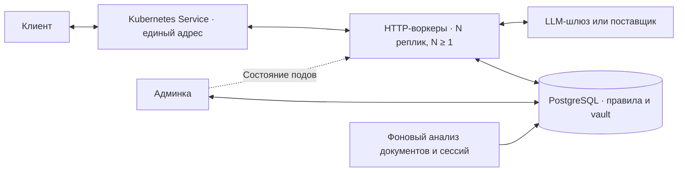

# Корпоративная архитектура Kaponir

Редакция 6 от 27 ноября 2026 года описывает целевую архитектуру Corporate и условия её приёмки. [Скачать эту редакцию в PDF](corporate-architecture-v6-ru.pdf)

## Один адрес и масштабируемый пул HTTP-воркеров

Сотрудники и приложения обращаются к одному адресу. За ним работают **от одного до любого необходимого числа
HTTP-воркеров**. Оператор выбирает число реплик по нагрузке и ресурсам кластера. Три реплики — пример
развёртывания. При изменении их числа сохраняются адрес шлюза, ключи клиентов и общая база PostgreSQL.
Единая админка и фоновая обработка развёртываются отдельно.

### Как проходит запрос

1. **Вход и права.** Воркер проверяет входной ключ, его владельца и команду. Политика определяет доступные
   vault, модели и подключения. Воркер резервирует бюджет команды. ID сессии связывает ходы диалога.
2. **Маскирование.** Воркер применяет действующую версию правил и детекторы. Для каждого значения определяет
   владельца значения и использует его токен либо создаёт соответствие в нужном vault. Запись фиксируется до
   отправки замаскированного запроса поставщику.
3. **Ответ.** Воркер находит токены, проверяет права и возвращает сотруднику разрешённые оригиналы. Это
   работает и с потоковым ответом, когда токен приходит частями. Закрытое для сотрудника значение остаётся
   токеном.
4. **Продолжение диалога.** Следующий запрос той же сессии может обслужить другой готовый воркер. У него есть
   та же база, версии ключей и правила доступа. Открытый HTTP-поток завершает принявшая его реплика.

### Пример одного диалога

Иванов отправляет «Проверь доступ пользователя `ivanov`». В личном vault уже есть соответствие для его логина,
и поставщик получает «Проверь доступ пользователя `ANON_USER_1`». Если этот токен придёт в ответе, Иванов
увидит свой логин. Другому сотруднику само знание токена права на раскрытие не даёт.

**Статус решения**

Настольная Community уже объединяет прокси, Web UI и локальный SQLite vault в одном процессе
`kaponir serve`. Кластерные роли, серверные права сотрудников и общий PostgreSQL входят в план Corporate.
Состояние отдельных функций и порядок проверки приведены в конце документа.

## Сотрудник, команда и три уровня доступа

Vault — защищённая область соответствий «токен ↔ оригинал». Один сотрудник в своей команде работает с тремя
областями. У каждой свой владелец, границы доступа и ключевой материал.

| Область | Кому доступно восстановление | Пример |
| --- | --- | --- |
| Личная | Сотруднику-владельцу в его рабочих запросах. | Логин `ivanov` и его личные значения. |
| Командная | Участникам назначенной команды. | Общий код проекта команды Orion. |
| Корпоративная | Авторизованным сотрудникам организации в рамках корпоративной политики. | Общий внутренний домен компании. |

### Как подключается Иванов

Администратор заводит сотрудника `ivanov` и назначает ему команду Orion. При создании учётной записи
появляются личный vault и первое личное правило для точного логина. Справочник также связывает домашний
каталог Иванова с его личным vault, в том числе в запросах коллег. Командный и корпоративный vault уже
существуют.

Администратор выдаёт персональный API-ключ. С ним сотрудник вызывает шлюз и входит в веб-кабинет, где видит
только собственную статистику запросов, замен и ошибок. Управление правилами, просмотр исходных находок и
чужих сессий остаются административными полномочиями. Права проверяет сервер для каждого обращения.

API-ключ удостоверяет сотрудника. Администратор может заменить или отозвать его. Личный vault и ранее выданные
токены привязаны к владельцу и сохраняются при замене ключа. Восстановление проверяет актуальное членство в
команде.

### Как разрешаются пересечения правил

Для одного совпадения приоритет у обязательного корпоративного правила. Далее следуют обычные корпоративные,
командные, личные правила и встроенный детектор. Приоритет правила определяет действие над текстом. Владельца
исходного значения и право раскрытия система учитывает отдельно.

В Community утверждённая маска каталога `/home/group.demo/ivanov/` охватывает и обычное совпадение
детектора домена `group.demo` внутри этого пути. Обязательное корпоративное правило маскирования домена
сохраняет приоритет. В Corporate для такого домашнего пути дополнительно определяется сотрудник-владелец.

**Пример масштаба и границ**

100 сотрудников и 10 отделов дают 111 логических vault в одной базе PostgreSQL. Обязательная политика может
предписывать скрывать логины всей организации. Конкретная находка `ivanov`, её индивидуальное правило и
оригинал принадлежат Иванову. В общую область попадают только явно общие значения.

## Общие данные, ключи и постоянный том

Все HTTP-воркеры и административный сервис подключаются по сети к одной логической базе PostgreSQL. В
рассмотренной модели каждому vault соответствует своя схема внутри базы. Воркер определяет разрешённые
области по владельцу ключа и актуальному членству. Личный, командный и корпоративный vault доступны в одном
соединении. Обращения к индексам этих областей можно объединять в пакет.

| Что хранится | Состав и назначение |
| --- | --- |
| Пользователи и доступ | Организации, сотрудники, команды, членство, роли, статус и проверочный отпечаток API-ключа. Реестр vault связывает область с владельцем. Справочник логинов позволяет установить его внутри организации до обращения к личному vault. |
| Правила | Личные, командные и корпоративные правила, их приоритеты и опубликованные версии. Для решений сохраняются автор, время и область действия. |
| Подстановки | Тип значения, токен, зашифрованный оригинал, индекс на основе HMAC для поиска совпадений и версия ключа. Общий реестр связывает токен с его vault. |
| Сессии и рабочие данные | Связь сессии с владельцем, запросами и подстановками. Находки, их вхождения и статусы, фоновые задания и история решений. Примеры и разметку сохраняет опциональный модуль «Датасет». |
| Статистика и аудит | Агрегаты для кабинетов, события доступа и изменения правил. Запись полных текстов переписки и сроки хранения аудита определяет политика организации. В технические метрики идут количества, статусы и длительности. |

### Что гарантирует корректное восстановление

Выделение токена и регистрация обратимого соответствия в нужном vault выполняются атомарно. Одновременные
запросы получают согласованный результат. Если запись зафиксировать не удалось, воркер возвращает ошибку до
обращения к поставщику. Любая готовая реплика восстанавливает разрешённое значение по записи токена и текущим
правам. Для этого достаточно сохранённых соответствий. Сохранение полного диалога для разбора и аудита
и срок его хранения задаёт организация. После перезапуска локальный кеш заполняется заново.

У каждого vault свой ключ шифрования либо выделенный для него производный ключ. Сервисы с нужными полномочиями
получают согласованные версии ключей из защищённого хранилища. Выданный сотруднику API-ключ выполняет
отдельную функцию аутентификации.

### К чему подключается PVC

При размещении PostgreSQL в Kubernetes постоянный том с файлами базы и журналом WAL подключается к PostgreSQL.
Воркеры обращаются к базе по сети. Добавление пода Kaponir не требует отдельного тома для vault. Если у самой
СУБД несколько экземпляров, у каждого свой диск, синхронизацию данных обеспечивает репликация PostgreSQL.
Резервное восстановление проверяется на копии базы с необходимыми версиями ключей.

## Единая админка и эксплуатация в Kubernetes

### Что видит и делает администратор

Администратор управляет пользователями, ключами, командами и тремя уровнями правил. В одном Web UI ему
доступны статистика, разрешённые сессии и находки, предложения ИИ и история решений. При установке модуля «Датасет» к ним добавляется работа с примерами.

### Как находка доходит до разбора

1. **Запись.** HTTP-воркер сохраняет спорное решение в общем журнале в транзакции с результатом обработки.
   Фоновый анализ документов и сессий пополняет ту же очередь разбора. Запись содержит источник, владельца и
   область, запрос или документ, позицию в тексте и состояние проверки.
2. **Повторы.** Стабильный идентификатор события и вхождения позволяет безопасно повторить доставку. Новое
   появление того же значения в другом запросе добавляет вхождение к карточке в той же области доступа.
   Админка читает накопленные находки и после своего перезапуска.
3. **Решение.** Администратор видит фрагмент, происхождение и статус ИИ. Он принимает, исправляет, отклоняет
   или откладывает предложение. Принятое изменение правила публикуется с новой версией. Разобранные и уже
   покрытые правилами значения остаются в истории. В открытой очереди видны случаи, ожидающие решения.
   Если установлен модуль «Датасет», из истории можно добавить в него выборку или включить сохранение примеров при разборе.

### Развёртывание и контроль воркеров

| Задача | Решение |
| --- | --- |
| Запуск | У админки и HTTP-воркеров отдельные Deployment. Оператор задаёт число HTTP-реплик в `spec.replicas` или настраивает HorizontalPodAutoscaler (HPA). Фоновый worker для файлов, OCR и моделей имеет отдельную очередь. |
| Обнаружение | Желаемое число реплик админка читает из Deployment. Адреса и готовность подов получает из всех EndpointSlice входного Service. По внутреннему порту опрашивает каждую реплику отдельно и сопоставляет данные по UID пода. Воркеру достаточно собственного состояния и доступа к общей базе. |
| Готовность | Воркер допускается к трафику при рабочем движке, доступе к vault и загруженной версии политики. При плановой замене он снимается с приёма новых соединений и завершает активные потоки. |
| Наблюдаемость | В админке по каждому поду видны готовность, версия правил, активные запросы и потоки, очередь и объём ожидающего текста, CPU, память, ошибки и задержки маскирования и восстановления. Ожидание первого ответа поставщика измеряется отдельно. |

**Отказ админки**

Доступные HTTP-воркеры продолжают обслуживать запросы с действующей политикой, пока доступны общая база и
нужные ключи. После восстановления админка показывает накопившиеся находки и состояние реплик.

## Балансировка и проверка пропускной способности

Kubernetes Service распределяет **новые соединения** между готовыми подами. Повторные HTTP-вызовы по одному
соединению могут попасть на одну реплику. Открытый SSE-поток обслуживает принявший его воркер. Привязка по ID
сессии остаётся опцией балансировщика. Для следующего соединения пригоден любой готовый воркер с доступом к
данным организации.

### Когда менять число реплик

Оператор видит активные запросы и потоки, очередь, CPU и память по каждому поду. При включённом HPA можно
масштабировать пул по CPU или по числу активных запросов при наличии этой метрики в Kubernetes. Границы HPA
выбираются для конкретной установки. Отдельно измеряются ожидание соединения с PostgreSQL, задержка диска и
квоты поставщика. Долгое ожидание первого токена у поставщика само по себе не означает нехватку воркеров.

### Что уже измерено

25 ноября 2026 года восемь параллельных клиентов выполнили на прототипе хранилища 43 200 циклов поиска,
записи и восстановления без ошибок. Стенд использовал PostgreSQL 17.12, 111 схем и локальный диск.
При общем лимите 4 CPU получено 1 699 циклов/с для известных значений, 817 для смеси известных и новых
и 898 для новых.
Единица измерения — полный цикл хранилища. [Исходный отчёт стенда](corporate-vault-storage-benchmark.json)

### Как принять масштабирование шлюза

1. **Изменить размер пула под трафиком.** Начать с одной реплики, добавить несколько и затем уменьшить их число.
   Проверить появление и удаление подов в админке, готовность новой реплики и завершение открытого потока при
   плановом выводе пода. Следующий запрос той же сессии направить на другую реплику и проверить восстановление.
2. **Проверить общее состояние.** Одновременно обработать одинаковые значения на разных подах. Проверить
   права трёх областей, отсутствие дублей для одной области и границы командного бюджета. Повторная доставка
   события сохраняет одно вхождение и одно списание за попытку.
3. **Измерить предел установки.** Для каждого размера пула повторить один и тот же профиль длин текстов,
   новых и повторных значений, обычных запросов и SSE. Зафиксировать завершённые запросы/с, ошибки и p95/p99
   задержки. Сравнить замер с управляемым поставщиком и замер с рабочим поставщиком на целевых сети и PVC.
   Сквозная пропускная способность Corporate определяется этим испытанием.

## Дашборд администратора

На первом экране видно, у кого сейчас открыт запрос, какой воркер его обслуживает и где проходит время. Из
строки сотрудника можно перейти к его ключу, запросу и сессии.

На макете показан пример с тремя репликами. В рабочей админке список строится по текущему составу пула.

### Кого считать активным

Запрос активен с момента приёма до завершения, ошибки или обрыва. Поток ответа входит в этот же счётчик.
Сотрудник с двумя открытыми запросами по разным ключам учитывается один раз. У завершённых запросов есть
отдельная история. Время последнего вызова видно в карточке ключа.

### Как обновлять экран

Каждый воркер отдаёт по защищённому внутреннему API текущие запросы, этапы и время измерения. Админка сводит
их по ID запроса и передаёт изменения браузеру. После переподключения браузер получает свежий снимок.
Начальный вариант — обновление раз в 5 секунд, после трёх пропусков данные реплики считаются устаревшими.

Админка отдельно показывает, сколько реплик запрошено, сколько готовы принимать трафик и по скольким есть
свежие данные. Например, «Данные по 7 из 8 воркеров» означает, что из восьми обнаруженных подов вовремя
ответили семь. У восьмого видно время последнего замера. При изменении состава пула пересчитываются оба числа.
В текущих итогах учитываются свежие данные. Список можно приостановить для чтения.

**Когда у сотрудника «всё медленно»**

Из активного запроса администратор открывает воркер. Там видны CPU и память относительно лимитов, длина, объём
и возраст очереди, задержки маскирования и восстановления, отдельно — ожидание первого токена поставщика. Если
лимит ресурса не задан, показывается фактическое потребление.

## Разбор решений с учётом vault

По умолчанию администратор видит все ожидающие решения находки в доступной ему части организации. Одна
карточка объединяет повторы значения в одном контуре доступа. Внутри остаётся список отдельных вхождений.

| Поле в интерфейсе | На какой вопрос отвечает |
| --- | --- |
| Источник вхождения | Кто прислал значение, в какой команде он состоял, каким ключом воспользовался, в какой сессии и запросе оно встретилось. Видны время и воркер. Для документа без достоверного автора показывается источник «Импорт», неизвестные поля так и помечаются. |
| Vault при запросе | Где в тот момент находилось использованное соответствие «токен ↔ оригинал». Для первого обнаружения обычно видно «Ещё не сохранено». После принятия решения историческое поле сохраняет прежнее значение. |
| Область правила | Контур конкретного правила. У точного логина сотрудника и префикса его домашнего каталога по умолчанию стоит «Личные». |
| Vault для будущих замен | Где будет храниться подстановка и кто сможет раскрыть оригинал. Для каталога Иванова автоматически выбран его личный vault, даже если путь прислал Белов. |

### Как пользоваться фильтрами

Отправитель, команда на момент запроса, ключ и фактический vault относятся к одному вхождению. Фильтр
владельца отдельно ограничивает карточки. Если Иванов прислал внутренний хост дважды, а Воронова один раз,
выбор Иванова покажет «2 из 3» в командной карточке. Выбор ключа Вороновой вместе с Ивановым даст пустую
выборку. Отозванный ключ остаётся доступен в истории.

Одинаковое написание в личных vault двух сотрудников образует две карточки. Сервер сначала проверяет доступ к
источникам и только затем считает группы и вхождения. Секрет API-ключа не отображается. Для просмотра
исходного фрагмента требуется соответствующее полномочие.

### Что происходит при решении

Карточка показывает выделенный фрагмент, отдельно заключение ИИ и решение человека. Перед принятием видны
область правила, будущий vault, получатели доступа и число затронутых вхождений. Принадлежность
подтверждённому сотруднику имеет приоритет над областью, предложенной моделью. Массовое принятие возможно
только с однозначными правами и адресатами для всей выборки.

После принятия, отклонения или откладывания открывается следующая карточка с теми же фильтрами. Последняя
возвращает к списку с итогом. Решение, автор и версия правила попадают в журнал при любом составе установки.

## Опциональный модуль «Датасет»

При установке Corporate оператор выбирает компонент «Датасет» в списке модулей. В проекте Helm-конфигурации этому выбору соответствует `modules.dataset.enabled` со значением `true` или `false`. Выбор действует для админки и всех воркеров. При обновлении установки он сохраняется.

В текущей установке компонент отключается командой `kaponir init --without-dataset`. Для Compose используется `KAPONIR_DATASET_ENABLED=false` у прокси и воркера. [Настройка установки и повторное включение](COMMANDS.md#общие-параметры-и-пространство)

**Установка без датасета**

Из Web UI исчезают раздел «Датасет», кнопки добавления находки или выборки, статусы разметки, флажок «Сохранять примеры в датасет» и сбор в лаборатории. Старая закладка на раздел открывает «Находки». Браузерный блокнот и подсказки для разметки отключены.

API примеров, разметки, импорта и экспорта JSONL возвращает HTTP 404. Воркеры прекращают сбор, в том числе в заданиях, поставленных в очередь до отключения. Отдельные копии фрагментов для обучения перестают создаваться на сервере и в браузере. Ранее собранные примеры хранятся по политике организации и вновь доступны при подключении модуля в пределах срока хранения.

Разбор находки по-прежнему завершается решением. Например, администратор принимает предложение скрывать «Северку». Шлюз применяет правило к следующим запросам, а в истории и аудите видны автор и происхождение правила.

**Установка с датасетом**

Администратор с правом работы с примерами может сохранить выборку в черновики. На новой установке автоматический сбор выключен. Если включить «Сохранять примеры в датасет», решение «скрывать» или «оставить» по открытому фрагменту с однозначным вхождением даст проверенный пример. Массовые решения сохранят черновики. Добавление примеров из прежней истории запускается вручную.

### Приёмка двух вариантов установки

1. **Без модуля.** Принять находку, проверить замену в следующем запросе и найти решение в истории. Повторить разбор для выборки. Проверить отсутствие новых примеров в базе и браузере, переход по старой закладке и ответ API на каждой реплике после перезапуска.
2. **С модулем.** Сохранить выборку вручную, проверить черновик и выгрузить JSONL. Затем включить автосбор и проверить метку решения по открытому фрагменту.
3. **Смена состава установки.** Отключить модуль при включённом автосборе и непустой очереди. Проверить, что старый клиент и отложенные задания больше не могут записать пример. После повторного включения сверить ранее сохранённую разметку.

## Пользователи и повседневное администрирование

«Пользователи» — самостоятельный раздел главного меню. В реестре видны имя, логин, текущая команда, состояние
доступа и число действующих ключей. Из карточки сотрудника открываются его запросы и находки с уже выбранным
фильтром.

| Задача администратора | Что он делает в интерфейсе |
| --- | --- |
| Подключить сотрудника | Указывает логин и команду. Система создаёт учётную запись, личный vault и первое правило для логина. Администратор выдаёт именной API-ключ, указывает назначение. Секрет показывается при выдаче, в реестре остаются название и безопасный ID. |
| Перевести в команду | В карточке видны текущая и новая команда и изменение прав. После подтверждения новые запросы используют новое членство. Персональный vault сохраняется. Старые события показывают команду на момент запроса. При раскрытии токена учитываются текущие права. |
| Заменить ключ или отключить доступ | Можно выдать новый ключ и отозвать конкретный старый. При отключении учётной записи прекращается приём новых запросов по всем её ключам. История запросов и решений доступна уполномоченному администратору. |
| Разобраться с правилом | Из решения открывается опубликованная версия политики. По каждому воркеру видны применённая версия, целевая версия и свежесть данных. Журнал указывает, кто и когда принял решение или изменил права. |

### Что видят сотрудник и администратор

Сотруднику по его ключу открывается личный дашборд со своей статистикой. В админке отдельно проверяются права
на управление пользователями, изменение правил, просмотр метаданных и раскрытие оригинала. Интерфейс
показывает только разрешённые действия. Ключи, переводы, решения и обращения к оригиналам оставляют запись в
журнале.

### Какие данные нужны экранам

Каждое вхождение хранит организацию, ID отправителя и отдельно ID владельца значения, если он установлен,
команду и ключ на момент события, источник, ID сессии, запроса, воркера и самого вхождения, время, версию
правил и фактический vault, если он использовался. Решение отдельно хранит автора, действие, будущий vault и
область правила.

**Граница телеметрии**

Идентификаторы клиентов для живого списка передаются через защищённый административный API в рамках прав
наблюдателя. В технических метриках остаются агрегаты по репликам и этапам. Исходные значения и секреты ключей
в метрики не попадают.

## Владелец логина и домашнего пути

После регистрации `ivanov` его логин и префикс домашнего каталога получают личную область Иванова. У каждого
вхождения отдельно видны отправитель и его команда.

| Что пришло в запросе | Результат в Kaponir Corporate |
| --- | --- |
| Логин `ivanov` в поле учётной записи | Повторные вхождения покрывает личное правило, созданное при регистрации. Дубли в командных правилах и очереди не создаются. |
| `/home/group.demo/ivanov/work/build.log` в запросе Белова из Vega | На разбор идёт один личный префикс `/home/group.demo/ivanov/`. Владельцем и получателем права восстановления остаётся Иванов. Белов указан как отправитель. Остаток `work/build.log` проверяется отдельно. |
| `C:\Users\ivanov\a.txt` | Для известного расположения профилей Windows берётся целый компонент учётной записи. Повторы файлов в том же каталоге объединяются у того же владельца. |
| `/srv/ivanov-tools/log` | Совпадение части имени проекта с логином не определяет владельца. Для общего проекта действуют его обычные правила. |

### Как определяется владелец

Сверяем целый логин под настроенным корнем со справочником организации, с учётом домена и правил регистра.
Фамилия, название общего каталога или служебная учётная запись сами по себе не устанавливают владельца. Модель
может проверить остаток пути. Расширять доступ по её рекомендации нельзя.

Индекс учётных записей указывает личный vault для системной записи. При восстановлении действуют права
отправителя. История хранит стабильный ID владельца. Если старый логин выдан другому сотруднику, прежние
события сохраняют исходную привязку. Для старой находки без владельца нужен отдельный разбор.

**Если командное правило уже действует**

Админка показывает конфликт и существующее личное правило. После подтверждения публикуется одна версия
политики, в которой командный дубль снят. Решение записывается в журнал. Права на ранее выданные токены
проверяются отдельно.

## Ключи команды и доступ к моделям

В карточке Orion раздела «Команды» администратор настраивает, кто может обращаться к шлюзу, какими моделями
пользуется команда и какие подключения оплачивают её запросы.

| Раздел карточки | Что видит и меняет администратор |
| --- | --- |
| Ключи доступа | Владелец, назначение, безопасный ID, команда, срок и последнее использование. Иванову можно выдать отдельные ключи для IDE и CLI. Для CI создаётся служебная учётная запись с собственным ключом. |
| Модели и подключения | Разрешённые модели, рабочий маршрут по умолчанию и резервные подключения из корпоративного или командного пула. У каждого подключения видны поставщик, доступные модели и способ оплаты. |
| Расходы | Использование и остаток бюджета за период. Из строки команды можно перейти к ключу, вопросу сотрудника и конкретному вызову поставщика. |

### Что проверяет воркер

У каждого входного ключа есть стабильный владелец и одна команда для атрибуции. У ключа CI собственная
служебная учётная запись с явно выданными правами. Один сотрудник может иметь несколько ключей.
Отзыв ключа действует на всех воркерах. Выпуск нового ключа сохраняет личный vault.
При переводе сотрудника новые вызовы проверяются по актуальному членству и назначению ключа.

Право на вызов определяется пересечением политик организации, команды и входного ключа. Одинаковая проверка
действует для каталога моделей, явного выбора подключения через `/p/{id}`, автоматического маршрута и повторной
попытки. Поставщику передаётся замаскированный запрос. Выбор модели сохраняет права владельцев vault.

Выходное подключение содержит отдельные учётные данные поставщика. Воркеры получают секрет через ссылку на
защищённое хранилище. В карточке и журнале виден ID подключения. В пул включаются подписки и API-аккаунты,
для которых поставщик разрешает такой режим использования. Для каждой учётной записи сохраняются собственные
квоты и условия.

## Учёт токенов и бюджета

Один вопрос сотрудника может вызвать несколько обращений к поставщику. Админка показывает оба уровня.
Служебный запрос OpenCode на название сессии учитывается как отдельный вызов с собственными токенами и
назначением. В ленте сотрудник видит свой вопрос под полученным названием сессии.

| Что учитываем | Как считаем |
| --- | --- |
| Принадлежность | На входе фиксируются организация, команда и ID ключа на момент запроса, владелец, сессия и идентификатор вопроса. Перевод сотрудника сохраняет историю расходов прежней команды. |
| Каждая попытка у поставщика | Идентификатор попытки, подключение, фактическая модель, назначение, результат, длительность, входные, выходные и кешированные токены при наличии. Повторный вызов имеет собственную запись. |
| Деньги | Для оплаты за токены применяется версия тарифа на момент вызова, с валютой и отдельными ставками для кеша. Для подписки отдельно показываются фиксированная плата, использование и остаток квоты. |

### Как все воркеры соблюдают общий лимит команды

До отправки воркер атомарно резервирует в PostgreSQL верхнюю оценку расхода с учётом входа и ограничения на
ответ. При нехватке бюджета шлюз возвращает причину до обращения к поставщику. По завершении резерв
закрывается по фактическому использованию. Уникальный ID попытки защищает от повторного списания при
повторной доставке события или последнего чанка потока.

При обрыве после отправки попытка остаётся на сверке. Учёт различает данные поставщика, оценку и отсутствие
данных. Пустой отчёт поставщика не превращается в нулевой расход. Администратор видит такие попытки,
оставшийся резерв и время последней сверки.

## Пулы подключений и совместная работа моделей

Сотрудник может выбрать конкретную разрешённую модель или опубликованный для его команды профиль.
У профиля есть понятное имя, разрешённые подключения, предел расходов и правила работы при отказе.

| Профиль Orion | Поведение |
| --- | --- |
| `orion/auto` | Для обычного запроса выбирается одна модель с учётом окна контекста, инструментов, формата, зоны обработки данных, доступности и квоты. При сбое до выдачи ответа допустима совместимая резервная попытка в разрешённом пуле. |
| `orion/agent` | Администратор явно включает многошаговый режим. Например, Claude или Astra составляют план, а DeepSeek выполняет шаг по замаскированному контексту. Сотрудник получает один ответ, администратор видит модель, время и расход каждого этапа. |

Автоматический повтор допускается, пока он безопасен для потока и побочных эффектов. После выдачи первого
фрагмента клиенту прерванный поток получает явный статус. Для многошагового режима задаются максимум шагов,
бюджет и время на вопрос. Вызов инструмента с побочным эффектом имеет одного исполнителя и устойчивый ID.

Явный выбор модели сохраняется при переходе на резервное подключение. Замену модели разрешает профиль команды. Перед каждым следующим этапом воркер снова применяет правила маскирования к результатам модели и инструментов и проверяет бюджет.

### Этапы внедрения маршрутизации

1. **Ключи, права и расходы.** Выдать ключ IDE Иванову и ключ CI служебной записи Orion. Проверить отзыв,
   запрет модели через прямой маршрут, общий бюджет при одновременных запросах на разные реплики и сверку после обрыва.
2. **Пулы и автоматический выбор.** Смоделировать исчерпание квоты одного подключения. Проверить границы данных,
   доступность инструментов и раздельные записи попыток при переходе на резерв.
3. **Многошаговый профиль.** На одинаковых рабочих задачах сравнить с одной моделью стоимость успешно решённой
   задачи, долю верных результатов и полную задержку. Включать профиль по командам после такой проверки.

## Состояние функций и порядок корпоративного пилота

### Что есть в Community

| Сценарий | Поведение на 26 ноября 2026 года |
| --- | --- |
| Текст до отправки | Прокси применяет локальные детекторы и правила. Поддерживается маскирование значений `password`, `secretKey` и `accessKey` в конфигурациях. Находка фоновой модели помогает улучшить политику будущих запросов. |
| Переписка агента | Один вопрос объединяет связанные вызовы модели и инструментов. Инженер видит подстановки и спорные решения. При включённом фоновом анализе связанные вызовы собираются в задание по вопросу. Название из служебного ответа OpenCode попадает в заголовок, при отсутствии названия виден ID. |
| Файлы и изображения | Документный worker с RapidOCR извлекает текст из изображений и сканов PDF для последующего разбора. Защита вложений закрывает чувствительные пиксели на пути к поставщику. |

Поведение текущей установки описано в руководствах. [Панель управления](CONTROL_PANEL.md) · [Документный worker](WORKER.md)

### В каком порядке проверять Corporate

1. **Хранилище и права.** Подключить PostgreSQL к шлюзу, создать организацию, команду Orion и Иванова.
   Проверить выдачу и отзыв ключей, личное правило для логина и домашнего пути, доступ сотрудника к собственной
   статистике. Восстановить базу и ключи из резервной копии и проверить ранее выданный токен.
2. **Пул воркеров и админка.** Выполнить испытание масштабирования. Остановить админку во время запросов,
   запустить снова и найти сохранённые вхождения по сотруднику, команде, ключу и vault. Проверить историю
   решения, публикацию правила и версию, которую применяет каждый готовый воркер. Пройти разбор находки
   в обеих конфигурациях установки модуля «Датасет».
3. **Доступ к моделям и расходы.** Ввести командные политики, учёт попыток и бюджет, затем резервные
   подключения и автоматический выбор. Многошаговый профиль включается отдельно по результатам сравнения.

### Отдельное расширение для изображений

Многоязычная модель RapidOCR находит текст локально. Перед
отправкой правила проверяют все вхождения, а исходные пиксели заменяются непрозрачной заливкой по всей
области чувствительного значения. При включённой защите и невозможности надёжно обработать вложение
прокси останавливает отправку. Для распознавания через доверенный мультимодальный API требуется явный выбор.

В проекте расширения настройки вынесены во вкладку «OCR и изображения» раздела «Настройки LLM», проверка
своего изображения — в «Лабораторию». В переписке под соответствующим сообщением будет видна миниатюра
версии, отправленной поставщику. Сохранение оригинала для аудита включается отдельно и подчиняется правам
просмотра и сроку хранения организации.
