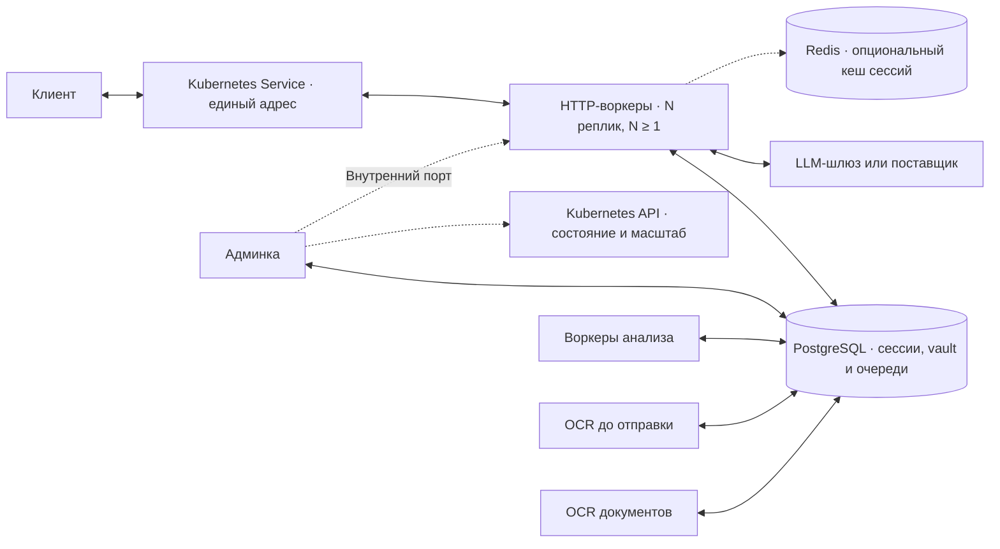
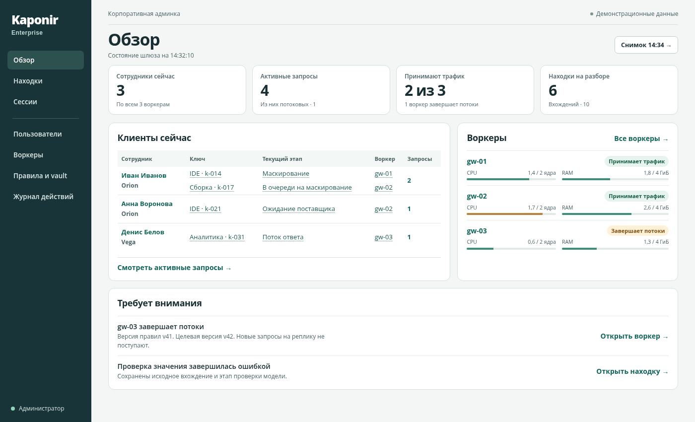

# Архитектура Kaponir Enterprise

Редакция 10 описывает Kaponir Enterprise. Отправная точка для реализации — опубликованная Community
`v1.0.3`, коммит `9e3a814babadb66790598c6e73d0e6ad971849b1`. [Исходный код релиза](https://github.com/miqonee/Kaponir/tree/v1.0.3) · [Скачать редакцию 10 в PDF](enterprise-architecture-v10-ru.pdf)

Для разработки и независимой проверки подготовлены два задания. [Промпт реализации](enterprise/implementation-prompt.txt) · [Промпт приёмки в Minikube](enterprise/minikube-prompt.txt)

## Один адрес и масштабируемый пул HTTP-воркеров

Сотрудники и приложения обращаются к одному адресу. За ним работают **от одного до любого необходимого числа
HTTP-воркеров**. Оператор выбирает число реплик по нагрузке и ресурсам кластера. Три реплики — пример
развёртывания. При изменении их числа сохраняются адрес шлюза, ключи клиентов и общая база PostgreSQL.
Единая админка и фоновая обработка развёртываются отдельно.



### Как проходит запрос

1. **Вход и права.** Воркер проверяет входной ключ, его владельца и команду. Политика определяет доступные
   vault, модели и подключения. Воркер резервирует бюджет команды. ID сессии связывает ходы диалога.
2. **Маскирование.** Воркер применяет действующую версию правил и детекторы. Для каждого значения определяет
   владельца значения и использует его токен либо создаёт соответствие в нужном vault. Запись фиксируется до
   отправки замаскированного запроса поставщику.
3. **Ответ.** Воркер находит токены, проверяет права и возвращает сотруднику разрешённые оригиналы. Это
   работает и с потоковым ответом, когда токен приходит частями. Закрытое для сотрудника значение остаётся
   токеном.
4. **Продолжение диалога.** Следующий запрос той же сессии может обслужить другой готовый воркер. У него есть
   та же база, версии ключей и правила доступа. Открытый HTTP-поток завершает принявшая его реплика.

### Пример одного диалога

Иванов отправляет «Проверь доступ пользователя `ivanov`». В личном vault уже есть соответствие для его логина,
и поставщик получает «Проверь доступ пользователя `ANON_USER_1`». Если этот токен придёт в ответе, Иванов
увидит свой логин. Другому сотруднику само знание токена права на раскрытие не даёт.

**Статус решения**

Настольная Community уже объединяет прокси, Web UI и локальный SQLite vault в одном процессе
`kaponir serve`. Кластерные роли, серверные права сотрудников и общий PostgreSQL входят в план Enterprise.
Состояние отдельных функций и порядок проверки приведены в конце документа.

## Общее ядро и реализация корпоративного воркера

Community и Enterprise используют одну реализацию детекторов, применения правил, формата токенов и
потокового восстановления. Исправление распознавания в общей библиотеке получают обе редакции.
Целевой репозиторий корпоративной редакции — приватный `miqonee/kaponir-enterprise`. В нём разрабатываются
серверные роли, админка и Helm chart. Публичный `miqonee/Kaponir` поставляет общее ядро. Сборка Enterprise
фиксирует его полный Git SHA и проверяет совместимость при обновлении зависимости.
В Community движок работает с локальным SQLite. В Enterprise каждый запрос получает от сервера контекст
организации, сотрудника, команды, входного ключа и версии политики. С этим контекстом воркер выбирает
разрешённые vault, читает и фиксирует соответствия в PostgreSQL, пишет события для админки.

В текущем Rust-коде у движка есть контракт `Vault`, а состояние прокси напрямую использует `SqliteVault`.
При разработке нужно выделить обращения к хранилищу из пути запроса и подключить корпоративную реализацию
к тому же движку. Сетевое ожидание PostgreSQL должно освобождать поток исполнения Tokio. При ошибке записи
воркер завершает запрос до обращения к поставщику. [Движок](../crates/kaponir-core/src/engine/mod.rs) · [Контракт vault](../crates/kaponir-core/src/vault.rs) · [Состояние прокси](../crates/kaponir-proxy/src/state.rs)

### Что сдаём в первой поставке

| Что запускается | Как подтвердить работу |
| --- | --- |
| HTTP-воркер `kaponir-http` | Через клиентский Service реальный воркер маскирует запрос. Стендовый поставщик возвращает токен частями. Клиент получает исходный текст, а следующий запрос на другой реплике восстанавливает разрешённый токен по общей БД. |
| Фоновый воркер `kaponir-analysis` | Из админки оператор ставит завершённый вопрос на проверку. Отдельный процесс берёт задание из очереди `analysis`, запускает общий движок на сохранённом тексте и записывает находку с исходными сотрудником, командой и запросом. При замене пода работа возобновляется по аренде. В админке остаётся одно вхождение. |

Для каждой роли поставляются команда запуска, образ из проверяемого коммита и отдельный Deployment.
Обе роли видны на экране «Воркеры». Первую поставку можно проверить с локальными детекторами.
Специализированные пулы OCR и SSO подключаются следующими этапами. Приёмка общего ядра сравнивает
участки маскирования, типы и восстановленный текст на одинаковых примерах и правилах обеих редакций.
Сами выданные токены могут различаться из-за разных ключей и состояния vault.

## Сотрудник, команда и три уровня доступа

Vault — защищённая область соответствий «токен ↔ оригинал». Один сотрудник в своей команде работает с тремя
областями. У каждой свой владелец, границы доступа и ключевой материал.

| Область | Кому доступно восстановление | Пример |
| --- | --- | --- |
| Личная | Сотруднику-владельцу в его рабочих запросах. | Логин `ivanov` и его личные значения. |
| Командная | Участникам назначенной команды. | Общий код проекта команды Orion. |
| Корпоративная | Авторизованным сотрудникам организации в рамках корпоративной политики. | Общий внутренний домен компании. |

### Как подключается Иванов

Администратор заводит сотрудника `ivanov` и назначает ему команду Orion. При создании учётной записи
появляются личный vault и первое личное правило для точного логина. Справочник также связывает домашний
каталог Иванова с его личным vault, в том числе в запросах коллег. Командный и корпоративный vault уже
существуют.

Администратор выдаёт персональный API-ключ для IDE и CLI. В базовой установке с ним можно войти и в
веб-кабинет. В организации с обязательным SSO сотрудник входит через корпоративную учётную запись.
В кабинете он видит свою статистику запросов, замен и ошибок. Управление правилами и доступ к исходным
находкам или чужим сессиям требуют отдельных полномочий. Права проверяет сервер для каждого обращения.

API-ключ удостоверяет сотрудника. Администратор может заменить или отозвать его. Личный vault и ранее выданные
токены привязаны к владельцу и сохраняются при замене ключа. Восстановление проверяет актуальное членство в
команде.

### Как разрешаются пересечения правил

Для одного совпадения приоритет у обязательного корпоративного правила. Далее следуют обычные корпоративные,
командные, личные правила и встроенный детектор. Приоритет правила определяет действие над текстом. Владельца
исходного значения и право раскрытия система учитывает отдельно.

В Community утверждённая маска каталога `/home/group.demo/ivanov/` охватывает и обычное совпадение
детектора домена `group.demo` внутри этого пути. Обязательное корпоративное правило маскирования домена
сохраняет приоритет. В Enterprise для такого домашнего пути дополнительно определяется сотрудник-владелец.

**Пример масштаба и границ**

100 сотрудников и 10 отделов дают 111 логических vault в одной базе PostgreSQL. Обязательная политика может
предписывать скрывать логины всей организации. Конкретная находка `ivanov`, её индивидуальное правило и
оригинал принадлежат Иванову. В общую область попадают только явно общие значения.

## Общие данные, ключи и постоянный том

Админка, HTTP-воркеры и фоновые исполнители подключаются по сети к одной логической базе PostgreSQL. В
рассмотренной модели каждому vault соответствует своя схема внутри базы. Воркер определяет разрешённые
области по владельцу ключа и актуальному членству. Личный, командный и корпоративный vault доступны в одном
соединении. Обращения к индексам этих областей можно объединять в пакет.

| Что хранится | Состав и назначение |
| --- | --- |
| Пользователи и доступ | Организации, сотрудники, команды, членство, роли, статус и проверочный отпечаток API-ключа. Реестр vault связывает область с владельцем. Справочник логинов позволяет установить его внутри организации до обращения к личному vault. |
| Правила | Личные, командные и корпоративные правила, их приоритеты и опубликованные версии. Для решений сохраняются автор, время и область действия. |
| Подстановки | Тип значения, токен, зашифрованный оригинал, индекс на основе HMAC для поиска совпадений и версия ключа. Общий реестр связывает токен с его vault. |
| Сессии и рабочие данные | Связь сессии с владельцем, запросами и подстановками. Находки, их вхождения и статусы, фоновые задания и история решений. Примеры и разметку сохраняет опциональный модуль «Датасет». |
| Статистика и аудит | Агрегаты для кабинетов, события доступа и изменения правил. Запись полных текстов переписки и сроки хранения аудита определяет политика организации. В технические метрики идут количества, статусы и длительности. |

### Что гарантирует корректное восстановление

Выделение токена и регистрация обратимого соответствия в нужном vault выполняются атомарно. Одновременные
запросы получают согласованный результат. Если запись зафиксировать не удалось, воркер возвращает ошибку до
обращения к поставщику. Любая готовая реплика восстанавливает разрешённое значение по записи токена и текущим
правам. Для этого достаточно сохранённых соответствий. Сохранение полного диалога для разбора и аудита
и срок его хранения задаёт организация. После перезапуска локальный кеш заполняется заново.

У каждого vault свой ключ шифрования либо выделенный для него производный ключ. Сервисы с нужными полномочиями
получают согласованные версии ключей из защищённого хранилища. Выданный сотруднику API-ключ выполняет
отдельную функцию аутентификации.

HashiCorp Vault может передавать корневой ключ контейнеру через `KAPONIR_VAULT_KEY` из Kubernetes
Secret или через файл Vault Agent, путь к которому задаёт `KAPONIR_VAULT_KEY_FILE`. Оператор выбирает
один источник. Новая реплика с правом доступа к vault получает ту же версию ключа. Реплике без этого
права секрет не выдаётся. Enterprise хранит идентификаторы версий, чтобы при восстановлении базы получить
нужные ключи. Неверный или недоступный ключ блокирует готовность реплики, которая от него зависит.

### К чему подключается PVC

При размещении PostgreSQL в Kubernetes постоянный том с файлами базы и журналом WAL подключается к PostgreSQL.
Воркеры обращаются к базе по сети. Добавление пода Kaponir не требует отдельного тома для vault. Если у самой
СУБД несколько экземпляров, у каждого свой диск, синхронизацию данных обеспечивает репликация PostgreSQL.
Резервное восстановление проверяется на копии базы с необходимыми версиями ключей.

## Настройки админки и внешний PostgreSQL

**«Настройки» — отдельный пункт бокового меню Enterprise** для общих параметров установки и организации.
В первой поставке здесь открывается «База данных». После реализации SSO появится «Вход и SSO» с названием
выбранной организации. Подключение PostgreSQL меняет администратор всей установки, способ входа — уполномоченный
администратор своей организации. Меню показывает доступные человеку разделы. Сотрудник видит личный кабинет.
Масштабирование остаётся на экране «Воркеры», показатели БД — на дашборде «Хранилище и поставщики».
С дашборда администратор может сразу перейти к подключению.

### Первый запуск и проверка связи

При установке можно выбрать PostgreSQL рядом с Kaponir или подключить существующую базу, в том числе
в другом кластере или управляемом сервисе. Во внешнем режиме PostgreSQL и его диск обслуживает владелец
БД. В кластере приложения для базы не создаётся PVC. Адрес должен быть доступен подам Kaponir по сети
и соответствовать сертификату сервера.

Оператор открывает **«Настройки → База данных»** и выбирает «Подключить существующую базу». Если база уже
подключена, первым он видит её состояние и кнопку «Изменить подключение». На первом запуске эту же форму
открывает защищённый мастер с одноразовым доступом установки. Оператор указывает адрес сервера, порт
(по умолчанию 5432), имя БД и пользователя, при необходимости добавляет корпоративный центр сертификации.
Пароль можно ввести по HTTPS или выбрать заранее разрешённый секрет. Сохранённый пароль сервер не возвращает.

**«Проверить подключение»** проверяет DNS, сеть, TLS с проверкой имени сервера, вход и необходимые права
из сетевого окружения админки, воркеров и роли миграций. На экране видна конкретная причина отказа, например
«Сертификат выдан на другое имя». Проверка только читает состояние БД. **«Применить»** использует проверенную
версию параметров. Для новой установки отдельная задача создаёт схему Kaponir в подготовленной пустой БД.
Экран показывает действующее подключение, время проверки и готовность каждого пула.

### Смена подключения действующей установки

Активная версия подключения и состояние мастера хранятся вне целевой БД. При ошибке проверки трафик
продолжает идти в действующую базу. Смену пароля к той же базе проверяют до переключения пулов соединений.
Если сама БД недоступна, оператор установки восстанавливает доступ через сохранённую конфигурацию Kubernetes
или GitOps. Первичный мастер при этом остаётся закрытым.

Для переезда с данными оператор готовит копию всех vault и обеспечивает доступ к нужным версиям ключей
из хранилища секретов. На время переключения приостанавливаются приём новых запросов и захват задач.
После завершения текущих записей фиксируется последняя согласованная точка данных. Система сверяет её,
идентификатор установки и схему в целевой базе. Все роли получают одну версию подключения. Доступ старых
процессов к записи закрывается до того, как новые начнут обслуживать трафик.
Пустая, чужая или отставшая база не принимается как замена. Оператор видит результат и запись в аудите.

## Кеш сессий и Redis

На первом этапе любая HTTP-реплика продолжает сессию по данным PostgreSQL. По результатам замера оператор
может подключить общий Redis по схеме cache-aside. Например, реплика B получает прогретый репликой A
индекс вопросов и вызовов сессии. При промахе, вытеснении или недоступности Redis она читает PostgreSQL.
Короткий тайм-аут, объединение одновременных загрузок одного ключа и лимит соединений защищают БД от
наплыва запросов при холодном старте.

В кеш попадают непрозрачные идентификаторы и производные метаданные с TTL в пределах срока хранения.
Ключ записи включает организацию, контур видимости, непрозрачный ID сессии и версию состояния. Воркер
получает актуальную версию вместе с проверенным контекстом запроса из PostgreSQL. Новая версия публикуется
после фиксации изменения. Доступ к запросу, актуальное членство, отзыв ключа,
сессионное разрешение на раскрытие, бюджет и обратимые подстановки проверяет авторитетное хранилище.
Полные сообщения, оригиналы, ключи шифрования и учётные данные в этот кеш не записываются. При недоступной
БД попадание в кеш не разрешает отправку или раскрытие оригинала. Доступ к Redis ограничен сетью, TLS и ACL.

### Когда нужен PVC для Redis

Новая реплика Kaponir сразу использует записи работающего Redis. PVC помогает **при перезапуске самого
Redis**, если включены RDB или AOF. Тогда сервер может загрузить сохранённые записи в память. Один только том ничего
не сохраняет. До завершения загрузки возможен холодный интервал, а устаревшие версии отсеиваются. Начальная
установка обходится без тома для кеша. Если замер показывает дорогой прогрев, оператор включает сохранение
на отдельный PVC Redis или использует управляемый сервис. При репликации каждый пишущий файлы экземпляр
имеет собственный том. Высокая доступность требует реплики и переключения. [Механизмы сохранения Redis](https://redis.io/docs/latest/operate/oss_and_stack/management/persistence/)

При выборе режима сравнивают одну и ту же нагрузку без кеша, с холодным и с прогретым кешем. Критерии —
сокращение обращений к БД и добавленной шлюзом задержки p95/p99, цена памяти, время прогрева и поведение
при отказе. Доля попаданий сама по себе не показывает выигрыш для пользователя.

## Как взаимодействуют воркеры

| Роль | Откуда получает работу | Кому передаёт результат |
| --- | --- | --- |
| `kaponir-http` | Клиентский Service направляет соединение на готовый HTTP-под. | Фиксирует маски и события в PostgreSQL, вызывает разрешённого поставщика и восстанавливает ответ. Создаёт фоновые задания по политике. |
| `kaponir-analysis` | Забирает из очереди `analysis` завершённые вопросы и документы. | Сохраняет находки, вхождения и статус в общей БД. Для скана ставит дочернее задание в `ocr.batch`. |
| `kaponir-ocr-batch` | Берёт пакетные файлы из `ocr.batch`. | Записывает защищённый результат распознавания. Ожидающее задание анализа снова становится доступно. |
| `kaponir-ocr-inline` | Получает из `ocr.inline` вложения, которые политика требует обработать до отправки. | Публикует ссылку на проверенную копию или причину отказа. Дальнейшую отправку выполняет HTTP-воркер. |

Это имена предлагаемых Deployment для Helm-релиза `kaponir`. Оба пула OCR используют один образ и разные
настройки очереди, ресурсов и параллельности. Пул пакетного OCR можно установить отдельно. Воркеры находят
задания в PostgreSQL. Им не нужен список соседей, а админка может перезапускаться во время обработки.

### От постановки до результата

1. **Постановка.** HTTP-воркер либо уполномоченный административный API пишет источник и задание в одной
   транзакции. Запись содержит организацию, очередь, стабильный ключ операции, родителя или запрос,
   версию политики, срок выполнения и ссылку на вход. Повтор того же события возвращает существующее задание.
   Авторизованному клиенту фонового API после commit возвращаются ID и статус.
2. **Захват.** Свободный потребитель своей очереди в короткой транзакции выбирает доступную запись через
   `FOR UPDATE SKIP LOCKED`, ставит `running`, записывает UID воркера, срок аренды и новый номер попытки.
   Затем освобождает соединение, выполняет работу и продлевает аренду. Периодический опрос отвечает за
   доставку. `LISTEN/NOTIFY` может разбудить потребителя раньше, в уведомлении достаточно ID.
3. **Фиксация.** Результат, вхождения и завершение задания фиксируются вместе, только пока действуют
   аренда и номер попытки. Просроченный исполнитель не может переписать результат новой попытки.
   Уникальный ID вхождения исключает дубли при повторной доставке. Ожидание дочернего OCR освобождает слот
   анализа. Чувствительное содержимое хранится отдельно от строки очереди, зашифрованным, с правами и TTL.
   Для пилота подходит отдельная таблица вложений PostgreSQL, для больших файлов — закрытое объектное хранилище.
4. **Сбой.** Истечение аренды возвращает подходящую работу в очередь. Временная ошибка даёт повтор с
   задержкой и пределом попыток или срока. Постоянная ошибка уходит в список «Требует разбора» с причиной.
   Повтор администратора связан с исходным заданием и попадает в аудит. Для внешнего вызова с неизвестным
   результатом используют ключ идемпотентности поставщика либо оставляют попытку на сверке.

### Вложение до отправки и пакет документов

Пользователь отправляет PDF, пока в импорте ждут сотни сканов. HTTP-воркер ставит срочное задание в
`ocr.inline` с общим дедлайном запроса и ждёт событие или перечитывает результат без открытой транзакции.
У этого пула свои слоты и минимум одна прогретая реплика при включённой защите вложений. Бюджет ресурсов
кластера учитывает оба пула. После успешного результата HTTP-воркер проверяет привязку артефакта к запросу,
актуальность политики и права отправки. Поставщику уходит обработанная копия. Тайм-аут, ошибка страницы
или отсутствие готового обработчика завершают обязательную проверку локальной ошибкой. Поздний результат
отменённого запроса не возобновляет отправку. В импорте `ocr.batch` может ждать свободной мощности дольше.

## Единая админка и эксплуатация в Kubernetes

### Что видит и делает администратор

Администратор управляет пользователями, ключами, командами и тремя уровнями правил. В одном Web UI ему
доступны статистика, разрешённые сессии и находки, предложения ИИ и история решений. При установке модуля «Датасет» к ним добавляется работа с примерами.
Общие параметры установки и организации открываются из бокового меню. [Раздел «Настройки»](#настройки-админки-и-внешний-postgresql)

### Как находка доходит до разбора

1. **Запись.** HTTP-воркер сохраняет спорное решение в общем журнале в транзакции с результатом обработки.
   Фоновый анализ документов и сессий пополняет ту же очередь разбора. Запись содержит источник, владельца и
   область, запрос или документ, позицию в тексте и состояние проверки.
2. **Повторы.** Стабильный идентификатор события и вхождения позволяет безопасно повторить доставку. Новое
   появление того же значения в другом запросе добавляет вхождение к карточке в той же области доступа.
   Админка читает накопленные находки и после своего перезапуска.
3. **Решение.** Администратор видит фрагмент, происхождение и статус ИИ. Он принимает, исправляет, отклоняет
   или откладывает предложение. Принятое изменение правила публикуется с новой версией. Разобранные и уже
   покрытые правилами значения остаются в истории. В открытой очереди видны случаи, ожидающие решения.
   Если установлен модуль «Датасет», из истории можно добавить в него выборку или включить сохранение примеров при разборе.

### Развёртывание и контроль воркеров

| Задача | Решение |
| --- | --- |
| Запуск | У админки, HTTP, анализа и выбранных пулов OCR отдельные Deployment. У каждого пула свой владелец масштаба и свой предел ресурсов. |
| Обнаружение | Желаемые и готовые реплики админка читает из Deployment. Для HTTP сверяет все EndpointSlice клиентского Service. Для потребителей сопоставляет поды своего namespace и разрешённых Deployment с heartbeat по UID, очередью и версией движка. Публичный Service потребителям не требуется. |
| Готовность | Воркер допускается к трафику при рабочем движке, доступе к vault и загруженной версии политики. При плановой замене он снимается с приёма новых соединений и завершает активные потоки. |
| Наблюдаемость | В админке по каждому поду видны готовность, версия правил, активные запросы и потоки, очередь и объём ожидающего текста, CPU, память, ошибки и задержки маскирования и восстановления. Ожидание первого ответа поставщика измеряется отдельно. |

**Отказ админки**

Доступные HTTP-воркеры продолжают обслуживать запросы с действующей политикой, пока доступны общая база и
нужные ключи. После восстановления админка показывает накопившиеся находки и состояние реплик.

## Как добавить воркер

**Админка → Воркеры** — обязательная точка управления для каждого установленного пула. Оператор выбирает
HTTP, фоновый анализ, пакетный OCR или OCR вложений. В ручном режиме он нажимает «Изменить число воркеров»,
задаёт итоговое число и нажимает «Применить». Например, при увеличении HTTP с двух до трёх экран показывает
«Готовы 2 из 3», затем «Готовы 3 из 3». При уменьшении там же видно, сколько подов ещё завершает работу.
Состояние обновляется автоматически. При задержке запуска рядом видна причина, полученная от Kubernetes.

Эквивалент для командной строки — `kubectl -n kaponir scale deployment/kaponir-http --replicas=3`.
Kubernetes запускает под и проверяет его готовность. HTTP-под попадает в EndpointSlice своего Service.
Потребитель OCR принимает работу после загрузки профиля распознавания и подключения к очереди.

Пример целевых Helm values для установки с Redis и автоматическим масштабированием пакетного OCR.
Имена параметров относятся к проектируемому chart. Для установки без общего кеша предусмотрено
`sessionCache.enabled: false`.

```yaml
workerPools:
  http:     {scaling: manual, replicas: 3}
  analysis: {scaling: manual, replicas: 1}
  ocrBatch: {enabled: true, scaling: keda, minReplicas: 0, maxReplicas: 6}
  ocrInline: {enabled: true, scaling: manual, replicas: 1}
sessionCache:
  enabled: true
  existingSecret: kaponir-session-redis
```

В автоматическом режиме HTTP масштабирует HPA по CPU при заданных requests либо по активным запросам через
адаптер метрик. Для очередей подходит KEDA с PostgreSQL scaler по числу готовых к захвату и ещё выполняемых
заданий этого пула на его рабочую ёмкость. Учитываются аренды, сроки повторов, скорость страниц и возраст
старейшего задания. Последние две метрики помогают настроить пороги и оповещения. KEDA читает только
агрегат через роль с правом SELECT на представление. Для пакетного OCR допустим минимум ноль при работающем
автоскейлере. Для интерактивного OCR и HTTP задают `minReplicas` не ниже единицы и отдельно проверяют
готовность подов. Верхние границы
задаёт оператор с учётом квот CPU/GPU, памяти, БД и поставщика. [HPA](https://kubernetes.io/docs/concepts/workloads/autoscaling/horizontal-pod-autoscale/) · [PostgreSQL scaler KEDA](https://keda.sh/docs/2.21/scalers/postgresql/)

У каждого пула один владелец масштаба. В ручном режиме сервер админки меняет `deployments/scale` с отдельным
полномочием оператора и ограниченной Role в namespace. При автомасштабировании оператор на том же экране
меняет минимум и максимум. Сервер обновляет границы у HPA или, для пула KEDA, у ScaledObject. При управлении
через GitOps действие в админке направляет изменение в настроенный процесс GitOps и показывает статус
синхронизации. Helm и GitOps учитывают владельца при сверке числа реплик. В аудит попадают пул, автор,
прежние и новые значения. При нехватке ресурсов видны `Pending` и причина от планировщика. Добавление
узлов зависит от конфигурации кластера.

При уменьшении пула HTTP перестаёт принимать новые соединения и завершает открытые SSE в пределах
`terminationGracePeriodSeconds`. Потребитель перестаёт брать задания и дожидается фиксации активного
результата либо освобождения аренды. Уменьшение сопровождается проверкой нагрузки и окном стабилизации.

## Балансировка и проверка пропускной способности

Kubernetes Service распределяет **новые соединения** между готовыми подами. Повторные HTTP-вызовы по одному
соединению могут попасть на одну реплику. Открытый SSE-поток обслуживает принявший его воркер. Привязка по ID
сессии остаётся опцией балансировщика. Для следующего соединения пригоден любой готовый воркер с доступом к
данным организации.

### Когда менять число реплик

Оператор видит активные запросы и потоки, очередь, CPU и память по каждому поду. При включённом HPA можно
масштабировать пул по CPU или по числу активных запросов при наличии этой метрики в Kubernetes. Границы HPA
выбираются для конкретной установки. Отдельно измеряются ожидание соединения с PostgreSQL, задержка диска и
квоты поставщика. Долгое ожидание первого токена у поставщика само по себе не означает нехватку воркеров.

### Что уже измерено

25 ноября 2026 года восемь параллельных клиентов выполнили на прототипе хранилища 43 200 циклов поиска,
записи и восстановления без ошибок. Стенд использовал PostgreSQL 17.12, 111 схем и локальный диск.
При общем лимите 4 CPU получено 1 699 циклов/с для известных значений, 817 для смеси известных и новых
и 898 для новых.
Единица измерения — полный цикл хранилища. [Исходный отчёт стенда](enterprise-vault-storage-benchmark.json)

### Как принять масштабирование шлюза

1. **Изменить размер пула под трафиком.** Начать с одной реплики, добавить несколько и затем уменьшить их число.
   Проверить появление и удаление подов в админке, готовность новой реплики и завершение открытого потока при
   плановом выводе пода. Следующий запрос той же сессии направить на другую реплику и проверить восстановление.
2. **Проверить общее состояние.** Одновременно обработать одинаковые значения на разных подах. Проверить
   права трёх областей, отсутствие дублей для одной области и границы командного бюджета. Повторная доставка
   события сохраняет одно вхождение и одно списание за попытку.
3. **Измерить предел установки.** Для каждого размера пула повторить один и тот же профиль длин текстов,
   новых и повторных значений, обычных запросов и SSE. Зафиксировать завершённые запросы/с, ошибки и p95/p99
   задержки. Сравнить замер с управляемым поставщиком и замер с рабочим поставщиком на целевых сети и PVC.
   Сквозная пропускная способность Enterprise определяется этим испытанием.

## Дашборд администратора

На первом экране видно, у кого сейчас открыт запрос, какой воркер его обслуживает и где проходит время. Из
строки сотрудника можно перейти к его ключу, запросу и сессии.



На макете показан пример с тремя репликами. В рабочей админке список строится по текущему составу пула.

### Кого считать активным

Запрос активен с момента приёма до завершения, ошибки или обрыва. Поток ответа входит в этот же счётчик.
Сотрудник с двумя открытыми запросами по разным ключам учитывается один раз. У завершённых запросов есть
отдельная история. Время последнего вызова видно в карточке ключа.

### Как обновлять экран

HTTP-воркер отдаёт по защищённому внутреннему API текущие запросы, этапы и время измерения. Потребители
публикуют heartbeat, UID и стадии заданий в PostgreSQL. Админка сопоставляет их с состоянием Kubernetes,
сводит запросы по ID и передаёт изменения браузеру. После переподключения браузер получает свежий снимок.
Начальный вариант — обновление раз в 5 секунд, после трёх пропусков данные реплики считаются устаревшими.

Админка отдельно показывает, сколько реплик запрошено, сколько готовы принимать трафик и по скольким есть
свежие данные. Например, «Данные по 7 из 8 воркеров» означает, что из восьми обнаруженных подов вовремя
ответили семь. У восьмого видно время последнего замера. При изменении состава пула пересчитываются оба числа.
В текущих итогах учитываются свежие данные. Список можно приостановить для чтения.

**Когда у сотрудника «всё медленно»**

Из активного запроса администратор открывает воркер. Там видны CPU и память относительно лимитов, длина, объём
и возраст очереди, задержки маскирования и восстановления, отдельно — ожидание первого токена поставщика. Если
лимит ресурса не задан, показывается фактическое потребление.

## Рабочие экраны админки

| Экран | Что видно без перехода в карточку | Действие оператора |
| --- | --- | --- |
| Обзор | Кто сейчас работает, активные запросы и SSE, готовность по пулам, самая старая работа в очереди, подтверждённые пропуски и полнота проверки за период. | Выбрать проблему и сразу открыть соответствующий пул, попытку или находку с теми же фильтрами. |
| Воркеры | Для HTTP, анализа и каждого OCR-пула — желаемые, готовые, обслуживающие и свежие реплики, источник управления масштабом. По подам — UID, время работы, перезапуски, версия политики или OCR, CPU/память относительно лимита, занятые слоты и ошибки. | Изменить число воркеров или границы автомасштабирования. Увидеть результат, открыть активные задания и причину Pending/NotReady. |
| Очереди и OCR | По каждой очереди — ожидают, выполняются, задержаны до повтора, ожидают зависимость, завершились ошибкой. Показаны возраст старейшего задания, время ожидания p95, страницы/с и доступные слоты OCR. | Приостановить захват новых пакетных заданий, возобновить его или повторить выбранное завершившееся ошибкой задание. Видны действующие аренды и последняя причина. |
| Защита данных | Замены до отправки, блокировки по политике, подтверждённые пропуски, находки только в ответах, передача внешним анализаторам и случаи с неизвестным исходом. | Из виджета «Что не успели скрыть» открыть конкретное вхождение и получателя, разобрать находку, проверить правило на следующем запросе. |
| Клиенты и расходы | Активные сотрудники и команды, ключи по назначению, вопросы и попытки, модели, фактический/оценочный расход, доступный бюджет и резервы на сверке. | Перейти от команды к ключу и попытке, открыть её сессию в пределах прав. |
| Хранилище и поставщики | Ожидание соединения с БД и фиксации записи, состояние Redis при его установке, попадания и вытеснения, обращения к БД при сбое кеша, ожидание первого токена, 429 и ошибки поставщиков. | Сопоставить задержки по времени с очередями и нагрузкой подов и определить, где имеет смысл добавлять мощность. |

На всех экранах действуют фильтры организации и периода. Список сессий и действий учитывает разрешённых
клиентов, команды и ключи. После перехода к запросу можно вернуться к исходной выборке. События управления
пишутся в аудит и имеют видимый результат «Применяется», «Готово» или причину отказа. Читатель телеметрии,
оператор пула и сотрудник с личной статистикой имеют разные серверные права. При недоступном источнике
показываются время последнего замера и «Нет свежих данных». ID клиентов и содержимое запросов доступны
только через авторизованный API, в Prometheus используются агрегаты с ограниченным набором меток.

### Откуда приходят данные и куда попадает команда оператора

Админка наблюдает Deployment, поды и EndpointSlice своего namespace. HTTP-под по защищённому внутреннему
маршруту отдаёт UID, время снимка, версию политики, активные запросы и SSE. Потребитель сообщает в БД UID,
пул, профиль, доступные слоты и время heartbeat. Собранные по UID данные CPU и памяти поступают из
`metrics.k8s.io` при наличии metrics-server. Исторические графики и p95/p99 строятся по временным рядам
и гистограммам, например в Prometheus. Показания ресурсов имеют собственное время измерения.

Предлагаемый административный API отдаёт снимок пулов через `GET /admin/api/worker-pools`. На команду
`PATCH /admin/api/worker-pools/{pool}/scale` браузер передаёт версию прочитанного состояния и желаемый размер
либо границы автомасштабирования. Сервер проверяет полномочия и пределы, направляет изменение владельцу
настроек с защитой от конкурирующей записи и возвращает ID операции. При конфликте клиент перечитывает снимок.
По этому ID видно, принято ли изменение контроллером и сколько подов действительно готовы. Учётные
данные Kubernetes остаются у серверного компонента. Имена маршрутов относятся к проекту Enterprise.

## Виджет «Что не успели скрыть»

В обзоре у виджета свой период и переход в экран «Защита данных». Основной счётчик учитывает уникальные пары
«попытка отправки основной модели + открытое вхождение», для которых поздний анализ нашёл
чувствительное значение и есть подтверждение его наличия в фактическом исходящем теле отправленной попытки.
Повторная доставка события этого счётчика не меняет. Рядом указаны число затронутых запросов и доля
проверенных отправок среди всех отправок за период. Если доказательств отправки
или представления значения недостаточно, случай попадает в «Неизвестно». Находки только в ответах,
заблокированные до отправки запросы и передачи вспомогательным анализаторам имеют собственные счётчики.

В переписке карточка выбранной попытки на одном экране показывает **«До отправки основной модели»** и
**«Найдено после ответа»**. Для каждого вхождения видны источник, представление у основной модели и
обработчик. Контур определяется конфигурацией на момент вызова — локально, сервис компании или внешний
сервис. Для каждого получателя показана фактическая форма данных — признаки, токен, исходное значение,
фрагмент либо изображение. Один вопрос может иметь несколько получателей и повторных попыток. Если анализ не запускался,
ещё выполняется, завершился без находок или с ошибкой, у каждого случая свой статус.

Например, пароль из YAML ушёл основной модели как токен. Фоновая проверка позже нашла в том же исходящем
теле открытое название «Северка», а номер договора впервые появился в ответе. В виджет пропусков попадёт
только «Северка». Внешний анализатор, получивший только признаки, будет указан отдельно. Доступ к оригиналу
требует отдельного права и действующего срока хранения. Новое правило действует для будущих запросов,
а результат прежней отправки остаётся в истории. Для вычисления показателей полная переписка не становится
обязательным журналом.

## Разбор решений с учётом vault

По умолчанию администратор видит все ожидающие решения находки в доступной ему части организации. Одна
карточка объединяет повторы значения в одном контуре доступа. Внутри остаётся список отдельных вхождений.

| Поле в интерфейсе | На какой вопрос отвечает |
| --- | --- |
| Источник вхождения | Кто прислал значение, в какой команде он состоял, каким ключом воспользовался, в какой сессии и запросе оно встретилось. Видны время и воркер. Для документа без достоверного автора показывается источник «Импорт», неизвестные поля так и помечаются. |
| Vault при запросе | Где в тот момент находилось использованное соответствие «токен ↔ оригинал». Для первого обнаружения обычно видно «Ещё не сохранено». После принятия решения историческое поле сохраняет прежнее значение. |
| Область правила | Контур конкретного правила. У точного логина сотрудника и префикса его домашнего каталога по умолчанию стоит «Личные». |
| Vault для будущих замен | Где будет храниться подстановка и кто сможет раскрыть оригинал. Для каталога Иванова автоматически выбран его личный vault, даже если путь прислал Белов. |

### Как пользоваться фильтрами

Отправитель, команда на момент запроса, ключ и фактический vault относятся к одному вхождению. Фильтр
владельца отдельно ограничивает карточки. Если Иванов прислал внутренний хост дважды, а Воронова один раз,
выбор Иванова покажет «2 из 3» в командной карточке. Выбор ключа Вороновой вместе с Ивановым даст пустую
выборку. Отозванный ключ остаётся доступен в истории.

Одинаковое написание в личных vault двух сотрудников образует две карточки. Сервер сначала проверяет доступ к
источникам и только затем считает группы и вхождения. Секрет API-ключа не отображается. Для просмотра
исходного фрагмента требуется соответствующее полномочие.

### Что происходит при решении

Карточка показывает выделенный фрагмент, отдельно заключение ИИ и решение человека. Перед принятием видны
область правила, будущий vault, получатели доступа и число затронутых вхождений. Принадлежность
подтверждённому сотруднику имеет приоритет над областью, предложенной моделью. Массовое принятие возможно
только с однозначными правами и адресатами для всей выборки.

После принятия, отклонения или откладывания открывается следующая карточка с теми же фильтрами. Последняя
возвращает к списку с итогом. Решение, автор и версия правила попадают в журнал при любом составе установки.

## Опциональный модуль «Датасет»

При установке Enterprise оператор выбирает компонент «Датасет» в списке модулей. В проекте Helm-конфигурации этому выбору соответствует `modules.dataset.enabled` со значением `true` или `false`. Выбор действует для админки и всех воркеров. При обновлении установки он сохраняется.

В текущей установке компонент отключается командой `kaponir init --without-dataset`. Для Compose используется `KAPONIR_DATASET_ENABLED=false` у прокси и воркера. [Настройка установки и повторное включение](COMMANDS.md#общие-параметры-и-пространство)

**Установка без датасета**

Из Web UI исчезают раздел «Датасет», кнопки добавления находки или выборки, статусы разметки, флажок «Сохранять примеры в датасет» и сбор в лаборатории. Старая закладка на раздел открывает «Находки». Браузерный блокнот и подсказки для разметки отключены.

API примеров, разметки, импорта и экспорта JSONL возвращает HTTP 404. Воркеры прекращают сбор, в том числе в заданиях, поставленных в очередь до отключения. Отдельные копии фрагментов для обучения перестают создаваться на сервере и в браузере. Ранее собранные примеры хранятся по политике организации и вновь доступны при подключении модуля в пределах срока хранения.

Разбор находки по-прежнему завершается решением. Например, администратор принимает предложение скрывать «Северку». Шлюз применяет правило к следующим запросам, а в истории и аудите видны автор и происхождение правила.

**Установка с датасетом**

Администратор с правом работы с примерами может сохранить выборку в черновики. На новой установке автоматический сбор выключен. Если включить «Сохранять примеры в датасет», решение «скрывать» или «оставить» по открытому фрагменту с однозначным вхождением даст проверенный пример. Массовые решения сохранят черновики. Добавление примеров из прежней истории запускается вручную.

### Приёмка двух вариантов установки

1. **Без модуля.** Принять находку, проверить замену в следующем запросе и найти решение в истории. Повторить разбор для выборки. Проверить отсутствие новых примеров в базе и браузере, переход по старой закладке и ответ API на каждой реплике после перезапуска.
2. **С модулем.** Сохранить выборку вручную, проверить черновик и выгрузить JSONL. Затем включить автосбор и проверить метку решения по открытому фрагменту.
3. **Смена состава установки.** Отключить модуль при включённом автосборе и непустой очереди. Проверить, что старый клиент и отложенные задания больше не могут записать пример. После повторного включения сверить ранее сохранённую разметку.

## Пользователи и повседневное администрирование

«Пользователи» — самостоятельный раздел главного меню. В реестре видны имя, логин, текущая команда, состояние
доступа и число действующих ключей. Из карточки сотрудника открываются его запросы и находки с уже выбранным
фильтром.

| Задача администратора | Что он делает в интерфейсе |
| --- | --- |
| Подключить сотрудника | Указывает логин и команду. Система создаёт учётную запись, личный vault и первое правило для логина. Администратор выдаёт именной API-ключ, указывает назначение. Секрет показывается при выдаче, в реестре остаются название и безопасный ID. |
| Перевести в команду | В карточке видны текущая и новая команда и изменение прав. После подтверждения новые запросы используют новое членство. Персональный vault сохраняется. Старые события показывают команду на момент запроса. При раскрытии токена учитываются текущие права. |
| Заменить ключ или отключить доступ | Можно выдать новый ключ и отозвать конкретный старый. При отключении учётной записи прекращается приём новых запросов по всем её ключам. История запросов и решений доступна уполномоченному администратору. |
| Разобраться с правилом | Из решения открывается опубликованная версия политики. По каждому воркеру видны применённая версия, целевая версия и свежесть данных. Журнал указывает, кто и когда принял решение или изменил права. |

### Что видят сотрудник и администратор

После входа сотруднику открывается личный дашборд со своей статистикой. В админке отдельно проверяются права
на управление пользователями, изменение правил, просмотр метаданных и раскрытие оригинала. Интерфейс
показывает только разрешённые действия. Ключи, переводы, решения и обращения к оригиналам оставляют запись в
журнале.

### Какие данные нужны экранам

Каждое вхождение хранит организацию, ID отправителя и отдельно ID владельца значения, если он установлен,
команду и ключ на момент события, источник, ID сессии, запроса, воркера и самого вхождения, время, версию
правил и фактический vault, если он использовался. Решение отдельно хранит автора, действие, будущий vault и
область правила.

**Граница телеметрии**

Идентификаторы клиентов для живого списка передаются через защищённый административный API в рамках прав
наблюдателя. В технических метриках остаются агрегаты по репликам и этапам. Исходные значения и секреты ключей
в метрики не попадают.

## Единый вход в корпоративный портал

SSO — отдельный этап Enterprise после поставки работающих воркеров. Первым протоколом выбран OpenID Connect
(OIDC). Организация подключает свой сервис входа, например Keycloak или Microsoft Entra ID. Администратор
привязывает внешнюю учётную запись к существующему сотруднику Kaponir. Связка состоит из организации,
проверенного издателя (`iss`) и идентификатора пользователя у него (`sub`). Она уникальна и указывает
на постоянный ID сотрудника. Совпадение логина или почты не даёт доступ к существующему профилю.

**Что видит сотрудник.** Иванов нажимает «Войти через компанию», проходит обычный вход у своего
провайдера и возвращается в личную статистику. За ним сохраняются его команда, ключи IDE и личный vault.
Оператор с назначенным правом после такого же входа видит управление воркерами. Сервер Kaponir проверяет
права на каждое действие. Привязка SSO и смена почты не создают новых vault.

**Как это подключить.** В «Настройки → Вход и SSO» администратор организации задаёт доверенный issuer,
client ID и ссылку на секрет.
Экран показывает точный адрес возврата и позволяет проверить вход перед включением обязательного SSO.
Портал использует Authorization Code с PKCE S256, одноразовые `state` и `nonce`, проверяет подпись,
издателя, аудиторию и срок ID-токена. После входа браузер получает защищённую серверную cookie с ограниченным
сроком. Для IDE и сервисов действуют именные входные API-ключи. HTTP-воркер обрабатывает такие запросы
без обращения к провайдеру SSO. [OpenID Connect Core](https://openid.net/specs/openid-connect-core-1_0.html)

**Что происходит при отзыве.** Отключение сотрудника в Kaponir закрывает доступ по всем его ключам и
браузерным сессиям со следующего запроса. Отзыв одного ключа завершает сессии, выданные по этому ключу.
Если сотрудника отключили только у провайдера, его браузерный доступ ограничен сроком до следующего
обязательного входа у провайдера. Для немедленного отзыва доступа через IDE требуется отключить сотрудника
или ключи в Kaponir. При недоступном провайдере новый SSO-вход завершается явной ошибкой.
При включении обязательного SSO завершаются браузерные сессии по ключу этой организации и закрывается
обмен ключа на новую браузерную сессию. Сервер проверяет способ входа и на API интерактивной админки.
Изменения настроек, привязок и события входа попадают в аудит без токенов и секретов.

## Владелец логина и домашнего пути

После регистрации `ivanov` его логин и префикс домашнего каталога получают личную область Иванова. У каждого
вхождения отдельно видны отправитель и его команда.

| Что пришло в запросе | Результат в Kaponir Enterprise |
| --- | --- |
| Логин `ivanov` в поле учётной записи | Повторные вхождения покрывает личное правило, созданное при регистрации. Дубли в командных правилах и очереди не создаются. |
| `/home/group.demo/ivanov/work/build.log` в запросе Белова из Vega | На разбор идёт один личный префикс `/home/group.demo/ivanov/`. Владельцем и получателем права восстановления остаётся Иванов. Белов указан как отправитель. Остаток `work/build.log` проверяется отдельно. |
| `C:\Users\ivanov\a.txt` | Для известного расположения профилей Windows берётся целый компонент учётной записи. Повторы файлов в том же каталоге объединяются у того же владельца. |
| `/srv/ivanov-tools/log` | Совпадение части имени проекта с логином не определяет владельца. Для общего проекта действуют его обычные правила. |

### Как определяется владелец

Сверяем целый логин под настроенным корнем со справочником организации, с учётом домена и правил регистра.
Фамилия, название общего каталога или служебная учётная запись сами по себе не устанавливают владельца. Модель
может проверить остаток пути. Расширять доступ по её рекомендации нельзя.

Индекс учётных записей указывает личный vault для системной записи. При восстановлении действуют права
отправителя. История хранит стабильный ID владельца. Если старый логин выдан другому сотруднику, прежние
события сохраняют исходную привязку. Для старой находки без владельца нужен отдельный разбор.

**Если командное правило уже действует**

Админка показывает конфликт и существующее личное правило. После подтверждения публикуется одна версия
политики, в которой командный дубль снят. Решение записывается в журнал. Права на ранее выданные токены
проверяются отдельно.

## Ключи команды и доступ к моделям

В карточке Orion раздела «Команды» администратор настраивает, кто может обращаться к шлюзу, какими моделями
пользуется команда и какие подключения оплачивают её запросы.

| Раздел карточки | Что видит и меняет администратор |
| --- | --- |
| Ключи доступа | Владелец, назначение, безопасный ID, команда, срок и последнее использование. Иванову можно выдать отдельные ключи для IDE и CLI. Для CI создаётся служебная учётная запись с собственным ключом. |
| Модели и подключения | Разрешённые модели, рабочий маршрут по умолчанию и резервные подключения из корпоративного или командного пула. У каждого подключения видны поставщик, доступные модели и способ оплаты. |
| Расходы | Использование и остаток бюджета за период. Из строки команды можно перейти к ключу, вопросу сотрудника и конкретному вызову поставщика. |

### Что проверяет воркер

У каждого входного ключа есть стабильный владелец и одна команда для атрибуции. У ключа CI собственная
служебная учётная запись с явно выданными правами. Один сотрудник может иметь несколько ключей.
Отзыв ключа действует на всех воркерах. Выпуск нового ключа сохраняет личный vault.
При переводе сотрудника новые вызовы проверяются по актуальному членству и назначению ключа.

Право на вызов определяется пересечением политик организации, команды и входного ключа. Одинаковая проверка
действует для каталога моделей, явного выбора подключения через `/p/{id}`, автоматического маршрута и повторной
попытки. Поставщику передаётся замаскированный запрос. Выбор модели сохраняет права владельцев vault.

Выходное подключение содержит отдельные учётные данные поставщика. Воркеры получают секрет через ссылку на
защищённое хранилище. В карточке и журнале виден ID подключения. В пул включаются подписки и API-аккаунты,
для которых поставщик разрешает такой режим использования. Для каждой учётной записи сохраняются собственные
квоты и условия.

## Учёт токенов и бюджета

Один вопрос сотрудника может вызвать несколько обращений к поставщику. Админка показывает оба уровня.
Служебный запрос OpenCode на название сессии учитывается как отдельный вызов с собственными токенами и
назначением. В ленте сотрудник видит свой вопрос под полученным названием сессии.

| Что учитываем | Как считаем |
| --- | --- |
| Принадлежность | На входе фиксируются организация, команда и ID ключа на момент запроса, владелец, сессия и идентификатор вопроса. Перевод сотрудника сохраняет историю расходов прежней команды. |
| Каждая попытка у поставщика | Идентификатор попытки, подключение, фактическая модель, назначение, результат, длительность, входные, выходные и кешированные токены при наличии. Повторный вызов имеет собственную запись. |
| Деньги | Для оплаты за токены применяется версия тарифа на момент вызова, с валютой и отдельными ставками для кеша. Для подписки отдельно показываются фиксированная плата, использование и остаток квоты. |

### Как все воркеры соблюдают общий лимит команды

До отправки воркер атомарно резервирует в PostgreSQL верхнюю оценку расхода с учётом входа и ограничения на
ответ. При нехватке бюджета шлюз возвращает причину до обращения к поставщику. По завершении резерв
закрывается по фактическому использованию. Уникальный ID попытки защищает от повторного списания при
повторной доставке события или последнего чанка потока.

При обрыве после отправки попытка остаётся на сверке. Учёт различает данные поставщика, оценку и отсутствие
данных. Пустой отчёт поставщика не превращается в нулевой расход. Администратор видит такие попытки,
оставшийся резерв и время последней сверки.

## Пулы подключений и совместная работа моделей

Сотрудник может выбрать конкретную разрешённую модель или опубликованный для его команды профиль.
У профиля есть понятное имя, разрешённые подключения, предел расходов и правила работы при отказе.

| Профиль Orion | Поведение |
| --- | --- |
| `orion/auto` | Для обычного запроса выбирается одна модель с учётом окна контекста, инструментов, формата, зоны обработки данных, доступности и квоты. При сбое до выдачи ответа допустима совместимая резервная попытка в разрешённом пуле. |
| `orion/agent` | Администратор явно включает многошаговый режим. Например, Claude или Astra составляют план, а DeepSeek выполняет шаг по замаскированному контексту. Сотрудник получает один ответ, администратор видит модель, время и расход каждого этапа. |

Автоматический повтор допускается, пока он безопасен для потока и побочных эффектов. После выдачи первого
фрагмента клиенту прерванный поток получает явный статус. Для многошагового режима задаются максимум шагов,
бюджет и время на вопрос. Вызов инструмента с побочным эффектом имеет одного исполнителя и устойчивый ID.

Явный выбор модели сохраняется при переходе на резервное подключение. Замену модели разрешает профиль команды. Перед каждым следующим этапом воркер снова применяет правила маскирования к результатам модели и инструментов и проверяет бюджет.

### Этапы внедрения маршрутизации

1. **Ключи, права и расходы.** Выдать ключ IDE Иванову и ключ CI служебной записи Orion. Проверить отзыв,
   запрет модели через прямой маршрут, общий бюджет при одновременных запросах на разные реплики и сверку после обрыва.
2. **Пулы и автоматический выбор.** Смоделировать исчерпание квоты одного подключения. Проверить границы данных,
   доступность инструментов и раздельные записи попыток при переходе на резерв.
3. **Многошаговый профиль.** На одинаковых рабочих задачах сравнить с одной моделью стоимость успешно решённой
   задачи, долю верных результатов и полную задержку. Включать профиль по командам после такой проверки.

## Состояние функций и порядок корпоративного пилота

### Что есть в Community

| Сценарий | Поведение Community v1.0.3 |
| --- | --- |
| Текст до отправки | Прокси применяет локальные детекторы и правила. Поддерживается маскирование значений `password`, `secretKey` и `accessKey` в конфигурациях. Находка фоновой модели помогает улучшить политику будущих запросов. |
| Переписка агента | Один вопрос объединяет связанные вызовы модели и инструментов. Инженер видит подстановки и спорные решения. При включённом фоновом анализе связанные вызовы собираются в задание по вопросу. Название из служебного ответа OpenCode попадает в заголовок, при отсутствии названия виден ID. |
| Файлы и изображения | Документный worker с RapidOCR обрабатывает изображения и сканы. Перед отправкой поддерживаются изображения и PDF, координаты печатного текста и OCR растра. Для PDF возможна обработка пары страниц в пределах свободных CPU, слотов и бюджета растра. Ошибка страницы останавливает отправку всего запроса. |

Поведение текущей установки описано в руководствах. [Панель управления](CONTROL_PANEL.md) · [Документный worker](WORKER.md)

### В каком порядке проверять Enterprise

1. **Хранилище и права.** Подключить внешний PostgreSQL через «Настройки → База данных». Создать организацию, команду Orion и Иванова.
   Проверить выдачу и отзыв ключей, личное правило для логина и домашнего пути, доступ сотрудника к собственной
   статистике. Восстановить базу и ключи из резервной копии и проверить ранее выданный токен.
2. **Воркеры и админка.** Собрать HTTP-воркер и фоновый воркер анализа из того же коммита, проверить
   обработку запросов, фоновые задания и масштабирование. Остановить админку во время запросов,
   запустить снова и найти сохранённые вхождения по сотруднику, команде, ключу и vault. Проверить историю
   решения, публикацию правила и версию, которую применяет каждый готовый воркер. Пройти разбор находки
   в обеих конфигурациях установки модуля «Датасет».
3. **Доступ к моделям и расходы.** Ввести командные политики, учёт попыток и бюджет, затем резервные
   подключения и автоматический выбор. Многошаговый профиль включается отдельно по результатам сравнения.
4. **Единый вход.** Подключить OIDC-провайдера пилотной организации. Проверить доступ сотрудника и оператора,
   связь с прежним vault и поведение сессий после отзыва. В базовой поставке достаточно входа по ключу.

### Приёмка новых функций эксплуатации в Minikube

На экране «Воркеры» увеличить и уменьшить пулы HTTP, анализа и OCR во время работы. Независимо сверить
показания админки с Kubernetes и heartbeat потребителей. Прервать захваченный анализ, дождаться истечения
аренды, проверить однократный результат и отклонение запоздалого исполнителя. Создать очередь импортируемых PDF и параллельно проверить срочное
вложение. При отказе срочного пула тестовый поставщик получает ноль новых запросов с этим вложением.

Для профиля Redis продолжить сессию через другой HTTP-под, перезапустить Redis и проверить права после
отзыва даже при восстановленном кеше и прежней версии записи. Повторить с Redis выключенным и с недоступной БД.
Сверить виджет защиты с двумя записывающими стендовыми сервисами — основной моделью и анализатором.
Проверить своевременную замену, подтверждённую открытую строку, находку только в ответе и «Неизвестно»,
область доступа к счётчикам и аудит действий оператора. [Сценарии приёмки](enterprise/minikube-prompt.txt)

### Защита изображений и PDF

Многоязычная модель RapidOCR находит текст локально. Перед
отправкой правила проверяют все вхождения, а исходные пиксели заменяются непрозрачной заливкой по всей
области чувствительного значения. При включённой защите и невозможности надёжно обработать вложение
прокси останавливает отправку. Для распознавания через доверенный мультимодальный API требуется явный выбор.

В Community настройки находятся во вкладке «OCR и изображения», проверка файла — в «Лаборатории».
В просмотре запроса доступна версия, отправленная поставщику. В Enterprise сохранение оригинала для аудита
остаётся отдельным выбором с проверкой права и срока хранения. [Защита изображений и PDF](IMAGE_PROTECTION.md)
