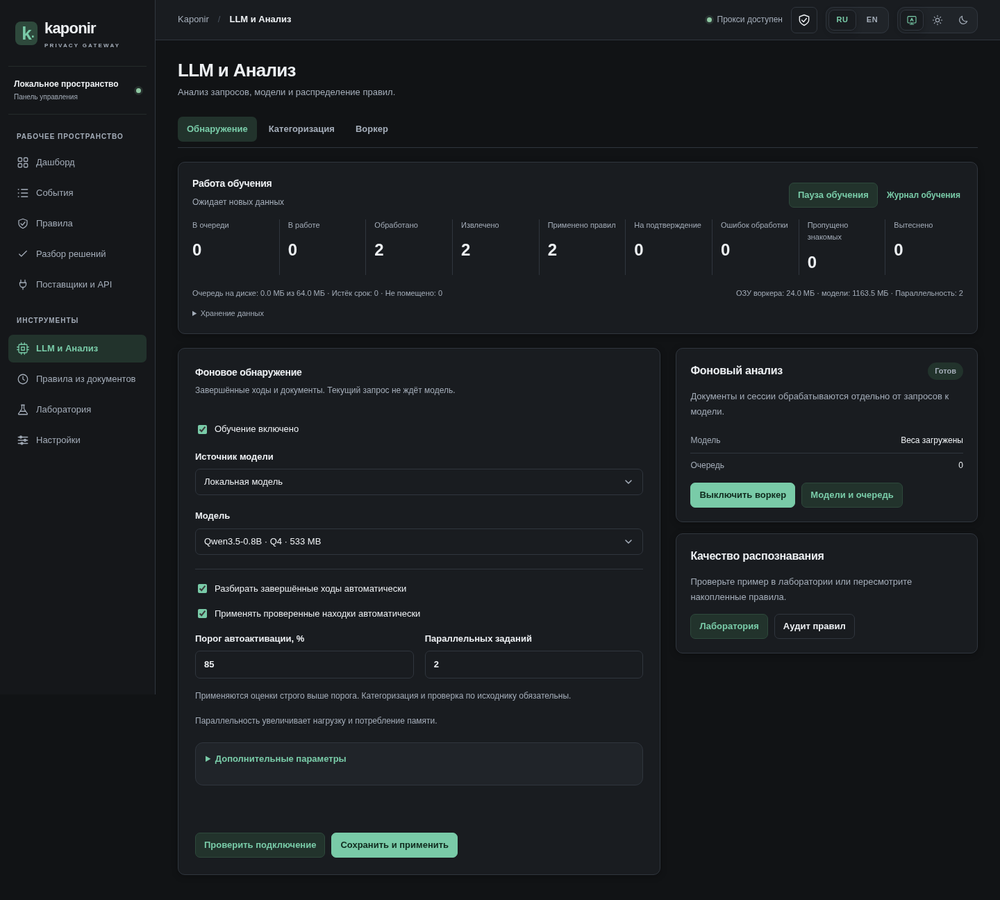
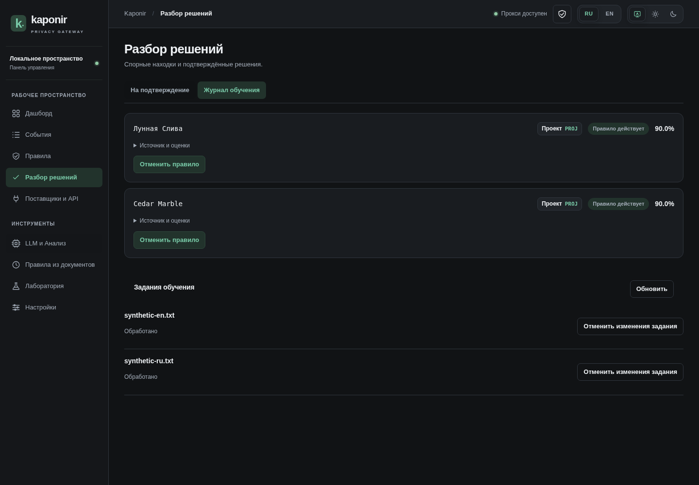

# Фоновый анализ и обучение правилам

[Документация](README.md) · [Панель управления](CONTROL_PANEL.md) · [Воркер](WORKER.md)

Клиентский запрос обрабатывают детекторы, действующие правила и память. Прокси не ждёт
LLM или HTTP S1 при маскировании. После успешного завершения ответа создаётся фоновое
задание; SSE даёт одно задание после окончания потока. Ошибки, прерванные потоки и
`count_tokens` автоматически не анализируются.

Фоновое обучение помогает следующим запросам. Оно не гарантирует обнаружение неизвестного
секрета в первом запросе и не устраняет конкуренцию за CPU/память на общей машине.

## Включение и настройки

Откройте **LLM и Анализ → Обнаружение**. Выберите локальную модель либо API, сохраните
подключение и включите обучение. Новые установки создаются с выключенным обучением.
Ключи API хранятся зашифрованными в vault; GET возвращает только признак сохранённого ключа.
Проверка подключения использует черновик формы и синтетический пример, не сохраняет настройки.
В выбранный API передаётся текст фонового анализа; используйте доверенное подключение.

**Категоризация** настраивается отдельно: локальная Qwen, S1/Choice либо выключено.
Поддерживаются OpenAI-compatible и SystemOne Choice. Старый probabilities-контракт
не выдаёт оценку правильности категории и не подходит для автоматического применения.
L0–L2 относятся к прежним CLI/S1-интерфейсам; новый фоновый сценарий не использует эти уровни.

Автоактивация проверенных находок включена по умолчанию после настройки обучения, порог — 85%.
Категоризация по умолчанию локальная, модель Qwen3-0.6B Q4; веса загружаются отдельно.
Разные модели для обнаружения и категоризации допустимы. При смене локальной модели
воркер дожидается окончания запросов к прежним весам.

Параллельность настраивается от 1 до 10, по умолчанию 1. Для API параллельно выполняются
независимые обращения. Локальный llama-server получает соответствующее число слотов и
контекст 4096 токенов на слот; рост параллельности увеличивает память и нагрузку на CPU.
Одновременные обращения используют одни загруженные веса. В стандартном Compose
воркер ограничен 2 CPU и 2560 МиБ: для высокой параллельности локальной модели
может потребоваться увеличить ресурсы сервиса. Файловые задания воркера
выполняются отдельно от текущего пакета модельных обращений.

Общая **Пауза обучения** прекращает сбор новых ходов, останавливает обработку и освобождает
процесс модели. Очередь и настройки сохраняются, существующие правила продолжают работать.
Возобновление не скачивает веса автоматически. Воркер можно выключить отдельно.

## Источники, проверки и уверенность

Из диалога берутся новые входные сообщения, включая текстовые результаты инструментов.
Системные инструкции не являются источником обучения; ответы ассистента используются
как контекст, а не как самостоятельное основание для автоматического правила.
Бинарные вложения не копируются в очередь. Для изображений/PDF используется файловый
воркер с извлечением текста и OCR.

Для документа в браузере выберите **Фоновый LLM-анализ**. В файловом воркере используйте
режим `configured`, который ставит извлечённые документы в общую очередь обучения.
Быстрый локальный предпросмотр документов остаётся доступен отдельно.

Повторная история хода не ставится в очередь заново. Идентичные документы, в том числе
под другим именем, не создают повторных заданий. Обработанные фрагменты запоминаются
отпечатками. Известные точные MASK-значения исключаются из повторного поиска; документ,
содержащий только известные значения и подписи полей, можно пропустить. Наличие множества
известных секретов не служит основанием пропустить оставшийся новый текст.

Модель возвращает точное значение и оценку уверенности. Сервер проверяет присутствие
значения в исходном тексте, сохраняет короткую цитату и отбрасывает заглушки, публичные
термины и известные ложные срабатывания. Категоризатор предлагает тип и контур.
Итоговая оценка — минимум уверенности обнаружения и категоризации.

Автоматически применяется только результат **строго выше 85%**, прошедший проверки.
Ровно 85%, отсутствующая оценка и недоступная категоризация требуют подтверждения.
Оценка модели не является измеренной вероятностью правильности решения.

Создаются только точные MASK-правила; существующие ручные правила и исключения не
перезаписываются. Подтверждение человеком позволяет выбрать тип и контур.
Обучение здесь означает накопление правил и решений, а не дообучение весов LLM.

## Виджет и журнал

Виджет показывает очередь, обработанные задания, извлечённые значения, применённые правила,
ожидание подтверждения, ошибки, вытеснение, объём очереди на диске и измеренную память
воркера/модели. На Linux используется RSS процессов; на неподдерживаемой платформе
память отображается как недоступная, а не как нулевой расход. Счётчики сохраняются
независимо от срока хранения подробного журнала. Они относятся к заданиям/находкам,
а не к измеренной полноте распознавания.

В **Разборе решений** доступны **На подтверждение** и **Журнал обучения**. Журнал содержит
источник, цитату, модели, оценки, результат применения и ошибку. Можно повторить неуспешное
задание, отменить отдельное созданное правило или изменения целого задания.

Откат отключает собственное правило обучения и блокирует повторную автоматическую активацию
этого значения. Изменённое вручную правило требует проверки в редакторе правил. Откат не
удаляет токены: старые ответы остаются восстанавливаемыми. После удаления подробного
журнала правило по-прежнему доступно в общем редакторе и аудите.

## Ограничения хранения

Исходники очереди зашифрованы в vault и отделены от 200 событий инспектора.
Максимум — 1000 ожидающих/выполняемых заданий и 64 МиБ зашифрованных данных исходников.
Неуспешные исходники также входят в лимит байтов.

При заполнении вытесняется самое старое ожидающее или неуспешное задание автоматического анализа хода.
Выполняемые задания и вручную переданные документы защищены от вытеснения. Если места
нельзя освободить, новое задание не добавляется; это отражается счётчиком «Не помещено».
Вытеснение означает потерю автоматического разбора этого задания, не потерю созданных правил.

После успешной обработки исходник очереди удаляется. Остальные исходники истекают через
7 дней, подробные задания, цитаты и отпечатки обработанных фрагментов — через 30 дней.
Очистка выполняется периодически; минимальные отметки отклонения сохраняются без текста.
Существующие события инспектора имеют отдельный лимит последних 200 запросов.
SQLite переиспользует освобождённые страницы; размер файла не обязан уменьшаться сразу.
Лимит относится к исходникам очереди: действующие правила и соответствия токенов хранятся
отдельно и могут увеличивать общий объём. Точные значения правил находятся в TOML-файлах,
как и другие пользовательские правила; шифрование относится к vault.
Истёкший документ можно передать заново. Обработанный документ повторно в очередь не добавляется.

## API

- `GET/PUT /api/v1/ui/analysis` — настройки обнаружения: `enabled`, `provider=none|local|api`,
  `model`, `url`, `background`, `auto_apply`, `threshold`, `parallelism`, `timeout_seconds`.
- `GET/PUT /api/v1/ui/categorization` — `provider=none|local|s1`, локальная `model`, HTTP-настройки.
- PUT принимает `{settings, key?, clear_key?}`. Ключ не возвращается в ответе.
- `POST /api/v1/ui/analysis/test` и `/categorization/test` принимают тот же черновик без сохранения.
- `POST /api/v1/ui/analysis/documents` принимает `{documents:[{name,text,format?}]}`.
- `GET /api/v1/ui/learning` — виджет, последние задания и находки; исходники заданий не выдаются.
- `POST /api/v1/ui/learning/{id}/approve|reject|rollback|retry|rollback-job` — действие с телом `{}`;
  для подтверждения можно передать `kind` и `scope`.

При смене подключения старое задание требует явного повтора, чтобы не отправлять его
другому поставщику незаметно. Изменение порога, параллельности и пауза не меняют адресата.
Старые HTTP-настройки S1 переносятся в категоризацию, не включая обучение автоматически.

## Проверки

```sh
python3 scripts/validate_learning.py target/release/kaponir
python3 scripts/validate_console.py target/release/kaponir
# Реальные уже загруженные веса, без автоматической загрузки:
python3 scripts/validate_local_learning.py target/release/kaponir --model-dir /path/to/models
```

Первый сценарий использует локальные имитации API и проверяет отсутствие ожидания LLM,
SSE, порог, параллельность, сохранение очереди, подтверждение и откат. Последний запускает
реальную модель на CPU; его результат зависит от весов и оборудования.

## Пример реальной локальной обработки

Синтетические русское и английское названия обработаны Qwen3.5-0.8B на CPU
с двумя параллельными заданиями. Виджет показывает измеренный RSS и созданные правила.




