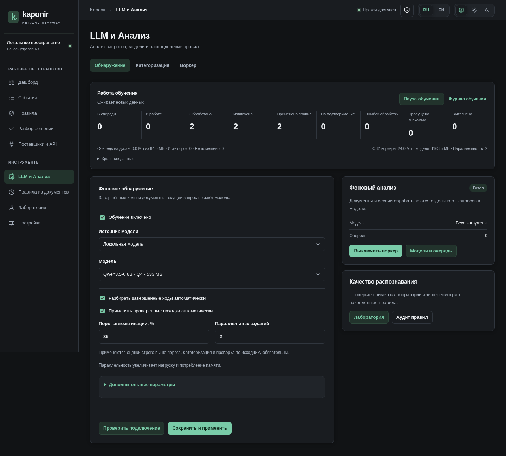
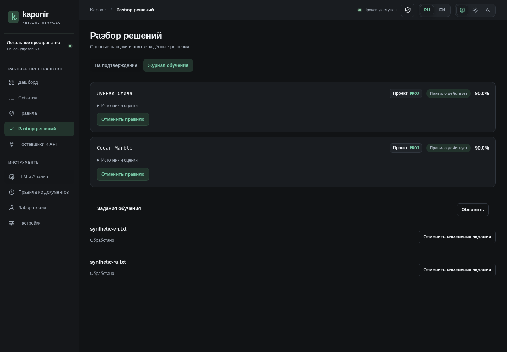

# Фоновый анализ и обучение правилам

[Документация](README.md) · [Панель управления](CONTROL_PANEL.md) · [Воркер](WORKER.md)

Клиентский запрос обрабатывают детекторы, действующие правила и память. Прокси не ждёт
LLM или HTTP S1 при маскировании. После успешного завершения ответа создаётся фоновое
задание; SSE даёт одно задание после окончания потока. Ошибки, прерванные потоки и
`count_tokens` автоматически не анализируются.

Фоновое обучение помогает следующим запросам. Оно не гарантирует обнаружение неизвестного
секрета в первом запросе и не устраняет конкуренцию за CPU/память на общей машине.

## Фоновый поиск кандидатов во время работы

Если вы оставляете поиск работать в фоне, а вечером проверяете находки вручную, выбирайте **Gemma 4 E4B QAT** с поздним пресетом из сравнения ниже, когда важнее пропустить как можно меньше. **Базовая Qwen3.5-2B Q4_K_M** подходит, когда важнее быстрее разобрать очередь и сохранить больше публичного текста. Одну выбранную модель можно использовать и для обнаружения, и для категоризации.

1. Включите локальный воркер в **Настройки LLM → Служба и очередь**. В **Настройки LLM → Обнаружение** выберите **Локальная модель** и нужные веса. Для Gemma пункт каталога называется **Gemma 4 E4B · QAT Q4_0**. Включите **Включить фоновый анализ** и **Автоматически анализировать новые сообщения после ответа**. Установите **Параллельных заданий** в **1** и сохраните настройки.
2. Для вечерней проверки выключите **Автоматически создавать правила**. В разделе **Настройки LLM → Модель и ресурсы** выберите локальную модель и нажмите **Использовать для поиска и проверки**. Вечером нажмите **На подтверждение** в виджете очереди, проверьте предложенные тип и область действия и внесите правки перед применением. Для сбора примеров откройте **Находки → В датасет все N**. Исходные фрагменты попадут в черновики. [Включение сбора и экспорт JSONL](DISCOVERY.md#датасет)
3. Для предыдущих сессий откройте **Настройки LLM → Служба и очередь**. В поле **Способ поиска** выберите **Настроенный фоновый анализ** и нажмите **Разобрать сессии прокси**. Это разово ставит в обработку тексты, ещё доступные в инспекторе (до 200 последних запросов). Для более старой переписки, если у вас сохранился экспорт, передайте его как документ. [Как работает разбор сессий](WORKER.md#анализ-сессий-что-доступно)

**Параметры при выборе модели.** В разделах **Обнаружение** и **Категоризация** WebUI подставляет параметры из соответствующего эксперимента. При необходимости измените лимиты до нажатия **Сохранить и применить**. Например, базовая Qwen3.5-2B для поиска получает контекст 4096, ответ до 1600 токенов и выключенные рассуждения. Для категоризации контекст равен 16384, ответ — до 4096, бюджет рассуждений — 2048. Повтор при усечении ограничен 8192 токенами и свободным местом в контексте. Ручные изменения сохраняются при перезагрузке. Для семантического поиска во вкладке **Настройки LLM → Служба и очередь** профиль поиска записывается в задание при его создании.

Встроенный каталог включает 13 моделей тиров S, A и B и прежние варианты Qwen3-0.6B. Для поиска WebUI использует итоговую таблицу от 22 ноября. Для MiniCPM5-2B в архиве указаны только лимиты контекста и ответа. Для Gemma 4 E2B-it параметры исторического поиска неизвестны, поэтому выбор модели подставляет обычные настройки. Для категоризации используются параметры отдельного прогона на готовых целях. Установленный GGUF можно выбрать для обеих задач. Если воркер работает на отдельной машине, обновите на ней службу анализа вместе с WebUI. [Финальная таблица поиска](experiments/model-search-final.csv) · [Сравнение на готовых целях](experiments/MODEL_RESEARCH_SUMMARY.md)

**Полный поиск на трёх документах.** Числа показывают результат маскирования документа через Kaponir. Одно значение может встретиться несколько раз.

| Модель и прогон | Полностью скрыто приватных вхождений из 193 | Затронуто публичных вхождений из 87 | Время запросов к модели |
| --- | ---: | ---: | ---: |
| Базовая Qwen3.5-2B Q4_K_M, архивный прогон | 173 | 3 | 7,08 мин |
| Gemma 4 E4B QAT, архивный пресет | 173 | 10 | 11,75 мин |
| Gemma 4 E4B QAT, настроенный пресет от 22 ноября | **190** | **5** | **12,26 мин** |

По квитанциям маскирования настроенная Gemma сохранила все 173 скрытия Qwen и добавила 17, преимущественно в журнале приложения. За весь корпус она затронула на два публичных вхождения больше и работала на 5,18 минуты дольше. Эти числа относятся к поиску. Для выбора типа и области уже найденной позиции нужен отдельный тест категоризации. Время отклика прокси во время обычной работы в этом опыте не измерялось.

Настроенный пресет использовал температуру 0, контекст 16 384 и лимит ответа 4 096 токенов. Для исходного текста до 1 024 токенов включались рассуждения с бюджетом 384, для более длинного текста — прямой ответ. Результат 190/193 относится к этой логике запуска из бенчмарка. WebUI подставляет этот пресет при выборе Gemma QAT в обнаружении. Воркер определяет режим по токенам всего исходного документа до разбиения на фрагменты. Для профилей с отдельными параметрами журналов применяет их к файлам с расширением .log. План `runs/gemma/full-short-thought384-long-direct/plan.json` и квитанции масок доступны в архиве. [Финальная таблица с настройками](experiments/MODEL_RESEARCH_SUMMARY.md#итоговые-профили-поиска-для-15-моделей) · [Первичные измерения](../research/privacy-policy-phase2/checkpoints/four-models-fresh-tuning/evidence.tar.gz) · [Архивные показатели](experiments/single-model-ranking.csv)

Если рабочая сессия замедляется, сравните задержку похожих запросов с активной очередью и на паузе. Для Docker Compose квота воркера задаётся `KAPONIR_WORKER_CPUS`; меньшее значение оставляет больше времени процессора другим приложениям и замедляет разбор очереди. Воркер также можно запускать на другой машине. [Ограничения ресурсов](WORKER.md#qwen35-и-ресурсы) · [Удалённый воркер](WORKER.md#4-worker-на-другом-сервере)

## Включение и настройки

Откройте **Настройки LLM → Обнаружение**. Выберите локальную модель либо API и включите
**Включить фоновый анализ**. Новые установки создаются с выключенным анализом.
Настройки можно сохранить без весов: виджет покажет, какая модель или среда запуска нужна,
а очередь продолжится после подготовки. Скачивание начинается только по **Скачать на сервер**.
Для ручной установки есть **Установить без интернета** и **Проверить файлы**;
см. [установку моделей](WORKER.md#установка-моделей-и-закрытый-контур).
Ключи API хранятся зашифрованными в vault; GET возвращает только признак сохранённого ключа.
**Проверить запуск** загружает выбранный GGUF с параметрами формы и запрашивает токены короткой строки у локального llama-server. На экране видны прошедшее время и предел ожидания. Для внешнего API проверка отправляет синтетический пример. Для сохранения параметров нажмите **Сохранить и применить**.

### Выбор модели и сценария для документа

1. В **Настройки LLM → Обнаружение** выберите модель. Проверенные скачанные веса находятся в начале списка. При выборе изученной модели заполняются параметры её поискового прогона.
2. В **Категоризация** можно выбрать ту же модель. Поле **Сценарий проверки найденных значений** заполняется лучшим вариантом для этой модели по баллу исследования. Например, для базовой Qwen3.5-2B это B, для Gemma 4 E4B QAT — D. Ручной выбор сохраняется. Кнопка **Восстановить рекомендованные настройки** возвращает профиль в форму. [Таблица результатов](experiments/model-search-final.csv)
3. Нажмите **Анализ документа**. Выберите файл или вставьте текст. Оставьте **Из настроек категоризации** либо выберите сценарий только для этого запуска. Для каталога и прошлых сессий такой же выбор есть в **Настройки LLM → Служба и очередь → Настроенный фоновый анализ**.
4. Откройте **Находки**. Для проверенных значений видны решение и причина. Сценарии A–D оставляют применение правил на ручное подтверждение.

| Сценарий | Что получает модель и что возвращает |
| --- | --- |
| A | Значение и контекст. Модель выбирает скрыть, оставить или отправить на проверку и указывает тип, область правила и цитату. |
| B | Та же задача с инструкцией о приватности из исследования. |
| C | Вариант B с отметкой точного вхождения внутри строки. |
| D | Выделенное вхождение и инструкция о приватности. Модель возвращает решение и короткую причину. |

Сценарий запускается после поиска кандидатов. Если C или D не может однозначно выделить вхождение, значение поступает на ручную проверку. Для API используются выдержки из текста, локальной модели также доступен короткий исходный документ. [Методика A–D](experiments/PRIVACY_RULE_REVIEW.md)

**Категоризация** настраивается отдельно: локальная Qwen, S1/Choice либо выключено.
Поддерживаются OpenAI-compatible и SystemOne Choice. Старый probabilities-контракт
не выдаёт оценку правильности категории и не подходит для автоматического применения.
L0–L2 относятся к прежним CLI/S1-интерфейсам; новый фоновый сценарий не использует эти уровни.

Автоактивация проверенных находок включена по умолчанию после настройки обучения, порог — 85%.
Категоризация по умолчанию локальная, модель Qwen3-0.6B Q4; веса загружаются отдельно.
Разные модели для обнаружения и категоризации допустимы. При смене локальной модели
воркер дожидается окончания запросов к прежним весам.

**Автоматически анализировать новые сообщения после ответа** управляет сбором новых
входных сообщений после успешного ответа прокси. При выключении можно отправлять документы
вручную. **Автоматически создавать правила** применяет только прошедшие все проверки
находки строго выше порога; при выключении все находки требуют подтверждения.
Пояснения у переключателей открываются по `?` с клавиатуры, наведением или нажатием.
Они показывают последствия обоих состояний. Обучение здесь означает
накопление правил и решений, а не изменение весов модели.

Параллельность настраивается от 1 до 10, по умолчанию 1. Для API параллельно выполняются
независимые обращения. Локальный llama-server получает соответствующее число слотов и
контекст 4096 токенов на слот; рост параллельности увеличивает память и нагрузку на CPU.
Одновременные обращения используют одни загруженные веса. В стандартном Compose
для воркера заданы пределы 2 CPU и 8 GiB. Высокая параллельность может потребовать больше ресурсов. Файловые задания воркера
выполняются отдельно от текущего пакета модельных обращений.

Общая **Приостановить анализ** прекращает сбор новых ходов, останавливает обработку и освобождает
процесс модели. Очередь и настройки сохраняются, существующие правила продолжают работать.
Возобновление не скачивает веса автоматически. Воркер можно выключить отдельно.

## Источники, проверки и уверенность

Из диалога берутся новые входные сообщения, включая текстовые результаты инструментов.
Системные инструкции не являются источником обучения; ответы ассистента используются
как контекст, а не как самостоятельное основание для автоматического правила.
Бинарные вложения не копируются в очередь. Для изображений/PDF используется файловый
воркер с извлечением текста и OCR.

Для документа в браузере выберите **Фоновый LLM-анализ**. В файловом воркере используйте
режим `configured`, который ставит извлечённые документы в общую очередь обучения.
Быстрый локальный предпросмотр документов остаётся доступен отдельно.

Повторная история хода не ставится в очередь заново. Идентичные документы, в том числе
под другим именем, не создают повторных заданий. Обработанные фрагменты запоминаются
отпечатками. Известные точные MASK-значения исключаются из повторного поиска; документ,
содержащий только известные значения и подписи полей, можно пропустить. Наличие множества
известных секретов не служит основанием пропустить оставшийся новый текст.

Модель возвращает точное значение и оценку уверенности. Сервер проверяет присутствие
значения в исходном тексте, сохраняет короткую цитату и отбрасывает заглушки, публичные
термины и известные ложные срабатывания. Категоризатор предлагает тип и контур.
Для автоматического применения используется минимум оценок обнаружения и категоризации.
В разборе решений оценки подписаны отдельно: если категоризация выключена, не выполнялась
или завершилась ошибкой, интерфейс показывает причину вместо необъяснённого прочерка.
Самооценка обнаружения не означает, что тип проверен.

Формат значения проверяется независимо от модели. Сумма или процент не может получить
тип человека или сервиса: такая находка нормализуется в AMOUNT, исходный тип сохраняется.
Исправленная таким образом находка не создаёт автоматическое правило и требует подтверждения.
Одна форма числа ещё не доказывает конфиденциальность. Количества с единицами и строки дат
не принимаются как имена. Неоднозначные результаты требуют проверки.

Автоматически применяется только результат **строго выше 85%**, прошедший проверки.
Ровно 85%, отсутствующая оценка и недоступная категоризация требуют подтверждения.
Оценка модели не является измеренной вероятностью правильности решения.

Создаются только точные MASK-правила; существующие ручные правила и исключения не
перезаписываются. Подтверждение человеком позволяет выбрать тип и контур.
Обучение здесь означает накопление правил и решений, а не дообучение весов LLM.

## Виджет и журнал

В **Настройки LLM → Служба и очередь** виджет показывает, сколько заданий ожидают и выполняются сейчас. График отражает успешные завершения за последние 24 часа, один столбец на час. **Обработано за час** — фактическое число успешных завершений за последние 60 минут. Интервалы обновляются с точностью до минуты. **Среднее время задания** учитывает время от начала до окончания успешной попытки за эти сутки, включая категоризацию, если она включена. Ожидание в очереди, неудачные и прерванные попытки исключены. Прочерк означает, что замеров пока нет.

Почасовая статистика сохраняется при перезапуске. При первом обновлении виджет указывает время начала измерений. **На подтверждение** открывает ожидающие LLM-находки. Раздел **Итоги за всё время** сохраняет прежние накопленные счётчики.

Виджет также показывает извлечённые значения, применённые правила,
ожидание подтверждения, ошибки, вытеснение, объём очереди на диске и измеренную память
воркера/модели. На Linux используется RSS процессов; на неподдерживаемой платформе
память отображается как недоступная, а не как нулевой расход. Счётчики сохраняются
независимо от срока хранения подробного журнала. Они относятся к заданиям/находкам,
а не к измеренной полноте распознавания.

В **Разборе решений** доступны **На проверку** и **История**. Общая очередь содержит решения
быстрых детекторов и фоновые находки, источник, цитату, модели, отдельные оценки,
результат применения и ошибку. Доступны фильтры, сортировка и группировка. Пакетная операция
действует только на явно выбранные записи; перед записью показаны её точные последствия.
Можно повторить неуспешное задание, отменить отдельное созданное правило или изменения задания.

**Пересмотреть моделью** — отдельная асинхронная операция. По умолчанию берётся настроенная
категоризация, иначе модель обнаружения; источник можно выбрать. Модель получает выбранные
значения и короткий контекст, другие распознанные секреты скрываются. Рекомендация хранится
зашифрованной и не меняет исходную оценку детектора. При недоступной модели видна ошибка,
подмена эвристикой не выполняется. Рекомендация становится устаревшей после изменения
контекста, типа или подключения; применить её нельзя до повторного пересмотра.
Рекомендации и завершённые задания пересмотра удаляются через 30 дней; очистка выполняется
при запуске и каждый час. Прерванные перезапуском задания не отправляются повторно сами.

**Авто по рекомендации** выбирает тип и контур правила, а не отдельный проект или пространство.
Рекомендация применяется только после явного подтверждения. MASK создаёт точное правило,
KEEP — точное исключение для детектора, закрытие записи не создаёт правила. Отклонение
LLM-находки сохраняет отрицательное решение без KEEP. Пересмотр не переобучает детекторы:
для изменения их весов есть отдельная [задача развития](ROADMAP.md).

Откат отключает собственное правило обучения и блокирует повторную автоматическую активацию
этого значения. Изменённое вручную правило требует проверки в редакторе правил. Откат не
удаляет токены: старые ответы остаются восстанавливаемыми. После удаления подробного
журнала правило по-прежнему доступно в общем редакторе и аудите.

## Ограничения хранения

Исходники очереди зашифрованы в vault и отделены от 200 событий инспектора.
Максимум — 1000 ожидающих/выполняемых заданий и 64 МиБ зашифрованных данных исходников.
Неуспешные исходники также входят в лимит байтов.

При заполнении вытесняется самое старое ожидающее или неуспешное задание автоматического анализа хода.
Выполняемые задания и вручную переданные документы защищены от вытеснения. Если места
нельзя освободить, новое задание не добавляется; это отражается счётчиком «Не помещено».
Вытеснение означает потерю автоматического разбора этого задания, не потерю созданных правил.

После успешной обработки исходник очереди удаляется. Остальные исходники истекают через
7 дней, подробные задания, цитаты и отпечатки обработанных фрагментов — через 30 дней.
Очистка выполняется периодически; минимальные отметки отклонения сохраняются без текста.
Существующие события инспектора имеют отдельный лимит последних 200 запросов.
SQLite переиспользует освобождённые страницы; размер файла не обязан уменьшаться сразу.
Лимит относится к исходникам очереди: действующие правила и соответствия токенов хранятся
отдельно и могут увеличивать общий объём. Точные значения правил находятся в TOML-файлах,
как и другие пользовательские правила; шифрование относится к vault.
Истёкший документ можно передать заново. Обработанный документ повторно в очередь не добавляется.

## API

- `GET/PUT /api/v1/ui/analysis` — настройки обнаружения: `enabled`, `provider=none|local|api`,
  `model`, `url`, `background`, `auto_apply`, `threshold`, `parallelism`, `timeout_seconds`.
- `GET/PUT /api/v1/ui/categorization` — `provider=none|local|s1`, локальная `model`, HTTP-настройки и `scenario=standard|A|B|C|D`.
- PUT принимает `{settings, key?, clear_key?}`. Ключ не возвращается в ответе.
- `POST /api/v1/ui/analysis/test` и `/categorization/test` принимают тот же черновик без сохранения.
- `POST /api/v1/ui/analysis/documents` принимает `{documents:[{name,text,format?}], scenario?}`. Без параметра `scenario` задание использует настройку категоризации.
- `GET /api/v1/ui/learning` — виджет, последние задания и находки; исходники заданий не выдаются.
- `POST /api/v1/ui/learning/{id}/approve|reject|rollback|retry|rollback-job` — действие с телом `{}`;
  для подтверждения можно передать `kind` и `scope`.
- `GET /api/v1/ui/review` — объединённая очередь; `status=pending|history|all`, `source`,
  `q`, `kind`, `action`, `sort`, `keys`, `offset`, `limit` (до 100).
- `POST /api/v1/ui/review/jobs` — `{keys:["detector:…","learning:…"], model_source:"auto"}`;
  до 64 явно выбранных записей, максимум два одновременных задания.
- `GET /api/v1/ui/review/jobs/{id}` — состояние и безопасный код ошибки пересмотра.
- `POST /api/v1/ui/review/{origin}/{id}/{action}` — применение рекомендации
  (`action=apply`, `use_recommendation=true`), ручные `mask|keep|dismiss|reject`,
  `reopen` закрытой записи, `rollback` собственного неизменённого правила.
- `POST /api/v1/ui/review/from-event` — `{event_id,indexes:[…]}`: явно выбранные новые
  встроенные замены из инспектора в очередь. Защищённые секреты, правила и кэш исключены.

При смене подключения старое задание требует явного повтора, чтобы не отправлять его
другому поставщику незаметно. Изменение порога, параллельности и пауза не меняют адресата.
Старые HTTP-настройки S1 переносятся в категоризацию, не включая обучение автоматически.

## Проверки

```sh
python3 scripts/validate_learning.py target/release/kaponir
python3 scripts/validate_review.py target/release/kaponir
python3 scripts/validate_console.py target/release/kaponir
# Реальные уже загруженные веса, без автоматической загрузки:
python3 scripts/validate_local_learning.py target/release/kaponir --model-dir /path/to/models
```

Первый сценарий использует локальные имитации API и проверяет отсутствие ожидания LLM,
SSE, порог, параллельность, сохранение очереди, подтверждение и откат. Последний запускает
реальную модель на CPU; его результат зависит от весов и оборудования.
Проверка сметы, ошибок финансовых типов и пропусков: [отчёт о качестве](REVIEW_QUALITY.md).

## Пример реальной локальной обработки

Синтетические русское и английское названия обработаны Qwen3.5-0.8B на CPU
с двумя параллельными заданиями. Виджет показывает измеренный RSS и созданные правила.





## Бюджет и разбиение модели

В «Дополнительных параметрах» обнаружения и категоризации доступны `inference`:
`context_tokens`, `max_output_tokens`, `reserve_tokens`, `batch_size`, `response_format`. Значения по
умолчанию — 4096, 1600, 64, 2 и `auto`. Это изменяемые стартовые настройки, а не пределы
выбранной GGUF или рекомендации для каждой модели. Бюджет входа не превышает
`context_tokens - max_output_tokens - reserve_tokens`. На локальной модели он
проверяется её chat template и токенизатором до генерации. Контекст задаётся
на слот; параллельность увеличивает общий расход памяти.

Для API без доступного токенизатора планирование использует UTF-8 байты как
консервативную меру, а диагностика сохраняет usage провайдера. Эта оценка не
учитывает неизвестные внутренние инструкции и reasoning самого сервиса.
Схема JSON дублируется в инструкции: некоторые совместимые шлюзы игнорируют
`response_format`. Принимается JSON-документ или целиком обрамлённый JSON-блок,
но не произвольный текст с извлечённым из середины объектом.

Настройки `analysis.chunking`:

| Поле | По умолчанию | Значение |
|---|---:|---|
| `strategy` | `auto` | Объединять абзацы в пределах бюджета; `paragraph` отправляет абзацы отдельно |
| `discovery_mode` | `typed` | Предположительный тип при обнаружении; `values` ищет только значения и оценки |
| `target_input_tokens` | 0 | Дополнительный предел входа; 0 использует доступную вместимость |
| `context_hint_tokens` | 0 | Бюджет преамбулы, заголовков и заголовка таблицы для каждого фрагмента |
| `max_candidates` | 24 | Предел списка находок в одном ответе |
| `max_fragments` | 256 | Предел генераций на документ с учётом повторов |

Длинный абзац делится по абзацам, затем строкам, словам и символам UTF-8.
Разбиение сохраняет исходный текст. При `finish_reason=length` фрагмент делится
повторно. Если весь список заполнен разными цитируемыми значениями, проверяются
меньшие части; повторы и выдуманные значения не вызывают каскад разбиений.
Полученные корректные находки сохраняются, даже если другая часть документа
завершилась ошибкой. Неполный результат требует подтверждения и не создаёт
правила автоматически; исходник остаётся доступным для повтора.

В режиме `values` находка имеет `CUSTOM`, пока категоризация или пользователь не
определит тип. Это позволяет не заставлять маленькую модель одновременно искать
все значения и выбирать тип. Категоризация и пересмотр получают значение и цитату
без исходной подсказки типа; исходная оценка детектора остаётся в истории.

История задания содержит модель и раскрываемую диагностику: вход, выход,
контекст, лимит ответа, finish reason, HTTP-статус или код завершения процесса.
Исходные документы, ключи и текст ответа модели в диагностике не сохраняются.

Профиль модели участвует в идентификаторах документов и отпечатках обработанного
текста. После изменения модели или бюджета явно загруженный заново документ
проверяется снова; изменение настроек само не отправляет старые документы новому
поставщику. Смена профиля делает прежние незавершённые задания и рекомендации
устаревшими, как смена подключения.

Методика и измеренные ограничения: [эксперименты с инференсом](INFERENCE_EXPERIMENTS.md).
