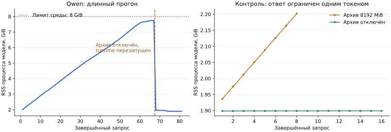

# Сравнение схем обнаружения и проверки: состояние на 14 ноября 2026

**Общая матрица четырёх моделей завершена**, включая Qwen3.5-0.8B и последний
аудит Huihui. После восстановления среды продолжены сохранённые запросы.
Базовые контроли thinking и полного контекста трёх младших моделей завершены.
Отдельные диагностики формата и одного кандидата на запрос завершены. Аудит
внутренних детекторов и отложенная проверка выбранного добавляющего поиска завершены.
Общий победитель по автоматической разметке не объявляется.

Исправления runtime и интерфейса опубликованы в
[4c1b178](https://github.com/miqonee/Kaponir/commit/4c1b178).
Контроли проверки сохраняют каждый ответ. В основном поиске сохранение успешных
ответов до рекурсивного дробления исправлено отдельно: после остановки процесса
они переиспользуются без новых запросов и без дублирования технических записей.
Сводные [таблицы](VALIDATION_TABLES.md) обновляются из
[VALIDATION_RESULTS.json](VALIDATION_RESULTS.json).
Контроли режима и короткие диагностические опыты не смешиваются с этой матрицей.

При возобновлении Nanbeige обнаружилось, что пять завершённых поисковых запросов
имели только технические записи, а ответы ещё не вошли в завершённый документ.
Эта часть потребует повторной генерации. Исправление сохраняет исходный ответ
перед дочерними запросами, проверяет профиль кеша и фиксирует хеши кода в
`discovery_checkpoint_policy`; `discovery_checkpoint_initial_calls=5` отличает
старые записи от нового сохраняемого прогона. Запросы, бюджеты, промпты и правила
оценки не меняются. Восстановление после остановки, привязка к физическим
запросам и ошибки записи проверены отдельными тестами.

## Данные

Это синтетические документы из `tests/docs/input`, не реальные документы пользователя.

| Документ | Содержание | Точных эталонных значений |
|---|---|---:|
| `01-cost-estimate.md` | Закрытая смета: организации, контакты, реквизиты, цены | 67 |
| `02-application.log` | Журнал приложения: аккаунты, пути, адреса, credentials | 25 |
| `08-public-reference.md` | Публичные технологии, даты и идентификаторы; отрицательный контроль | 0 |
| Всего в общей матрице | | 92 |

51 из 92 значений — суммы. Этот перекос важен при оценке общего результата.
Полный набор содержит 8 документов, 219 уникальных значений и 363 вхождения.
Оставшиеся пять документов содержат 127 значений; результаты проверки выбранного
подхода на них приведены отдельно ниже.

Единица — точное значение в документе; повторения дедуплицируются.
Часть ФИО не считается точным совпадением с полным ФИО.
Значения вне эталона включают ошибки границ и не являются автоматически
доказанными ложными срабатываниями. Это оценка списка находок, не измерение
утечек после реального маскирования.

## Общий профиль

- Модели: Qwen3.5-0.8B, MiniCPM5-2B, Qwen3.5-2B, Huihui-Qwen3.5-2B-abliterated, Q4_K_M.
- Runtime: llama.cpp b12038, CPU, 2 потока, один слот.
- Контекст 4096, ответ до 1600 токенов, резерв 64.
- Подсказка документа до 256 токенов, политика `prefix`.
- Пакет до 8 кандидатов, JSON Schema, temperature 0, thinking выключен.
- Экспериментальный контракт проверки: reason до 120 символов, цитата evidence до 160.
- До 24 предложений извлечения на ответ, до 256 фрагментов, timeout 300 секунд.
- S1 и пользовательские правила выключены. Эксперименты не меняют vault и обучение.

Вход считается нативным токенизатором с chat template. Бюджет и алгоритм одинаковы;
границы пакетов и длина видимого контекста могут различаться между токенизаторами.
Таблица получает заголовки столбцов, журнал — запись с продолжениями.
Проверяющий запрос содержит непрозрачный ID, значение, запись и контекст документа;
исходный тип, вероятность и название детектора в него не передаются.

Артефакты моделей закреплены по размеру, SHA-256 и ревизии в
[каталоге worker](../scripts/kaponir_worker.py).
SHA-256 runtime: `3e042c4518a74fc3bdb3edb80e07922ee01d6a3455618952af23f3e546508934`.

SHA-256 исходных документов:

- `01-cost-estimate.md`: `351f59c7e7ce4c0723f9163daa9145bd3696ac0a253062e3c25845a7eb9417c1`
- `02-application.log`: `8b461622d02f3d702834494970e9d293a0476fe9a16d08dff87ab1ba701651e9`
- `08-public-reference.md`: `7585bc2c1300afbdfa71654653d6363f41ba9fed7bb5cf73ffc2702ea359a5b4`

## Какие схемы проверялись

| Код | Действие | Пул |
|---|---|---|
| `detector_proposals` | Контроль без LLM | Все предложения быстрых детекторов |
| `current_union` | Добавить самостоятельный поиск LLM | Детекторы + точные цитаты LLM |
| `point` | Проверить приватность, тип и scope каждого кандидата с его записью | Предложения детекторов |
| `regions` | Найти значения заново в записях срабатывания | Исходные строки и записи |
| `union_point` | Один проверяющий проход | Объединённый пул конкретной модели |
| `double` | Два прохода; второй не видит ответ первого | Тот же объединённый пул |

Проверяющий возвращает `mask`, `keep` или `review`.
Ошибки, отсутствующие ID, неверные цитаты и несовместимые с форматом типы оставляют
значение на проверке. Защищённые credentials нельзя отклонить.
Два согласованных `keep` отклоняют находку; два `mask` подтверждают её при совпадении
типа и scope. Остальное остаётся на проверке.
Независимость входов не означает независимости ошибок одной модели.

Для одного и двух проходов пул одинаков внутри каждой модели.
`regions` создаёт другой список: отсутствие значения в нём — пропуск поиска,
а не успешное отклонение шума.

## Результаты общей матрицы

В ячейке: **осталось эталонных из 92 / осталось вне эталона**.
Первая величина включает записи на ручной проверке.
Она не означает правильные тип/scope или готовность к автоматическому применению.

| Схема | Qwen3.5-0.8B | MiniCPM5-2B | Qwen3.5-2B | Huihui |
|---|---:|---:|---:|---:|
| `detector_proposals` | 68 / 26 | 68 / 26 | 68 / 26 | 68 / 26 |
| `current_union` | 76 / 47 | 77 / 36 | 80 / 51 | 76 / 66 |
| `point` | 68 / 26 | 47 / 5 | 13 / 20 | 27 / 15 |
| `regions` | 30 / 26 | 17 / 6 | 70 / 24 | 47 / 23 |
| `union_point` | 76 / 47 | 50 / 6 | 23 / 34 | 34 / 53 |
| `double` | 76 / 47 | 53 / 11 | 80 / 42 | 71 / 56 |

Как распределяется покрытие объединённого поиска:

| Эталонная группа | Детекторы | Qwen0.8 + детекторы | MiniCPM + детекторы | Qwen2 + детекторы | Huihui + детекторы |
|---|---:|---:|---:|---:|---:|
| Суммы / 51 | 51 | 51 | 51 | 51 | 51 |
| Остальные значения / 41 | 17 | 25 | 26 | 29 | 25 |
| Полные пути / 5 | 0 | 0 | 0 | 1 | 0 |
| Учётные записи / 3 | 0 | 2 | 3 | 1 | 1 |
| Хосты / 3 | 0 | 0 | 0 | 0 | 0 |

Строки путей, учётных записей и хостов входят в «остальные значения».
Это группы по эталонному типу найденного значения, а не оценка типа, выданного LLM.
Полная разбивка по всем типам и схемам — `primary_coverage_by_reference_kind`
в JSON-сводке. Высокое общее покрытие не устраняет эти пропуски.

Сколько предложенных эталонных значений ошибочно отклонено:

| Проверяющая схема | Qwen0.8 | MiniCPM | Qwen2 | Huihui |
|---|---:|---:|---:|---:|
| `point` | 0 | 21 | 55 | 41 |
| `union_point` | 0 | 27 | 57 | 42 |
| `double` | 0 | 24 | 0 | 5 |

Число оставшихся записей на проверке, включая значения вне эталона:

| Проверяющая схема | Qwen0.8 | MiniCPM | Qwen2 | Huihui |
|---|---:|---:|---:|---:|
| `point` | 84 | 35 | 23 | 32 |
| `union_point` | 113 | 39 | 47 | 77 |
| `double` | 113 | 54 | 112 | 117 |

Ноль отклонений Qwen0.8 не является успехом классификации. В `point` все 84
незащищённых кандидата остались на проверке: 33 валидных воздержания и 51 ответ,
не прошедший проверку типа/формата. В `double` на проверке все 113 незащищённых
кандидатов. Ни один применимый `mask/keep` моделью не получен. Запросы при этом
завершались штатно: 74 ответа с `finish_reason=stop`, без транспортных ошибок.

Пул предложений детекторов содержит 94 значения. Это не фактически применённые маски:
текущая политика без S1 и пользовательских правил применяет 32, из которых 15 совпадают
с точным эталоном, а 17 находятся вне него. Частичные границы требуют отдельного разбора.

Сырые детекторы и `current_union` ещё не классифицируют scope: `personal` — начальное
служебное значение. Их нельзя оценивать как готовые решения о приватности.
Поисковые предложения тоже требуют подтверждения.

## Тип и scope

Качество `regions` без 7 эталонных credentials, сохранённых защитой независимо от LLM:

| Модель | Найдено эталонных без защиты | Верный тип | Верный scope | Оба верны |
|---|---:|---:|---:|---:|
| MiniCPM | 10 | 9 | 8 | 7 |
| Qwen | 63 | 9 | 25 | 8 |
| Huihui | 40 | 26 | 9 | 5 |
| Qwen0.8 | 23 | 5 | 3 | 1 |

Знаменатель — найденные точные эталонные значения, не весь набор из 92.
MiniCPM аккуратнее классифицирует небольшую найденную часть, но в этой схеме
не находит суммы из сметы. Qwen находит больше значений, но часто ошибается в типе
и scope. Одной общей «уверенностью» эти свойства описать нельзя.

## Что дала двойная проверка Qwen

Она сохранила все 80 эталонных значений объединённого пула и убрала 9 значений вне
эталона. Но 112 из 131 кандидата остаются на проверке. Совместно подтверждены только
7 эталонных credentials, сохранённых защитой; 3 защищённых предложения вне эталона
тоже нельзя убрать этим протоколом.

Воспроизвелась исходная ошибка: для `1 320,00 ₽` аудит вернул `mask`, но тип `SVC`,
поскольку сумма является ценой услуги. Для `48 600,00 ₽` он вернул `keep` и `MNAME`.
Контроль формата отверг оба ответа.

Все 51 эталонная сумма второго прохода Qwen не прошли проверку формата: типы
в сырых ответах — `MNAME` или `SVC`. В первом проходе эти суммы имели правильный
тип `AMOUNT`, но ошибочное решение `keep`. Поэтому ноль отклонённых эталонов
в двойной схеме достигнут в том числе защитой и ручной проверкой.
Это не правильная автоматическая классификация всех сумм.

В дополнительном record-контроле Qwen2 для `740,00 ₽` вернул `keep`, `AMOUNT`,
scope `team` и точную цитату строки сметы. Через `/tokenize` того же runtime
восстановлена подсказка из 256 токенов: фраза «распространение вне рабочей группы
запрещено» присутствует целиком. Этот конкретный keep нельзя объяснить потерей
заголовка или невалидным JSON. Подсказка, параметры и исходное решение сохранены
в `context_budget_probe` JSON-сводки и архиве `context-budget-probe.json.gz`.

## Накопление памяти runtime

У Qwen воспроизведены разные причины технических сбоев; их нельзя сводить к одной:

| Причина | Измеренное свидетельство | Что сделано |
|---|---|---|
| Переполнение общего контекста при старом делении по байтам | Вход 3201 + ответ 895 = 4096, `length`; лимит ответа 1600 не достигнут | Нативный tokenizer, резерв для ответа до разбиения |
| Накопление отдельного RAM-архива runtime | RSS около 2 → 7.7 GiB, интенсивное вытеснение, OOM=0 | Архив выключен, независимые повторы проверены |
| Исчерпание ответа рассуждениями | Qwen0.8: 8192 reasoning-токена, финального JSON нет; контекст и RAM не исчерпаны | Отдельный явный бюджет reasoning в контроле |

Первый случай подробно описан в [INFERENCE_EXPERIMENTS.md](INFERENCE_EXPERIMENTS.md).
Это воспроизведения на стенде, не установление причины каждого исторического сбоя
на машине пользователя. Штатно завершённые, но неверные решения о приватности
учитываются отдельно от этих технических проблем.

В длинном прогоне Qwen RSS вырос примерно с 2 до 7.7 GiB за 67 завершённых запросов.
OOM не зарегистрирован, но при лимите среды 8 GiB началось интенсивное вытеснение
страниц. Сопоставимые ответы замедлились примерно с 50 до 237–260 секунд.

В b12038 отдельный RAM-архив состояний по умолчанию имеет лимит 8192 MiB.
Запрос `cache_prompt=false` не отключает сохранение состояний в этот архив.

Контроль с теми же весами и однотокенными ответами:

| Настройка RAM-архива | Запросов | Изменение RSS между первым и последним |
|---|---:|---:|
| 8192 MiB | 8 | около +272 MiB |
| Отключён | 16 | около +0.5 MiB |

Worker теперь запускает все модели с `--cache-ram 0 --no-cache-idle-slots`.
Контекст и лимит ответа не уменьшаются.
Два исходных проверяющих пакета Qwen повторены: ответы полностью совпали с прежними,
RSS оставался около 2 GiB.

Это исключение в условиях явно учитывается: MiniCPM и первые 67 запросов Qwen2
выполнены со старым RAM-архивом; продолжение Qwen и Huihui — с исправлением.
Qwen0.8 целиком выполнен с отключённым архивом.
Все запросы запрещают повторное использование prompt; измеренные ответы Qwen
сообщают ноль кешированных токенов. Скорость и холодный RSS разных моделей по этим
запускам не ранжируются. Два совпавших повтора не доказывают правильность решений.

Недоступность рабочей среды прервала наблюдение за Huihui; после восстановления
он завершён из контрольной точки. Причина сбоя самой среды не установлена.



## Внутренние детекторы и политика

Их результаты измерены до LLM. S1 и пользовательские правила выключены.
Подробная диагностика сохраняется в `classifier-audit/result.json` внутри каталога
артефактов; в общей JSON-сводке ей соответствует `internal_classifier_audit`.

| Этап, точные значения | Предложено | В эталоне / 92 | Вне эталона |
|---|---:|---:|---:|
| Встроенный движок | 36 | 15 | 21 |
| Business discovery | 62 | 53 | 9 |
| Объединённые предложения | 94 | 68 | 26 |
| Реально применённые маски | 32 | 15 | 17 |

Business discovery предлагает бизнес-значения для подтверждения; эти предложения
не являются автоматически применёнными масками. Поэтому находки и реальная работа
движка оцениваются отдельно.

15 из 26 предложений вне точного эталона находятся внутри размеченных приватных
отрезков. Это, например, части полного ФИО. Их нельзя автоматически назвать мусором.
Внутренний код `ID` вместо эталонного `CUSTOM` тоже является строгим несовпадением
таксономии, а не доказанной ошибкой приватности.

Есть подтверждённые ошибки: `names` принимает «Межсетевой» и «Оптический» за
фамилии. Вероятность около 0.232 попадает между порогами identity 0.2 и 0.7;
получается `uncertain`, а default-политика `uncertain=mask` применяет маску.
Это ошибка до вызова LLM, её нельзя приписывать модели.

Три лишних предложения в журнале жёстко защищены ещё до LLM: уже анонимизированный
маркер `ANON_SECRET_19` и общие подписи систем `database` / `upstream` в
`credential=database` и `credential=upstream`. `config-keys` трактует значение поля
`credential` как сам секрет; в этих записях поле обозначает систему, для которой
меняется пароль или API-ключ. Уверенность около 0.997 и `hard=true` не делают
эту интерпретацию верной. Проверяющий протокол не может отклонить эти три значения,
поэтому их сохранение не является ошибкой LLM или доказательством её качества.
Исходные кандидаты, вероятности и evidence сохранены в архиве
`classifier-audit--raw.json.gz` вместе с кратким аудитом.

Из 193 размеченных вхождений в калибровке маски затронули 53; полностью покрыли
буквы/цифры 49, весь отрезок — 45. Это буквальное перекрытие координат, не гарантия
приватности. На полном наборе из 363 вхождений соответствующие числа — 137, 119 и 100.
Контрольные публичные вхождения сохранились, однако их набор не включает все обычные
слова: обнаруженные ложные фамилии выше показывают, почему этого контроля недостаточно.

Пользовательского снимка S1 n-gram в рабочей копии нет. Его качество не измерено;
модель не обучается на проверочных эталонах для заполнения таблицы.

## Контроль thinking и полного контекста

Основная матрица выше — профиль с thinking off. Это не доказательство, что такой
режим оптимален для MiniCPM или другой модели. RAM-кеш и thinking — разные настройки.

Отдельный эксперимент сравнивает record/document × thinking off/bounded при общих
бюджетах 16384/4096 и нативном подсчёте токенов. Во втором бюджете ответа до 8192
повторяется только усечённый запрос, если он помещается вместе с тем же полным входом.
Первый обрыв и повтор сохраняются отдельно; неполный результат не становится оценкой качества.

Верификатор получает 32 проверенных отрезка: 16 приватных, распределённых по типам,
и 16 публичных. Это oracle-диагностика LLM с правильными границами, не оценка recall
детекторов. Метки и эталонные типы не передаются в запрос. Здесь отключён обход LLM
для защищённых credentials, чтобы не приписывать модели работу жёстких правил.
Полный текст используется также для отдельного поиска на исходных трёх документах.
Базовые контроли Qwen0.8, Qwen2 и MiniCPM завершены. Дополнительные проверки
формата, native thinking, sampling и одного кандидата на запрос учитываются отдельно. Эти контроли
не смешиваются с матрицей из 92 значений.

Qwen0.8: 16 приватных и 16 публичных эталонных отрезков, жёсткая защита отключена
для измерения самой LLM. Все запросы в строках ниже получили финальный ответ.

| Контекст и формат | Верный mask приватного | Верный keep публичного | Ошибочный keep приватного | Ошибочный mask публичного | Review |
|---|---:|---:|---:|---:|---:|
| Запись, grammar, off | 0 | 0 | 0 | 0 | 32 |
| Запись, grammar, bounded | 0 | 0 | 0 | 0 | 32 |
| Весь документ, grammar, off | 0 | 0 | 0 | 0 | 32 |
| Весь документ, grammar, bounded | 0 | 3 | 5 | 0 | 24 |
| Весь документ, схема в prompt, off | 0 | 0 | 0 | 0 | 32 |

В `document/bounded` модель, например, назвала значение из `password="..."`
«Redis cache key, not a private secret». Из семи сырых ошибочных keep два
отклонил контроль цитат/формата, а пять прошли его. Верная цитата сама по себе
не является проверкой смысла. Это контроль LLM без защиты credentials,
а не доказанная утечка через обычную политику приложения.

В prompt-варианте все пять ответов были строгими JSON-объектами, но содержали
лишь одно решение на пакет из 5–8 кандидатов. Все 32 решения не прошли проверку.
Для отделения этого эффекта от классификации выполнен парный контроль
одного кандидата на запрос на тех же 32 отрезках у трёх младших моделей.

Qwen0.8 в контроле одного кандидата уже завершила все 32 запроса с stop:
снова 32 review и ни одного применимого mask/keep. Невалидных решений стало
17 вместо 7 у record/off с пакетами до 8; валидные воздержания составили остальные
15. Восемь сырых ошибочных keep приватного отвергнуты проверками цитат/формата.
Например, `740,00 ₽` получила тип FNAME и английский пересказ вместо дословного
evidence. Размер пакета один не устранил ошибки этого профиля.

Qwen2, четыре завершённых проверяющих варианта на тех же 32 отрезках:

| Режим | Верный mask приватного | Верный keep публичного | Ошибочный keep приватного | Ошибочный mask публичного | Review |
|---|---:|---:|---:|---:|---:|
| Запись, grammar, off | 0 | 10 | 3 | 0 | 19 |
| Запись, grammar, bounded | 0 | 6 | 6 | 0 | 20 |
| Весь документ, grammar, off | 0 | 11 | 10 | 0 | 11 |
| Весь документ, grammar, bounded | 0 | 7 | 10 | 0 | 15 |

Все 20 запросов завершились с `stop`, без технических сбоев и OOM. Thinking
не улучшил результат; полный документ дал больше ошибочных keep приватного.
Даже более удачный `record/off` не является безопасным автоматическим валидатором.
Это ошибки завершённых ответов; объяснить их только обрывом генерации нельзя.

У Qwen2 один кандидат на запрос также не улучшил record/off: 0 верных mask
приватного, 10 верных keep публичного, 4 ошибочных keep приватного, 0 ошибочных
mask публичного и 18 review. При пакете до 8 ошибочных keep было 3. Все 32 ответа
завершились с stop. Для `740,00 ₽` выданы keep и AMOUNT с дословной цитатой, но
reason начинается с «is a private monetary amount». Формальные проверки
пропускают это противоречие между объяснением и действием. Это сбой выполнения
контракта; по нему нельзя заключить, что модель вообще не распознаёт сумму.
Проверялся тот же трёхвариантный контракт mask/keep/review, а не отдельная схема
с единственным логическим полем приватности.

В отдельном Qwen2 prompt-контроле все пять ответов — строгие JSON-объекты с нужными
8/5/8/5/6 решениями. Исходный контракт оставил 23 случая на review: 8 правильных keep
публичного, 1 ошибочный keep приватного, ни одного принятого mask. В 21 случае причиной
отклонения была только длина reason. Например, верные mask/PERSON/personal и цитата
для ФИО отклонены из-за объяснения длиной 124 символа вместо разрешённых 120.

Это не означает нулевой способности модели распознавать приватное. Дополнительный
разбор **тех же сохранённых ответов, без новой генерации** обрезает только reason до
120 символов, сохраняя проверки ID, цитат, типа и scope. Получается: 12 mask приватного,
8 keep публичного, 4 ошибочных keep приватного, 6 ошибочных mask публичного и 2 review.
Тип и scope одновременно верны у 4 из 12 подтверждённых приватных значений.
Нормализация пропускает и неверные keep; она не делает вариант безопасным для авторазбора.
Основные метрики не заменяются этим анализом. Подробности — `reason_length_diagnostics`
и отдельная таблица диагностики лимита объяснения.

MiniCPM, завершённая основная четвёрка проверок на тех же 32 отрезках:

| Контекст и режим | Верный mask приватного | Верный keep публичного | Ошибочный keep приватного | Ошибочный mask публичного | Review |
|---|---:|---:|---:|---:|---:|
| Запись, off | 1 | 9 | 12 | 4 | 6 |
| Запись, bounded | 0 | 12 | 12 | 0 | 8 |
| Весь документ, off | 0 | 14 | 14 | 0 | 4 |
| Весь документ, bounded | 2 | 13 | 12 | 1 | 4 |

В полном контексте ограниченное thinking подтверждает два приватных значения
с верными типом и scope; в режиме off оба отправлены на проверку. Ошибочных keep
приватного у bounded на два меньше, но это другие значения.
Обобщённого правила «всегда выключать thinking» по этим данным нет. Оба варианта
при этом дают много неверных keep. Native thinking и рекомендуемый sampling
MiniCPM проверены отдельно ниже; bounded не объявляется оптимальным режимом модели.

В сохранённых ответах видна и смысловая ошибка: MiniCPM выдаёт keep для
`cache.fixture.N8v2Q6z9`, объясняя, что это «внутренний пароль Redis команды».
Другие keep ссылаются на внутренний хост или рабочий контакт как на основание
не скрывать значение. Модель распознаёт часть назначения, но неверно связывает
его с приватностью. Это отдельная проблема от обрыва генерации и ошибок границ
детекторов: в этом контроле границы проверены, финальные ответы получены.

В отдельном MiniCPM prompt-контроле все пять ответов завершились с stop, но каждый
содержал повреждённый JSON: повторные открывающие конструкции `{"{"id"` или лишние
закрывающие скобки. Один ответ был дополнительно обёрнут в Markdown, но ошибка
оставалась и внутри блока. Все 32 случая остались на review. Это ошибка контракта
вывода, не усечение; строки не исправляются вручную для улучшения метрик.

Парный контроль размера пакета: те же 32 отрезка, record/off, общие бюджеты
16384/4096, grammar. Меняется только число кандидатов на запрос.

| Модель | Кандидатов на запрос | Верный mask приватного | Верный keep публичного | Ошибочный keep приватного | Ошибочный mask публичного | Review | Верны тип и scope / mask приватного |
|---|---:|---:|---:|---:|---:|---:|---:|
| Qwen0.8 | до 8 | 0 | 0 | 0 | 0 | 32 | — |
| Qwen0.8 | 1 | 0 | 0 | 0 | 0 | 32 | — |
| Qwen2 | до 8 | 0 | 10 | 3 | 0 | 19 | — |
| Qwen2 | 1 | 0 | 10 | 4 | 0 | 18 | — |
| MiniCPM | до 8 | 1 | 9 | 12 | 4 | 6 | 0/1 |
| MiniCPM | 1 | 4 | 9 | 8 | 5 | 6 | 2/4 |

У MiniCPM индивидуальная проверка улучшила часть решений о приватности, но
увеличила число ошибочных mask публичного с 4 до 5. Из четырёх подтверждённых
приватных значений тип и scope одновременно верны у двух. У обеих Qwen улучшения
не получено. Все 96 индивидуальных запросов завершились с stop. Это частичное
подтверждение подхода для MiniCPM в данном контракте, не основание для автоотсева.

Поиск по целым документам Qwen0.8 вместе с детекторами:

| Профиль | В эталоне / 92 | Вне эталона | Документов завершено |
|---|---:|---:|---:|
| Полный документ, off | 68 | 30 | 3/3 |
| Полный документ, bounded | 70 | 31 | 3/3 |
| Исходный поиск по фрагментам, off | 76 | 47 | 3/3 |

Те же поисковые профили Qwen2:

| Профиль | В эталоне / 92 | Вне эталона | Документов завершено |
|---|---:|---:|---:|
| Полный документ, off | 74 | 33 | 3/3 |
| Полный документ, bounded | 77 | 32 | 3/3 |
| Исходный поиск по фрагментам, off | 80 | 51 | 3/3 |

Те же поисковые профили MiniCPM:

| Профиль | В эталоне / 92 | Вне эталона | Ответов получено |
|---|---:|---:|---:|
| Полный документ, off | 81 | 29 | 3/3 |
| Полный документ, bounded | 68 | 27 | 3/3 |
| Исходный поиск по фрагментам, off | 77 | 36 | 3/3 |

MiniCPM `document/off` — лучший добавляющий поиск среди трёх моделей в общем
полном профиле на этой калибровке. Поверх детекторов добавлены 13 точных значений,
включая все три эталонных хоста и три учётные записи. Суммы уже были найдены
детекторами. Это не проверка приватности, типа или scope и не отложенный результат.

Качество сырых ответов остаётся проблемой. В смете отклонены 115 повторов
`смета-041`, отсутствующего в исходном тексте. Два ответа содержали предельные
128 строк кандидатов, в том числе дубликаты; получение финального JSON не означает
полного осмысленного перебора документа. На смете первый ответ оборвался на
4096 токенах; повтор на том же входе завершился на 4144 из разрешённых 8192.
В основном контроле все 27 запросов сохранены: 26 stop и одно успешно повторённое
length. Два перезапуска среды отражены отдельно, готовые ответы переиспользованы.

У Qwen2 ограниченное thinking немного улучшило полноту поиска по целому документу,
но ухудшило проверку отдельных кандидатов. Режим не выбирается одинаковым для всех задач.
Все три первоначальных усечения поискового контроля успешно повторены. После
22 сохранённых ответов процессы среды были перезапущены; контроль продолжен с
переиспользованием ответов. Это отражено в `runtime_restarts`, без изменения профиля.

Это сравнение политик поиска: у полных документов дополнительно увеличены
контекст, лимит ответа и число предложений. Его нельзя выдавать за изолированный
эффект одной длины входа. В полном профиле четыре первоначально усечённых ответа
повторены на том же входе с большим лимитом; все повторы завершены.

В первоначальном native-on контроле Qwen0.8 дважды исчерпал 4096, а затем 8192
токена ответа исключительно рассуждениями: финального JSON не было. Вход из 2631
токена вместе с ответом помещался в контекст 16384; RSS был около 1.05 GiB.
Это воспроизведённое исчерпание лимита генерации, не OOM и не переполнение входа.
Этот контроль остановлен с явным статусом `interrupted`; незапрошенные случаи
не получают оценку качества.

В парном профиле `bounded` нативный бюджет рассуждений равен половине первоначального
бюджета ответа: 2048 из 4096. Это общий настраиваемый параметр, без условий по имени
модели. Первый запрос Qwen0.8 завершился штатно: 2047 токенов reasoning и полный JSON.
Это доказательство технического завершения, не качества классификации. Отдельный
native-on поиск по полным документам проверен без этого ограничения; режим MiniCPM
проверялся независимо от результатов Qwen.

На полной смете native-on Qwen0.8 также исчерпал 4096, затем 8192 токена исключительно
рассуждениями, без финального ответа. Вход 2612 + ответ 8192 = 10804 токена при контексте
16384. Вариант остановлен после этой пары; два остальных документа не запрашивались.
Качество поиска этим вариантом не оценено. Значения быстрых детекторов, сохранённые
при техническом сбое LLM, не приписываются модели.

Последняя парная диагностика Qwen0.8 со схемой в тексте и без JSON-грамматики
не устранила проблему: 4095 и 8191 токен рассуждений при лимитах 4096 и 8192,
ноль символов финального ответа. Вход 2748 + ответ 8192 = 10940 меньше контекста
16384, OOM не зарегистрирован. Остальные два документа не запрашивались.
Переключение одного режима JSON не обеспечило завершения этого профиля.

Qwen2 в том же native-on поисковом контроле также исчерпал 4096 и 8192 токена
рассуждениями без финального JSON. Остальные два документа не запрашивались;
численная оценка качества этому профилю не присваивается.

MiniCPM в парном native-on контроле повторила эту техническую проблему: 4093
и 8189 токенов рассуждений при общих лимитах 4096 и 8192, ноль символов финального
ответа. Вход 2646 + ответ 8192 = 10838 помещались в контекст 16384; RSS около
3.1 GiB, OOM не зарегистрирован. Остальные два документа не запрашивались;
сохранённые 68 значений детекторов не считаются находками LLM. Это профиль
temperature 0. Отдельный контроль MiniCPM с рекомендованной temperature 1,
top-p 0.95, min-p 0 и seed 42 в режиме off дал 72/92 и 29 вне эталона;
все три ответа получены. Это меньше 81/92 у greedy off на этой калибровке.
В native-on части рекомендованного профиля смета получила 7593 токена рассуждений
и 1602 символа финального текста, но JSON оборвался внутри строки при общем лимите
8192. Журнал после первого усечения исчерпал таймаут 1200 секунд на повторе;
публичный документ завершился. Профиль технически неполный (1/3 документов),
сравнимая оценка качества ему не присваивается. OOM не зарегистрирован.
Рекомендованный sampling меняет поведение, но не обеспечил полный результат в
этих бюджетах. Каждый sampling-вариант проверяется с одним seed, устойчивость
к повторным генерациям здесь не измеряется.

## Что можно заключить сейчас

- Для добавления кандидатов Qwen даёт наибольшее покрытие: 80 из 92. MiniCPM
  сохраняет меньше значений вне эталона: 36 против 51 у Qwen. Huihui в этой схеме
  уступает обеим по покрытию и числу значений вне эталона.
- Один проверяющий проход ошибочно отклоняет приватные значения у MiniCPM, Qwen2 и Huihui;
  Qwen0.8 оставляет все незащищённые предложения на проверке.
  Оснований включать такой отсев автоматически нет.
- Двойная проверка Qwen полезна как консервативный контроль с очередью ручного разбора:
  потерь предложенного эталона в этом замере нет, но автоматическая разметка не получена.
- Общего победителя по поиску, приватности, типу и scope пока нет.
  Выводы относятся к этому профилю и калибровочным данным.

## Отложенная проверка добавляющего поиска

По калибровке выбран Qwen3.5-2B `current_union`: максимальное покрытие, затем меньше
значений вне эталона, затем меньший файл весов. Политика выбора записана до запуска
на документах 03–07. Профиль поиска сохранён: 4096/1600/24, prefix, temperature 0,
thinking off. Автоматического отклонения или применения правил нет.

| Пул на пяти отложенных документах | В эталоне / 127 | Вне эталона |
|---|---:|---:|
| Предложения детекторов | 51 | 40 |
| Детекторы + поиск Qwen2 | 79 | 58 |

Все пять документов завершены, 7 запросов. Добавлено 28 точных эталонных значений
и 18 значений вне эталона. Значения вне эталона требуют разбора границ, а не
автоматического объявления ложными срабатываниями. На калибровке тот же профиль
давал 80/92; 51 сумма, уже найденная детекторами, заметно облегчала эту часть набора.
Результат на отложенных документах не проверяет автоматическую классификацию.

В сумме на восьми документах этот профиль вместе с детекторами дал 159/219 точных
значений и 109 вне эталона. Это единственный добавляющий профиль, проверенный здесь
на всех восьми документах; остальные модели по этим итоговым числам не ранжируются.

## Отдельные опыты и незавершённая работа

На отдельном наборе из 20 вымышленных случаев проверялись пакетный эффект и JSON-режим
MiniCPM, а также предварительные валидаторы Nanbeige4.2-3B и Granite-4.2-3B.
Эти опыты не заменяют матрицу выше и не дают основания ранжировать их против Qwen
на полном документном наборе. Gemma 4 E4B добавлена в каталог; её качество не проверено.

Контроли младших моделей завершены. Остаётся общая матрица и дополнительные
полные профили Nanbeige4.2-3B, Granite4.2-3B и Gemma4 E4B. Очередь выполняет их
последовательно после младших моделей.

У больших моделей сохраняются контекст 4096, выход 1600 и остальные токенные
лимиты основной матрицы, но CPU-таймаут повышен с 300 до 1200 секунд. Все запросы
четырёх младших моделей основной матрицы уже завершились в пределах 300 секунд,
без ошибок инференса; максимальное время одного запроса — 259.686 секунды.
Повышение ожидания для больших моделей не даёт им большего токенного бюджета.

Эффективный JSON-режим также указан явно. В prompt-варианте 24 кандидата —
инструкция и порог повторного дробления, а не жёсткий максимум строк ответа.
Например, первый ответ Nanbeige содержал 31 точную цитату при 821 выходном токене;
планировщик затем повторил запрос на половинах фрагмента. Грамматика четырёх
младших моделей ограничивала массив жёстко. Поэтому сравниваются конкретные
совместимые профили приложения, а не изолированное влияние размера модели.

Промежуточно Nanbeige завершила смету: LLM отдельно дала 66/67 эталонных значений
и 22 вне эталона; вместе с детекторами — 66/67 и 41 вне эталона. Пропущен
`КА-26/041`. Среди лишних поисковых значений — `180`, дата, редакция и названия
типовых работ. Это результат одного документа, пока не оценка всей матрицы.
В журнале три ответа с finish_reason=stop не прошли JSON-парсинг и вызвали
дробление фрагментов. Счётчики ошибок отдельных запросов в отчёте отделены от
ошибок этапов; stop сам по себе не доказывает корректный JSON. Сырые ошибочные
поисковые ответы этой версии клиента не сохраняются, поэтому конкретный дефект
их синтаксиса по журналу метаданных не устанавливается.

Контрольные точки сохранялись в `artifacts/validation-schemes/` рабочей копии.
Файлы после восстановления среды проверены; завершённые запросы не запускались заново.

## Воспроизведение

```sh
cargo build -p kaponir-cli --example detector_candidates --example classifier_audit
python3 scripts/evaluate_scheme_matrix.py --runtime /path/to/llama-server \
  --model-dir /path/to/models --detectors target/debug/examples/detector_candidates
python3 scripts/audit_internal_classifier.py --audit-binary target/debug/examples/classifier_audit \
  --detectors target/debug/examples/detector_candidates
python3 scripts/report_validation_results.py
```
