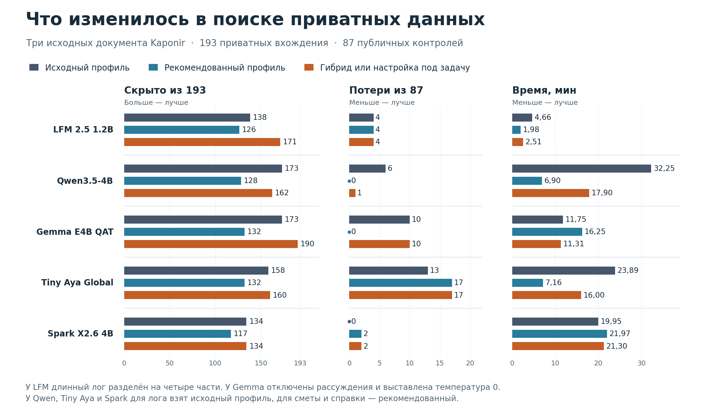

# Итоги исследования моделей Kaponir

<!-- final-search-profiles -->
## Итоговые профили поиска для 15 моделей

22 ноября 2026 года. Для каждой модели выбран один профиль поиска по трём документам. У Qwen3.5-4B, Nanbeige и LFM 2.5 2.6B взяты ускоренные режимы, сохранившие все прежние маски и публичные вхождения на основном и коротком корпусах. Места определяет итоговый балл 60:30:15. Время каждой строки относится к собственному проходу соответствующей модели. Для исторической Gemma E2B-it доступна опубликованная итоговая строка.

Прежние публикации охватывают исходный поиск и короткие замеры от 20 ноября. Парное сравнение базовой Qwen и LoRA epoch‑2 опубликовано отдельно. [Исходная сводка 15 моделей](ALL_MODELS.md) · [Рейтинг от 20 ноября](FOCUSED_MODEL_RESULTS.md) · [Qwen3.5‑2B и Privacy v4 epoch‑2](../../research/privacy-training/README.md)

В «Исх. / рек.» приведены баллы исходного и проверенного рекомендованного пресета на той же шкале. У Granite использован полный прогон прямого пресета IBM из отдельной калибровки. Потери — затронутые вхождения из 87 публичных, замены — все замены в публичной справке. Колонка A–D показывает лучший балл модели в отдельной проверке готовых целей на 16 приватных и 16 публичных примерах. Балл A–D рассчитан отдельно, параметры этого теста могут отличаться от поисковых.

| Место | Модель | Исх. / рек. | Итог /100 | Мин | Скрыто /193 | Потери / замены | Лучший A–D | T / top_p / top_k | Настройки поиска |
|---:|---|---:|---:|---:|---:|---:|---|---|---|
| 1 | Gemma 4 E4B QAT | 79,97 / 70,41 | **87,21** | 12,26 | 190 | 5 / 2 | D · 78,8 | 0 / 0,95 / 64 | До 1 024 токенов исходного текста — рассуждения до 384, выше — прямой ответ. Окно 16 384, выход 4 096. Потоки 2/2. |
| 2 | Nanbeige 4.2 3B | 81,74 / — | **86,04** | 22,05 | 191 | 3 / 2 | D · 55,4 | 0 текст, 0,2 лог / 0,95 / 20 | Прямой ответ, JSON Schema через /completion. Лог до 2 304 токенов, остальные документы целиком. Окно 16 384, выход 4 096. Потоки 4/2. |
| 3 | LFM 2.5 1.2B Instruct | 74,43 / 72,89 | **86,00** | 2,22 | 171 | 4 / 6 | D · 37,5 | 0,1 / 0,95 / 50 | Прямой ответ. Лог до 2 432 токенов, четыре фрагмента. repeat_penalty 1,05. Окно 16 384, выход 4 096. Потоки 2/2. |
| 4 | Qwen3.5-2B | 84,02 / — | **84,02** | 7,08 | 173 | 3 / 4 | B · 59,0 | 0 / 0,95 / 40 | Исходный режим с JSON Schema. Окно 4 096, выход 1 600. |
| 5 | LFM 2.5 2.6B | — / 71,78 | **82,16** | 6,60 | 161 | 0 / 2 | D · 65,1 | 0,1 / 0,95 / 50 | Рассуждения 384. Лог до 1 536 токенов без подсказки, repeat_penalty 1,0. На обычном тексте подсказка 256 и штраф 1,1. Окно 16 384, выход 4 096. Потоки 4/2. |
| 6 | Qwen3.5-4B | 77,84 / 72,24 | **81,81** | 9,77 | 173 | 6 / 6 | D · 49,7 | 0 / 0,95 / 40 | Прямой ответ. Все документы до 2 432 токенов на запрос, presence_penalty 0, repeat_penalty 1. Окно 16 384, выход 4 096. Потоки 4/2. |
| 7 | Qwen3.5-0.8B | 77,28 / — | **77,28** | 3,54 | 146 | 5 / 6 | D · 30,2 | 0 / 0,95 / 40 | Исходный режим с JSON Schema. Окно 4 096, выход 1 600. |
| 8 | Granite 4.2 3B | 76,21 / 69,23 | **76,21** | 9,37 | 145 | 0 / 2 | D · 61,8 | 0 / 0,95 / 40 | Исходный режим auto, сервер выбрал JSON Schema. Окно 4 096, выход 1 600. |
| 9 | MiniCPM5-2B | 72,40 / — | **72,40** | 6,17 | 135 | 5 / 6 | B · 60,5 | — | Исходный архив содержит лимиты контекста и ответа. Семплирование и режим JSON не записаны. Окно 4 096, выход 1 600. |
| 10 | Tiny Aya Global | 72,05 / 67,32 | **72,05** | 23,89 | 158 | 13 / 12 | D · 37,2 | 0 / 0,95 / 40 | Исходный прямой ответ, JSON Schema. Окно 4 096, выход 1 600. Потоки 2/2. |
| 11 | Gemma 4 E4B-it Q4_K_M¹ | 73,80 / 71,65 | **71,65** | 17,44 | 137 | 0 / 2 | D · 87,3 | 1 / 0,95 / 64 | JSON Schema, рассуждения до 2 048. Проверенный GGUF Q4_K_M. Окно 16 384, выход 4 096. Потоки 2/2. |
| 12 | Huihui Qwen3.5-2B | 71,33 / — | **71,33** | 7,99 | 143 | 13 / 15 | D · 60,5 | 0 / 0,95 / 40 | Исходный режим с JSON Schema. Окно 4 096, выход 1 600. |
| 13 | Gemma 4 E2B-it² | 70,44 / — | **70,44** | 11,55 | 132 | 2 / 4 | D · 69,3 | — | Историческая строка. Настройки полного прогона и точный GGUF не подтверждены. |
| 14 | Spark X2.6 4B | 70,31 / 64,41 | **70,31** | 19,95 | 134 | 0 / 2 | D · 67,4 | 0 / 0,95 / 40 | Исходный прямой ответ, JSON Schema. Окно 4 096, выход 1 600. Потоки 2/2. |
| 15 | LFM 2.5 8B-A1B | — / 69,68 | **69,68** | 6,11 | 118 | 0 / 2 | D · 62,3 | 0,2 / 0,95 / 80 | JSON Schema, рассуждения до 1 024, repeat_penalty 1,05. Окно 16 384, выход 4 096. Потоки 2/2. |

T — температура. Окно и первичный лимит ответа даны в токенах. Предел фрагмента учитывает инструкцию и структурную подсказку, а порог 1 024 у Gemma QAT относится к исходному тексту. Потоки указаны в порядке чтение входа / генерация. У трёх ускоренных моделей llama.cpp запускался с `-t 2 -tb 4 -np 1`. Числа потоков приведены там, где их подтверждает профиль или журнал запуска. Разные серии работали при разной нагрузке на CPU.

¹ У Gemma E4B-it исторический исходный замер дал 73,80/100 и 150/193 за 20,36 минуты. Для итоговой строки взят прогон с подтверждёнными весами Q4_K_M. В отдельном D этот пресет принял все 32 решения верно. ² Для Gemma E2B-it балл пересчитан по опубликованным числам. Привязка исторического прогона к конкретным весам и настройкам остаётся открытой. У MiniCPM5-2B подтверждены окно и выход, поля семплирования отсутствуют в исходном журнале.

У Gemma QAT полностью прямой ответ при температуре 0 дал те же 190/193 за 11,31 минуты, с десятью публичными потерями и семью заменами в справке. У выбранного режима 12,26 минуты, пять потерь и две замены. У LFM 2.6B вариант с бюджетами 192/384 набрал 83,10 и закрыл 164/193 за 6,48 минуты. Он добавил семь скрытий и открыл четыре прежних, поэтому в итог взят профиль на 82,16 с сохранением каждой прежней маски. У Nanbeige вариант на 192/193 дал пять публичных потерь и 32,91 минуты, у выбранного — три потери и 22,05 минуты.

В исходных прогонах Gemma QAT и базовая Qwen3.5‑2B полностью скрыли по 173 из 193, из них 158 совпали по позициям. Настроенная Gemma сохранила все 173 скрытия Qwen и добавила 17. У Qwen осталось преимущество по времени (7,08 против 12,26 минуты) и публичным потерям (3 против 5). Результаты относятся к измеренным пресетам поиска. [Как выбрать режим продукта](../LEARNING.md#фоновый-поиск-кандидатов-во-время-работы)

Итоговый балл равен `(60 × H/193 + 25 × (87 − P)/87 + 5/(1 + R) + 15 × 11,55/(11,55 + t)) / 1,05`. H — полностью скрытые приватные вхождения после применения через API, P — публичные потери, R — замены в справке, t — минуты HTTP-поиска по смете, журналу и справке.

У Nanbeige лучший A–D получен на другом пресете, восемь целей остались без ответа по тайм-ауту. [Проверка Nanbeige и пресет IBM](MODEL_SETTINGS_RESEARCH.md#подбор-пресетов-granite-и-nanbeige)

[Финальная таблица с параметрами в CSV](model-search-final.csv) · [Все исходные и подобранные профили](model-search-summary-60-30-15.csv) · [Парные замеры CPU](THREE_MODEL_SPEED.md) · [Четыре калиброванных пресета](FOUR_MODEL_TUNING.md) · [Архив исходных параметров](../../benchmark/data/validation/manifest.json) · [Проверки A–D](NATIVE_MODEL_RETEST.md#abcd)
<!-- /final-search-profiles -->

<!-- single-model-speed-comparison -->
**Скорость при сохранении качества.** Для каждого пресета проверены прежние приватные маски и сохранность публичного текста на основном и коротком корпусах. Время рассчитано по полному проходу трёх основных документов.

| Модель | Потоки CPU на чтение / генерацию | Свежий контроль, мин | Выбранный, мин | Скрыто /193 | Публичные потери /87 | Замены в справке |
|---|---:|---:|---:|---:|---:|---:|
| Qwen3.5-4B | 4 / 2 | 11,97 | **9,77** | 173 | 6 | 6 |
| Nanbeige 4.2 3B | 4 / 2 | 27,43 | **22,05** | 191 | 3 | 2 |
| LFM 2.5 2.6B | 4 / 2 | 7,79 | **6,60** | 161 | 0 | 2 |

[Время одного прохода и качество трёх моделей](THREE_MODEL_SPEED.md) · [Время по документам и все проверенные настройки](model-search-speed.csv)
<!-- /single-model-speed-comparison -->

**Обновление поиска от 22 ноября.** По формуле 60:30:15 первой стала Gemma E4B QAT с 87,21/100. Она скрыла 190/193 при пяти публичных потерях и двух заменах в справке. На трёх новых коротких документах профиль скрыл 19/19 и сохранил все 21 публичное вхождение. В поисковой таблице также обновлены Nanbeige, Qwen3.5-4B и LFM 2.5 2.6B. [Свежие прогоны четырёх моделей](FOUR_MODEL_TUNING.md) · [Общий рейтинг поиска](model-search-summary-60-30-15.csv)

[Тирлист выбора одной модели](MODEL_TIER_LIST.md) объединяет 15 моделей, проверенные пресеты и основные компромиссы по качеству и времени.

21 ноября 2026 года. В основном сравнении 15 моделей. Для восьми завершён повтор с настройками производителей, включая шесть схем обработки и варианты A–D. В этой серии проверены 80 применений через API и 480 точных восстановлений текста. Ошибочные решения моделей, усечения и тайм-ауты учтены в тех сравнениях, где они произошли. [Статус и архивы](PHASE2_STATUS.md#повторный-прогон-на-настройках-производителей)

Пользователь выбирает **одну модель**. Для первой проверки в качестве общего профиля я бы взял **Gemma 4 E4B-it Q4_K_M**. В сравнении восьми рекомендованных профилей она получила самый высокий поисковый балл без учёта времени и верно решила все 32 готовые цели в D. Чтобы подтвердить выбор, нужно измерить, сколько приватного она полностью скроет в пользовательском сценарии на новых документах. Главный конкурент среди LFM по полноте на новых документах — **2.6B**. [Данные поиска и A–D](NATIVE_MODEL_RETEST.md)

По прежней формуле 50:20:30 рейтинг поиска на 21 ноября возглавила **LFM 1.2B** с разбиением длинного лога — **84,48/100**, 171/193 за 2,22 минуты в полном свежем прогоне. У исходного Qwen3.5-2B **78,90**, 173/193 за 7,08 минуты. По качеству без учёта времени у Qwen 60,30 балла из 70, у LFM 59,32, у **Gemma E4B QAT с температурой 0** — **63,12**. Максимум покрытия **191/193** дала комбинация Nanbeige с одним новым фрагментом лога и сохранёнными ответами. Сумма запросов 29,76 минуты, семь публичных потерь. Прямой режим QAT дал **190/193** за 11,31 минуты с десятью публичными потерями. Два прохода одной QAT в другом профиле дали 180/193 за 55,60 минуты с сохранением всех размеченных публичных контролей и двумя заменами в справке. [Полный корпус LFM](MODEL_SETTINGS_RESEARCH.md#проверка-lfm-на-трёх-больших-документах) · [Полный корпус Gemma QAT](MODEL_SETTINGS_RESEARCH.md#прямой-режим-gemma-e4b-qat-на-трёх-документах) · [Сочетания Nanbeige](MODEL_SETTINGS_RESEARCH.md#сочетания-пресетов-по-документам) · [Данные поиска](model-search-summary.csv)

## Выбор одной модели

Каждая строка ниже использует один файл весов. У поиска и D сверены хеши весов, температура, параметры семплирования, режим рассуждений и контекст. У Tiny Aya в D зарезервировано 2 048 выходных токенов против 4 096 в поиске. Поиск измерен по фактическим заменам в документах. В D той же модели дали 16 приватных и 16 публичных готовых целей. Вариант и профиль для всех строк выбраны одинаковым способом. [Планы и результаты](NATIVE_MODEL_RETEST.md)

| Одна модель в рекомендованном профиле | Поиск, скрыто /193 | Публичные потери /87 · замены в справке | Качество поиска /70 | Время поиска, мин | D, верно скрыть /16 · верно оставить /16 | После перепроверки своего списка, скрыто /193 |
|---|---:|---:|---:|---:|---:|---:|
| Gemma 4 E4B-it Q4_K_M | 137 | 0 · 2 | 52,16 | 17,44 | **16 · 16** | 55 |
| Gemma 4 E4B QAT | 132 | 0 · 2 | 50,86 | 16,25 | 14 · 15 | **82** |
| LFM 2.5 2.6B | 128 | 0 · 2 | 49,83 | 7,89 | 10 · 10 | 45 |
| Qwen3.5-4B | 128 | 0 · 2 | 49,83 | 6,90 | 2 · 16 | 45 |
| LFM 2.5 1.2B | 126 | 4 · 6 | 47,67 | **1,98** | 2 · 3 | 45 |
| LFM 2.5 8B-A1B | 118 | 0 · 2 | 47,24 | 6,11 | 7 · 13 | 45 |
| Spark X2.6 4B | 117 | 2 · 2 | 46,63 | 21,97 | 11 · 15 | 77 |
| Tiny Aya Global | 132 | 17 · 17 | 46,54 | 7,16 | 0 · 10 | 45 |

Качество из 70 — первые три слагаемых ранее согласованной формулы поиска, до прибавления 30 баллов за скорость. Последняя колонка показывает отдельную схему «Проверка объединения». Та же модель перепроверяет список кандидатов поиска и детекторов, после чего маски применяются через API. Во всех восьми строках эта схема сохранила 87 публичных контролей. У трёх LFM осталось по 45 полных скрытий — столько дают автоматические детекторы сами. У Gemma E4B-it после такого отбора осталось 55, у QAT — 82. Результат D описывает решения по заранее выделенным целям и сам по себе не предсказывает, сколько приватного скроет такая цепочка. [Шесть схем](NATIVE_MODEL_RETEST.md#шесть-схем) · [Что делает пользовательский Review](PRODUCT_FINDINGS.md#ошибка-строки-не-отменяет-пригодных-соседей)

### Что показало прямое сравнение LFM

На новой паре документов у трёх LFM сверены три пары сообщений в запросах — в каждом совпадают инструкция, текст, контекст фрагмента и схема JSON. Совпадают также выходной лимит 4 096, seed 42, число потоков и способ применения масок. Каждая модель использует собственный шаблон и параметры генерации. Приведены исходные режимы с одинаковым разбиением для всех трёх. [Архив запросов и ответов](../../research/privacy-policy-phase2/checkpoints/lfm-cpu-latency/manifest.json)

| LFM2.5 | Скрыто /69, штатно → с учётом контекста | Пропущено приватных после перепроверки | Ошибочно скрыто публичных /46 в обоих вариантах | Всего замен в публичной справке | Время модели |
|---|---:|---:|---:|---:|---:|
| 1.2B | 55 → 55 | 14 | 11 | 0 | 0:59 |
| 2.6B | 69 → **69** | **0** | 15 | 0 | 10:16 |
| 8B-A1B | 50 → **57** | 12 | 24 | 15 | 5:03 |

У 2.6B есть измеримый выигрыш в качестве — она скрыла все 14 вхождений, пропущенных 1.2B, ценой четырёх дополнительных публичных потерь. Если пропуск и лишняя маска стоят одинаково, в этом тесте получается **15 ошибок у 2.6B, 25 у 1.2B, у 8B-A1B — 43 до перепроверки и 36 после**. На этих двух документах 69 приватных вхождений соответствуют 18 различным значениям. После перепроверки во всех своих вхождениях скрыты 14 из 18 значений у 1.2B, 18 у 2.6B и 15 у 8B. [Новые документы](MODEL_SETTINGS_RESEARCH.md#проверка-на-новых-документах)

**Семь пропусков 8B объяснила схема обработки фрагментов.** Модель вернула имя пользователя и ФИО в ответе на второй фрагмент. Оба значения встречались дословно в переданном контексте и первом фрагменте того же документа. Штатный фильтр искал совпадение только в текущем фрагменте. Общая для трёх моделей перепроверка приняла также корректные строки ответа с дословным совпадением в контексте и исходном документе. У 8B покрытие выросло с 50 до 57 при тех же 24 публичных потерях. Остальные 12 пропусков пришлись на три значения, отсутствовавших в финальных списках модели. У 2.6B и 1.2B покрытие сохранилось. В каждом варианте работала одна модель, переиспользованы её сохранённые ответы, все 24 восстановления через API точны. Это исследовательская проверка изменения фильтра. [Сравнение по моделям и документам](../../research/privacy-policy-phase2/checkpoints/lfm-context-grounding/comparison.json)

## Все 15 моделей на исходных документах

В смете 80 приватных вхождений, в длинном логе 113, в публичной справке 0. Всего это 92 разных приватных значения и 193 вхождения. Полное скрытие засчитывается, когда замены перекрыли весь размеченный диапазон. Обычные автоматические детекторы сами закрыли 45/193. Явное применение всех их предложений дало 107/193. В добавляющем поиске к пулу предложений детекторов присоединяются находки модели. [Методика применения](APPLICATION_RESULTS.md#общая-база)

Историческое сравнение в этом разделе использует прежние веса 50:20:30. Первые три числовых столбца — **баллы поиска из 100**. «Рекоменд.» относится к серии из восьми профилей. В третьем столбце показан лучший результат дополнительной настройки или объединения архивных ответов. Строки упорядочены по **жирному** баллу. К нему относятся покрытие, публичные потери, замены в справке и время в той же строке. Последний столбец — лучший измеренный вариант A–D этой модели. Пресет A–D может отличаться от поискового. Прочерк означает отсутствие полного замера для ячейки. [Данные профилей в CSV](model-search-summary.csv) · [Параметры и A–D исходной и рекомендованной серий](NEW_MODELS_RESULTS.md#сводная-оценка-добавляющего-поиска) · [Пресеты Granite и Nanbeige](MODEL_SETTINGS_RESEARCH.md#подбор-пресетов-granite-и-nanbeige)

| Модель | Исходный | Рекоменд. | Гибрид или тюнинг | Скрыто /193 | Потери /87 · замены в справке | Мин | Лучший A–D |
|---|---:|---:|---:|---:|---:|---:|---|
| LFM 2.5 1.2B | 72,15 | 73,27 | **84,48** | 171 | 4 · 6 | 2,22 | D · 37,5 |
| Qwen3.5-2B | **78,90** | — | — | 173 | 3 · 4 | 7,08 | B · 59,0 |
| Gemma 4 E4B QAT | 73,59 | 63,33 | **78,28** | 190 | 10 · 7 | 11,31 | D · 78,8 |
| Qwen3.5-0.8B | **75,64** | — | — | 146 | 5 · 6 | 3,54 | D · 30,2 |
| Nanbeige 4.2 3B | 68,48 | — | **74,63** | 190 | 2 · 2 | 26,58 | D · 55,4 |
| Granite 4.2 3B | 70,79 | — | **72,29** | 143 | 0 · 2 | 7,11 | D · 61,8 |
| Qwen3.5-4B | 67,41 | 68,60 | **70,23** | 162 | 1 · 2 | 17,90 | D · 49,7 |
| LFM 2.5 2.6B | — | 67,65 | **69,60** | 127 | 0 · 2 | 5,74 | D · 65,1 |
| MiniCPM5-2B | **69,38** | — | — | 135 | 5 · 6 | 6,17 | B · 60,5 |
| Huihui Qwen3.5-2B | **67,85** | — | — | 143 | 13 · 15 | 7,99 | D · 60,5 |
| LFM 2.5 8B-A1B | — | **66,85** | 64,97 | 118 | 0 · 2 | 6,11 | D · 62,3 |
| Tiny Aya Global | 63,85 | 65,06 | **66,38** | 160 | 17 · 17 | 16,00 | D · 37,2 |
| Gemma 4 E4B-it¹ | **65,37** | 64,11 | — | 150 | 2 · 4 | 20,36 | D · 87,3 |
| Gemma 4 E2B-it | **64,85** | — | — | 132 | 2 · 4 | 11,55 | D · 69,3 |
| Spark X2.6 4B | **62,38** | 56,97 | 61,59 | 134 | 0 · 2 | 19,95 | D · 67,4 |

¹ Для Gemma E4B-it исходная строка историческая. Повтор на Q4_K_M дал 137/193, 0 потерь, 2 замены и 17,44 минуты. Привязку старого поискового замера к тому же артефакту подтвердить не удалось. У старших LFM рекомендованный профиль впервые довёл полный поиск до результата. У Nanbeige исходный A–D завершился тайм-аутами. Балл D получен на экспериментальном прямом пресете, который вернул 24 из 32 решений. [Исходные измерения](NEW_MODELS_RESULTS.md#основной-и-нативный-профили) · [Исходные A–D](NEW_MODELS_RESULTS.md#отдельная-проверка-abcd-старых-моделей) · [Новые замеры D](MODEL_SETTINGS_RESEARCH.md#решения-по-готовым-целям)

Поисковый балл даёт до 50 за полностью скрытые вхождения, до 20 за сохранение публичного текста и до 30 за скорость. Формула — `50 × H/193 + 15 × (87−P)/87 + 5/(1+R) + 30 × 11,55/(11,55+t)`. Здесь H — полные скрытия, P — потери контролей, R — все замены в справке и t — сумма HTTP-времени в минутах по трём документам. Исторические профили Qwen3.5-2B, Qwen3.5-0.8B, Huihui и MiniCPM использовали свои настройки. [Исторические профили](NEW_MODELS_RESULTS.md#остальные-исторические-профили)

В общем CSV есть 76 строк с покрытием, потерями, временем и баллом. На одной модели получены 75 из 76 результатов. Одна историческая строка использует две разные модели. Для 74 строк сверены исходные измерения и SHA-256 файла применения. У двух исторических строк Gemma E2B-it и E4B-it значения перенесены из основной таблицы с опубликованной точностью. Все пути к источникам в трёх сводных CSV отсчитываются от корня репозитория. Файлы применения для 39 строк перенесены из рабочих каталогов с сохранением исходных SHA-256. [CSV для пересчёта](model-search-summary.csv) · [Контрольные суммы перенесённых файлов](../../research/privacy-policy-phase2/checkpoints/model-search-history/SHA256SUMS)

## Что изменили рекомендации производителей

У пяти моделей можно напрямую сопоставить исходный и рекомендованный поиск. **Все пять скрыли меньше приватных вхождений. У трёх из пяти общий балл при этом вырос.** Менялся профиль целиком, включая окно, лимит выхода, а у некоторых моделей и режим рассуждений. [Сравнение на тех же документах](NATIVE_MODEL_RETEST.md#добавляющий-поиск-по-документам)

| Исходный → рекомендованный | Скрыто /193 | Потери /87 | Замены в справке | Мин | Изменение балла |
|---|---:|---:|---:|---:|---:|
| LFM 1.2B | 138 → 126 | 4 → 4 | 6 → 6 | 4,66 → 1,98 | +1,12 |
| Qwen3.5-4B | 173 → 128 | 6 → 0 | 6 → 2 | 32,25 → 6,90 | +1,19 |
| Tiny Aya Global | 158 → 132 | 13 → 17 | 12 → 17 | 23,89 → 7,16 | +1,21 |
| Gemma E4B QAT | 173 → 132 | 10 → 0 | 7 → 2 | 11,75 → 16,25 | −10,26 |
| Spark X2.6 4B | 134 → 117 | 0 → 2 | 2 → 2 | 19,95 → 21,97 | −5,41 |

Основная потеря пришлась на длинный лог. Например, у QAT из 41 потерянного полного скрытия 39 пришлись на лог, у Aya на нём стало на 28 меньше, хотя на смете стало на два больше. Для LFM 1.2B это и подсказало проверить размер фрагментов. [Разбивка по документам](NATIVE_MODEL_RETEST.md#добавляющий-поиск-по-документам)

## Что дали гибриды и настройка под задачу

- **Granite и Nanbeige.** Сочетания по документам обошли исходные баллы. Granite с температурой 1 на смете и справке и температурой 0 на частях лога дала **143/193, 0 потерь, 8,06 минуты** в свежем полном повторе. Сумма архивных запросов с тем же итогом составляла 7,11 минуты. Лучший по баллу вариант Nanbeige сочетает температуру 0,6 и JSON Schema на первом фрагменте с сохранёнными ответами на остальных. Получилось **190/193 за 26,58 минуты**, с двумя публичными потерями вместо шести. Температура 0 на первом фрагменте дала **191/193 за 29,76 минуты** и семь публичных потерь. [Настройки и разбор результатов](MODEL_SETTINGS_RESEARCH.md#сочетания-пресетов-по-документам)

- **LFM 1.2B.** Сохранили `temperature=0.1`, `top_p=0.95`, `top_k=50`, `repeat_penalty=1.05`. Изменили только обработку длинного лога — четыре фрагмента при `target_input_tokens=2432`. На логе получилось 59 → 104 из 113, на всём корпусе 126 → **171/193**, балл 73,27 → **83,96**. Сумма запросов выросла с 1,98 до 2,51 минуты. Полный свежий повтор подтвердил 171/193 и 4/87 публичных потерь за **2,22 минуты**, балл **84,48**, публичные потери и замены остались 4 и 6. Относительно исходного профиля это **+33 скрытия и на 2,15 минуты быстрее**. Смета и справка взяты из того же рекомендованного прогона. [Полный замер](MODEL_SETTINGS_RESEARCH.md#проверка-lfm-на-трёх-больших-документах)
- **Qwen3.5-4B, Tiny Aya и Spark.** Если для лога выбирать исходный профиль, а для сметы и справки рекомендованный, Qwen закрывает **162/193** с одной публичной потерей за 17,90 минуты. Это середина между исходными 173 при шести потерях и рекомендованными 128 при нуле. У Aya получилось **160/193**, но потеряно 17 публичных контролей. Spark повторила исходные **134/193**, потеряла два дополнительных контроля и потратила больше времени. [Сочетания архивных ответов](MODEL_SETTINGS_RESEARCH.md#гибридные-профили-на-сохранённых-ответах) · [Баллы и замены](model-search-summary.csv)
- **Gemma E4B QAT.** Исходный профиль на логе и рекомендованный на остальных документах дали **171/193, 5 потерь и 2 замены за 15,21 минуты**. На 0,54 балла ниже исходного профиля, зато сохранены пять дополнительных публичных контролей. Время восстановлено по записям отдельных запросов. Объединение двух проходов рекомендованного профиля дало **180/193, 0/87 потерь, 2 замены за 55,60 минуты** и 68,46 балла. Если исходные находки принимать только при подтверждении перепоиском, справка остаётся целой, покрытие снижается до 140/193 за 51,11 минуты. [Профили Gemma и источники времени](MODEL_SETTINGS_RESEARCH.md#гибридные-профили-на-сохранённых-ответах)
- **Gemma E4B QAT с одним фиксированным профилем на всех документах.** Прямой ответ при температуре 0 дал **190/193 за 11,31 минуты**. Она сохранила все 173 полных скрытия исходного профиля и добавила 17 в длинном логе. Затронуты те же 10 публичных контролей, в справке совпали все семь мест замены. Рекомендованный профиль с рассуждениями сохранял больше публичного текста. Для прямого режима на температуре 0 результат D на 32 целях пока открыт. Балл D в большой таблице выше относится к рекомендованному режиму с рассуждениями. [Три профиля на полном корпусе](MODEL_SETTINGS_RESEARCH.md#прямой-режим-gemma-e4b-qat-на-трёх-документах)
- В архиве сохранён также эксперимент с двумя разными моделями. Поиск Qwen3.5-4B плюс перепоиск LFM 2.6B дал 170/193, 0 потерь, 2 замены за 41,32 минуты. Для выбора пользователю в рейтинге участвуют только варианты с одной моделью. Все смешанные варианты применены через API, время сложено из выбранных архивных запросов. Правила сочетания подбирали на этих документах. [Все сочетания и баллы](model-search-summary.csv)
- **Старшие LFM на всех 193 вхождениях.** У 2.6B снижение бюджета рассуждений с 2 048 до 384 дало 128 → 127 скрытий и 7,89 → 5,74 минуты при нуле публичных потерь. Если оставить 2 048 для сметы и 384 для лога и справки, сохраняются все 128 за **6,34 минуты**, балл **69,19**. У 8B-A1B снижение 1 024 → 768 дало 118 → 111 скрытий за 6,11 → 6,17 минуты. Для неё на этом корпусе предпочтителен бюджет **1 024**. [Бюджеты на трёх документах](MODEL_SETTINGS_RESEARCH.md#проверка-lfm-на-трёх-больших-документах)

### Что воспроизвелось на коротких текстах

Для восьми моделей взяли новый короткий лог и публичную справку. В ячейке по порядку указаны **скрыто из 14 · потеряно из 16 публичных · секунды HTTP**. Гибрид у всех использует исходный профиль на логе и рекомендованный на справке. Из 32 запросов четыре взяты из замера LFM 1.2B на этой же паре. [Состав и протокол короткого прогона](MODEL_SETTINGS_RESEARCH.md#короткий-прогон-восьми-моделей-на-одинаковых-документах)

| Модель | Исходный | Рекомендованный | Гибрид |
|---|---:|---:|---:|
| LFM 1.2B | 7 · 4 · 15,66 | 7 · 3 · 14,71 | 7 · 3 · 14,73 |
| LFM 2.6B | усечён лог | 8 · 6 · 138,04 | — |
| LFM 8B-A1B | усечён лог | 8 · 3 · 119,04 | — |
| Tiny Aya | 8 · 8 · 91,25 | 7 · 7 · 77,11 | 8 · 8 · 85,51 |
| Qwen3.5-4B | 8 · 5 · 73,48 | **9 · 4 · 66,74** | 8 · 4 · 62,89 |
| Spark X2.6 4B | 9 · 5 · 84,51 | два тайм-аута | — |
| Gemma E4B QAT | **9 · 3 · 71,55** | 9 · 4 · 309,11 | 9 · 4 · 181,81 |
| Gemma E4B-it Q4_K_M | 8 · 4 · 78,25 | 9 · 4 · 293,23 | 8 · 4 · 166,01 |

Точечная проверка рекомендаций производителей и сообщества дала следующие результаты на той же короткой паре. [Источники и настройки](MODEL_SETTINGS_RESEARCH.md#калибровка-granite-qwen-и-gemma-на-коротком-наборе) · [Парные измерения](NEW_MODELS_RESULTS.md#короткая-калибровка-добавляющего-поиска)

| Модель | Что изменили | Что получилось |
|---|---|---|
| Granite 4.2 3B | Отключили рассуждения | 575,21 → **42,36 с**, 9 → 8 скрытий, 5 → 3 публичных потери. Сравнены завершённые запросы, первая попытка исходного профиля также дала тайм-аут. |
| Qwen3.5-4B | Отдельно проверили `presence_penalty=0` и `temperature=0` | Обе замены уменьшили покрытие с 9 до 8. При нулевом штрафе публичных потерь стало 3 вместо 4, время прежнее. На этой паре для покрытия предпочтителен рекомендованный профиль без рассуждений при температуре 0,7. |
| Gemma E2B-it | Снизили температуру с 1 до 0,25 | Те же 8/14, публичные потери выросли с 3 до 4. Время 42,22 → 41,33 с. |
| Gemma E4B QAT | Отключили рассуждения и выставили `temperature=0` | **9/14**, 4 → **3** публичные потери, 309,11 → **72,79 с**. Это в 4,25 раза быстрее рекомендованного режима. Исходный профиль уже давал 9/14 и три потери за **71,55 с**. |

У Spark отдельный запрос на коротком логе с рекомендованным семплированием и отключёнными рассуждениями дал **12/14** против исходных **9/14**, публичные потери 0 → 1 из 6, время 41,90 → 52,38 с. Проверка относится к одному логу. [Проверка режима Spark](MODEL_SETTINGS_RESEARCH.md#короткий-прогон-восьми-моделей-на-одинаковых-документах)

## Почему старшие LFM всё-таки обошли 1.2B на длинном логе

Приватные пути и имена сервисов многократно встречаются в одном логе. В исходной инструкции старшие модели пропускали часть этих значений уже в финальном списке кандидатов. Например, 8B видела имя сервиса в рассуждении, но оставила его за пределами списка и пропустила 14 вхождений. С инструкцией, явно разделяющей внутренние имена и публичные форматы, 8B поднялась с **57 до 108/113**. У 2.6B отдельное уточнение о публичных номерах трассировки и приватных клиентских ID дало **69 → 112/113**. Обе сохранили все 32 публичных контроля. Здесь вклад внесла формулировка задачи. Эффект изменения только параметров виден при следующем сравнении внутри каждой модели. [Пропущенные значения и варианты инструкции](MODEL_SETTINGS_RESEARCH.md#lfm-на-одном-длинном-логе-с-общей-инструкцией)

| Профиль | Длинный лог, скрыто /113 и время | Новые лог и справка, скрыто /69 | Потери /46 | Время на новых |
|---|---|---:|---:|---:|
| 1.2B, 2 потока, без рассуждений | 104 · 1:37 | 55 | 11 | 0:59 |
| 2.6B, укрупнение фрагментов, бюджет 2 048, шаг `confidence` 0,01 | 112 → 112 · 16:34 → **8:35** | 69 → 55 | **15 → 1** | 10:16 → **6:12** |
| 8B-A1B, 2 потока генерации и 4 обработки входа, бюджет 1 024 | 108 → 108 · 8:57 → **7:44** | 50 → 50 | 24 → 24 | 5:03 → **3:45** |

Перенос проверен на заранее размеченной новой паре. **2.6B** в более медленном режиме скрыла все **69/69** и затронула 15 публичных вхождений. Ускоренный режим сохранил 14 дополнительных публичных вхождений и пропустил 14 приватных. В справке у обоих ноль замен. **8B-A1B** с `-t 2 -tb 4 -np 1 --reasoning-budget 1024` ускорилась на обеих выборках, все семь финальных ответов совпали побайтно. На новой паре остались 24 публичные потери и 15 замен в справке. Для использования этих флагов в штатном Worker требуется раздельная настройка входных потоков и генерации. **1.2B** воспроизвела результат на двух потоках, а переход на четыре потока генерации снизил покрытие старого лога со 104 до 69. [График времени и качества](../images/lfm-cpu-latency.png) · [Замеры и архив запросов](MODEL_SETTINGS_RESEARCH.md#время-lfm-на-cpu)

Была и ошибка, которую легко принять за удачную настройку. В режиме одного окна 2.6B формально скрыла 62/69 за 5:59. JSON разобрался, но у 19 из 21 строки смешанного лога числовая уверенность вышла за допустимый диапазон. После применения только корректных строк осталось **20/69**. У режима с шагом 0,01 оба новых ответа прошли проверку полей. Спекулятивное декодирование DSpark на нашем CPU увеличило время короткого запроса у 1.2B и 2.6B, а у 8B сервер завершился ошибкой запуска. [Проверки схемы ответа и DSpark](MODEL_SETTINGS_RESEARCH.md#время-lfm-на-cpu)

## Где вмешался валидатор и почему у Tiny Aya ноль MASK

В A–D модель получает готовые цели. A задаёт базовый вопрос, B добавляет политику приватности, C выделяет проверяемое значение, D просит короткое решение с причиной. Каждый вариант оценивается на 16 приватных и 16 публичных целях. Балл равен `50 × M/16 + 20 × K/16 + 30 × 51,77481835/(51,77481835+t)`, где M и K — верные MASK и KEEP, t — минуты с записанными повторами и тайм-аутами. У Nanbeige на прямом пресете D дал 8 верных MASK и 13 верных KEEP при восьми целях без ответа из-за тайм-аута. У Spark лучший A–D вырос с 33,8 до 67,4 при падении балла поиска. У QAT результаты решений A–D совпали с повтором того же профиля, разница баллов связана со временем. [Варианты A–D](PRIVACY_POLICY_PHASE2.md) · [Результаты и время](NATIVE_MODEL_RETEST.md#abcd) · [Повтор D у Nanbeige](MODEL_SETTINGS_RESEARCH.md#решения-по-готовым-целям)

**Tiny Aya.** В A–C модель выбрала KEEP для всех 48 предъявлений приватных целей и ещё для 46 публичных. Во всех 94 строках цитата отличалась от текста документа. Нормализация цитат дала ноль дополнительных MASK. В D поле цитаты убрали, модель выдала 31 KEEP и один REVIEW. Все 36 запросов штатно завершились, максимальный ответ занял **1 120 из 2 048 токенов**. Увеличение лимита для этих ответов не обосновано. В задаче поиска та же модель с детекторами скрыла **132/193** на рекомендованном профиле. [Разбор Tiny Aya по исходным ответам](NEW_MODELS_RESULTS.md#влияние-валидатора-ad)

**У других моделей оформление цитаты действительно стоило полезных решений.** На 1 024 исходах проверка однозначных ID и нормализация внешних кавычек, пробелов и эквивалентного Unicode восстановили 6 верных MASK. При применении через API это дало **семь дополнительных полностью скрытых вхождений суммарно в четырёх прогонах B**, без дополнительных публичных потерь в них. В том же пересчёте число ошибочных KEEP приватных целей выросло со 105 до 117. Полное отключение проверки цитаты дало уже 190 таких KEEP и 21 ошибочный MASK публичных целей против исходных 12. Для повторной оценки MASK есть отдельный скрипт. Пользовательский Review работает без поля цитаты. [Таблица валидаторов и повторное применение](NEW_MODELS_RESULTS.md#влияние-валидатора-ad) · [Проверка MASK](../../scripts/recheck_mask_evidence.py)

## Что можно выбрать по результатам

**Для фонового поиска** настроенная **Gemma 4 E4B QAT** даёт 190/193 при пяти публичных потерях. **Базовая Qwen3.5‑2B** подходит, когда важнее время и сохранность публичного текста. **Gemma 4 E4B-it Q4_K_M** верно решила все 32 готовые цели D в отдельном сравнении на рекомендованном пресете. Для пользовательской кнопки «Пересмотреть моделью» нужен замер через её собственный короткий контекст и формат рекомендаций. [Фоновый поиск](../LEARNING.md#фоновый-поиск-кандидатов-во-время-работы) · [Поиск и D на одном пресете](#выбор-одной-модели)

Ближайший пробел у QAT — пять пакетов D с 32 готовыми целями при тех же `temperature=0` и `enable_thinking=false`, которые дали 190/193 в поиске. Для выбора профиля по умолчанию затем нужен короткий финал. Заранее зафиксировать веса, параметры и штатный пользовательский сценарий каждой модели. На одних новых логе, смете и полностью публичной справке измерить, сколько приватного осталось в итоговом тексте и сколько публичного исчезло. Отдельно записать время, число решений, переданных человеку, и проверить восстановление оригинала. На новой паре с 69 приватными вхождениями пока есть результаты только для LFM. Более широкая свежая матрица RU/EN и политик v1/v2 для всех 15 моделей остаётся отдельным пунктом первоначального плана. [Критерии полного этапа](FINISH_CRITERIA.md) · [Проверка LFM](MODEL_SETTINGS_RESEARCH.md#проверка-на-новых-документах)
