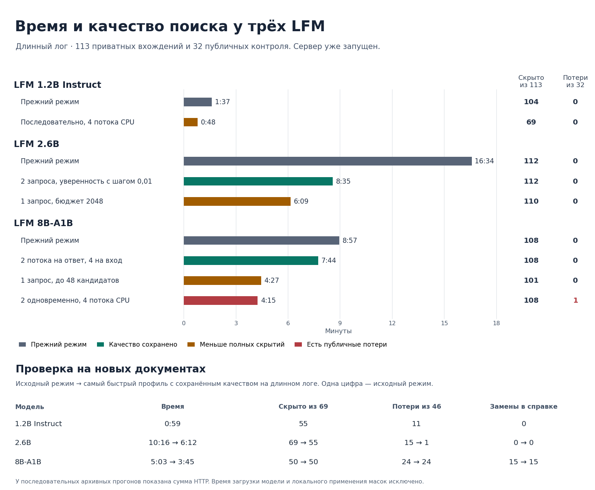

# Настройки моделей для извлечения приватных данных

В отдельном сравнении скорости проверены свежие полные прогоны Nanbeige, Qwen3.5-4B и LFM 2.5 2.6B, включая сохранность ранее скрытых вхождений. [Время одного прохода и качество трёх моделей](THREE_MODEL_SPEED.md)

Источники проверены 19–21 ноября 2026 года. Текущие профили, калибровка и замеры Kaponir собраны в [отчёте повторного прогона](NATIVE_MODEL_RETEST.md).

Повторная калибровка 22 ноября охватывает четыре модели. В отчёте приведены полные свежие замеры по каждому пресету и отдельная проверка переноса на короткие документы. [Gemma E4B QAT, Nanbeige, Qwen3.5-4B и LFM 2.5 2.6B](FOUR_MODEL_TUNING.md)

Журналы и результаты маскирования ранних прогонов сохранены в репозитории. Файлы, для которых ниже указан путь `/workspace/work/kaponir-hybrid-pilot/`, лежат в архиве в одноимённых каталогах без этого префикса. [Архив ранних прогонов](../../research/privacy-policy-phase2/checkpoints/model-search-history/evidence.tar.gz) · [Контрольные суммы](../../research/privacy-policy-phase2/checkpoints/model-search-history/SHA256SUMS)

## Опубликованные замеры

- Custodian Labs проверили Gemma 4 E4B и Qwen3.5-4B как детекторы на нескольких корпусах PHI и PII. На исходных документах PII-en F1 по точным границам сущностей без учёта типа составила 0,734 у Gemma и 0,675 у Qwen. Это сравнение двух моделей на задаче обнаружения. [Custodian Labs, код и таблицы](https://github.com/Custodian-Labs/guardian-layer-phi-benchmark#detection-on-the-original-documents-per-benchmark).
- NuMind прогнали те же семейства на извлечении документов в JSON на vLLM при `temperature=0.25` и лимите 65 000 токенов на рассуждения и ответ. Оценка извлечения составила 0,538 у Gemma E4B-it и 0,417 у Qwen3.5-4B. В таблице опубликован один температурный режим. [NuMind, оценка извлечения](https://huggingface.co/numind/NuExtract3-FP8).
- WumboLabs тестировали QAT Q4_0 Gemma E4B в llama.cpp при `temperature=0`. Имя GGUF и префикс SHA-256 `676c3507` совпадают с нашим артефактом. При точном поиске фактов в длинном контексте оставались ошибки заполнения отсутствующих полей и усечения JSON. Замер выполнен на RTX 5070 с llama.cpp b10449. [WumboLabs, условия и результаты](https://wumbolabs.dev/evaluations/gemma4-e4b/).
- XHToken измерили переход Spark 4B с `high` на `low`. В их наборе задач средний выход сократился на 22%, средняя оценка снизилась на 1,7 пункта. Набор включает программирование, математику, длинный контекст и работу с инструментами. [XHToken, сравнение режимов](https://huggingface.co/XHToken/Spark-X2.6-4B-GGUF#reasoning-effort-comparison).
- В исследованиях малых моделей JSON Schema улучшает соблюдение формата, а точность заполнения полей измеряется отдельно. В Kaponir это различие видно на калибровке Qwen. Оба режима дали четыре пригодных ответа, но разное число масок и пропусков. [Исследование и код](https://github.com/CruiseDevice/small-llm-structured-benchmark).
- Preserve измеряет извлечение PII по коротким регионам, отдельно от правил. В их опубликованной конфигурации Qwen3.5-4B Q4_K_M рассуждения отключены на уровне сервера через `--reasoning off`. [Preserve, замеры](https://github.com/thirtysix/Preserve/blob/main/docs/LLM_BENCHMARK.md).
- В замерах пользователя KikoCis с LFM2.5-2.6B общий лимит 900 токенов на некоторых запросах расходовался целиком на рассуждения. При лимите 2 600 модель завершала ответ на тех же запросах. В короткой проверке Kaponir менялся отдельный бюджет рассуждений. [KikoCis, замеры LFM2.5-2.6B](https://huggingface.co/KikoCis/LFM2.5-2.6B-GGUF).

## Кандидаты для короткой проверки в Kaponir

| Модель | Профиль текущего прогона | Вариант для отдельного сравнения | Источник |
|---|---|---|---|
| LFM2.5-1.2B-Instruct | `temperature=0.1`, `top_k=50`, `repeat_penalty=1.05`, JSON Schema | Сравнить с `temperature=0` на том же плане и схеме. При нулевой температуре основной прогон лучше закрыл приватные вхождения в добавляющем поиске. | [Liquid AI](https://huggingface.co/LiquidAI/LFM2.5-1.2B-Instruct#model-details) |
| Tiny Aya Global | `temperature=0.1`, `top_p=0.95`, JSON Schema, окно 8 192 | Сравнить с `temperature=0`. Cohere Labs подтвердили, что использовали нулевую температуру для генеративных задач своего бенчмарка. В Kaponir оставить JSON Schema в обеих ветках, она прошла калибровку 4/4. | [Карточка](https://huggingface.co/CohereLabs/tiny-aya-global), [ответ Cohere Labs](https://huggingface.co/CohereLabs/tiny-aya-global/discussions/8) |
| Qwen3.5-4B | По итогам калибровки выбран `enable_thinking=false`, `temperature=0.7`, `top_p=0.8`, `top_k=20`, `presence_penalty=1.5` | Проверить режимы отдельно для поиска и D. В калибровке поиск нашёл 26 из 34 без рассуждений и 20 из 34 с ними. В D режим с бюджетом 2 048 дал четыре приватных MASK, режим без рассуждений дал ноль. У Qwen есть профиль для точного кода с `temperature=0.6` и `presence_penalty=0`, это дополнительная гипотеза для копирования значений. | [Qwen, режимы генерации](https://huggingface.co/Qwen/Qwen3.5-4B#best-practices) |
| Spark X2.6 4B | `low`, бюджет 2 048, `temperature=1.0`, `top_p=0.95`, `top_k=0` | Сравнить `low` и `enable_thinking=false` на том же плане и с тем же семплированием. Для добавляющего поиска основной профиль без рассуждений дал больше полного покрытия. Перед замером проверить режим по реальному ответу. | [XHToken, управление рассуждениями](https://huggingface.co/XHToken/Spark-X2.6-4B-GGUF) |
| LFM2.5-8B-A1B | `temperature=0.2`, `top_k=80`, `repeat_penalty=1.05`. Калибровка выбрала бюджет 1 024 после сравнения с 2 048 | Проверить, воспроизводится ли преимущество 1 024 на другом наборе. В калибровке этот бюджет дал на один пропуск меньше и сократил HTTP-время с 7,4 до 5,9 минуты. | [Конфигурация Liquid AI](https://huggingface.co/LiquidAI/LFM2.5-8B-A1B/blob/main/generation_config.json) |
| Gemma 4 E4B QAT Q4_0 | `temperature=1.0`, `top_p=0.95`, `top_k=64`, бюджет 2 048. На двух запросах D профиль `off` вернул рассуждения | Сравнить `temperature=1.0` и `0.25` на одних запросах с тем же бюджетом. Для QAT это перенос гипотезы NuMind с E4B-it. | [Google, QAT](https://huggingface.co/google/gemma-4-E4B-it-qat-q4_0-gguf), [NuMind](https://huggingface.co/numind/NuExtract3-FP8) |
| Gemma 4 E4B-it Q4_K_M | Те же параметры семейства, бюджет 2 048. В калибровке поиск нашёл 25 из 34 с рассуждениями и 13 из 34 без них | Проверить `temperature=0.25` на своём GGUF при том же режиме. Измерить заполнение отсутствующих полей и технические REVIEW вместе с покрытием. | [Google, E4B-it](https://huggingface.co/google/gemma-4-E4B-it), [NuMind](https://huggingface.co/numind/NuExtract3-FP8) |
| LFM2.5-2.6B | `temperature=0.1`, `top_k=50`, `repeat_penalty=1.1`. При равенстве в калибровке выбран бюджет 2 048 по заранее заданному порядку | В калибровке оба бюджета нашли 11 из 34 в поиске и дали 4 из 4 приватных MASK в D, с нулём публичных MASK. Четыре запроса заняли 7,37 минуты с 1 024 и 11,15 минуты с 2 048. Повтор на двух регионах приведён ниже. | [Liquid AI, шаблон и параметры](https://huggingface.co/LiquidAI/LFM2.5-2.6B#chat-template) |

Для трёх LFM Liquid AI также измерили спекулятивное декодирование DSpark с отдельным черновым GGUF. Их замеры сравнивают скорость при жадном декодировании на H100 и MacBook M4 Max с Metal. Ускорение на двух потоках CPU в Kaponir требует своего замера. [Liquid AI, условия замеров DSpark](https://www.liquid.ai/blog/lfm2.5-dspark).

В основных прогонах LFM1.2B, Tiny Aya, Qwen и Spark использовались `temperature=0`, окно 4 096, выход 1 600 и выбор формата `auto`. В повторных прогонах вместе с температурой менялись окно, лимит ответа, формат и у Spark режим рассуждений. Текущие дельты описывают профиль целиком. Для проверки одного параметра нужны одинаковые документы, запросы и формат, а итог оценивается по полному покрытию, публичным потерям, техническим отказам, HTTP-времени и точному восстановлению.

## Гибридные профили на сохранённых ответах

На трёх документах проверено 21 сочетание сохранённых масок через API Kaponir. Все 126 проверок побайтового восстановления прошли. Время гибридов оценено по сумме HTTP-времени выбранных архивных запросов. Правило для `.log` выбрано после просмотра результатов на этих же документах.

| Модель и сочетание | Полностью скрыто /193 | Потери публичных /87 | HTTP, мин |
|---|---:|---:|---:|
| LFM2.5-1.2B, исходный поиск для `.log`, нативный для остальных файлов | 138 → 140 | 4 → 4 | 4,66 → 3,60 |
| Qwen3.5-4B, то же правило | 173 → 162 | 6 → 1 | 32,25 → 17,90 |
| Gemma 4 E4B QAT, то же правило | 173 → 171 | 10 → 5 | 11,75 → 15,21 |
| Gemma 4 E4B QAT, объединение нативного поиска и перепоиска записей | 173 → 180 | 10 → 0 | 11,75 → 55,60 |
| Нативный поиск Qwen3.5-4B и перепоиск записей LFM2.5-2.6B | 170 | 0 | 41,32 |

Стрелки показывают сравнение с исходным добавляющим поиском той же модели. Объединение исходного поиска с нативным перепоиском увеличило полное покрытие у пяти моделей и увеличило потери публичных контролей у четырёх. Быстрый кандидат для проверки на новых логах использует один профиль на документ. Два прохода Gemma QAT дали более высокое покрытие на этом корпусе ценой примерно 4,7-кратного HTTP-времени.

У Gemma QAT время гибрида с исходным профилем на логе удалось восстановить из архива. Для лога поле `record_index` указывает на записи 2–5 в `calls`, суммарно 454,267 секунды. Смета и справка в рекомендованном профиле заняли 316,409 и 141,804 секунды. В сумме 15,208 минуты. При 171 полном скрытии, пяти публичных потерях и двух заменах в справке это **73,05/100**. [Исходные вызовы и их привязка к документам](../../benchmark/data/validation/gemma-calibration--result.json.gz) · [Архив рекомендованного профиля](../../research/privacy-policy-phase2/checkpoints/native-retest-gemma4-e4b-qat/manifest.json)

### Проверка LFM 1.2B на новом логе и публичной справке

Два новых синтетических документа размечены до запуска. На коротком логе и публичной справке измерили по одному запросу с каждым профилем. Совпали текст запросов, отрендеренный шаблон, JSON Schema, GGUF и число потоков CPU. Исходный профиль использовал окно 4 096 и лимит ответа 1 600, рекомендованный 16 384 и 4 096. В этом замере оба профиля поместили каждый документ в один запрос.

| Профиль | Полностью скрыто в логе /14 | Потери публичных в логе /6 | Потери в справке /10 | Лог, с | Справка, с | Всего HTTP, с |
|---|---:|---:|---:|---:|---:|---:|
| Встроенные детекторы | 1 | 0 | 1 | — | — | — |
| Все предложения детекторов | 5 | 0 | 3 | — | — | — |
| Исходный | 7 | 0 | 4 | 8,96 | 6,70 | 15,66 |
| Рекомендованный | 7 | 0 | 3 | 8,94 | 5,77 | 14,71 |
| Гибрид с исходным профилем на логе | 7 | 0 | 3 | 8,96 | 5,77 | 14,73 |

Оба профиля дали одинаковый набор масок на логе. Три приватных вхождения скрыты частично и четыре остались открытыми. Проверка дословности отклонила одно искажённое название клиента в рекомендованном ответе. Точный вариант уже был в предложениях детекторов. Сами детекторы скрыли публичную почту, а применение полного списка их предложений также закрыло сайт и цену билета. Исходный ответ дополнительно предложил скрыть название организатора.

Гибрид повторно применён через API, его HTTP-время сложено из уже измеренных запросов. Все четыре запроса завершились штатно. Все 16 проверок восстановления побайтовые. На этой паре рекомендованный профиль дал то же покрытие и те же публичные потери, что и гибрид, при практически равном времени. На длинном архивном логе исходный профиль дал 73 полных маски за четыре запроса, рекомендованный 59 за один. Влияние разбиения длинных логов остаётся отдельной гипотезой. План, ответы и применение сохранены локально в `/workspace/work/kaponir-hybrid-pilot/fresh-lfm12`.

### Короткий прогон восьми моделей на одинаковых документах

Те же два синтетических документа, один запрос на документ и профиль. Из 32 запросов четыре переиспользованы из свежего замера LFM 1.2B выше, 28 сделаны в этом прогоне. Использовались тот же GGUF для профилей одной модели, llama.cpp b12038, два потока на модель, одинаковые тексты запросов и JSON Schema. Новые модели измерялись в двух параллельных процессах с разными парами CPU. Матрица заняла 22,1 минуты и прошла 86 побайтовых проверок восстановления.

Исходный профиль использует `temperature=0`, окно 4 096, выход 1 600 и `auto`, который выбрал JSON Schema. Для LFM 2.6B, LFM 8B-A1B и Gemma E4B-it Q4_K_M эти общие настройки запущены на том же GGUF без завершённого исторического замера добавляющего поиска. Рекомендованный профиль взят из [ретеста производителей](NATIVE_MODEL_RETEST.md#выбранные-профили). Гибрид использует исходный ответ на логе и рекомендованный на справке. Маски гибрида применены отдельно через API, время сложено из двух выбранных HTTP-запросов.

В каждой ячейке указаны полностью скрытые приватные вхождения из 14, потери публичных из 16 и суммарное HTTP-время в секундах.

| Модель | Исходный | Рекомендованный | Гибрид | Параметр для отдельной проверки |
|---|---:|---:|---:|---|
| LFM2.5-1.2B | 7 · 4 · 15,66 | 7 · 3 · 14,71 | 7 · 3 · 14,73 | Размер фрагмента на длинном логе при том же семплировании |
| LFM2.5-2.6B | Усечение лога | 8 · 6 · 138,04 | — | Бюджет рассуждений 2 048 → 1 024 на длинных регионах |
| LFM2.5-8B-A1B | Усечение лога | 8 · 3 · 119,04 | — | Бюджет 1 024 → 512 при том же лимите ответа |
| Tiny Aya Global | 8 · 8 · 91,25 | 7 · 7 · 77,11 | 8 · 8 · 85,51 | `temperature=0.1` → `0` при той же JSON Schema и том же окне |
| Qwen3.5-4B | 8 · 5 · 73,48 | 9 · 4 · 66,74 | 8 · 4 · 62,89 | `presence_penalty=1.5` → `0` при выключенных рассуждениях |
| Spark X2.6 4B | 9 · 5 · 84,51 | Два тайм-аута | — | `low` → `off` при рекомендованном семплировании, проверено на логе |
| Gemma 4 E4B QAT | 9 · 3 · 71,55 | 9 · 4 · 309,11 | 9 · 4 · 181,81 | Серверный `--reasoning off` при рекомендованном семплировании |
| Gemma 4 E4B-it Q4_K_M | 8 · 4 · 78,25 | 9 · 4 · 293,23 | 8 · 4 · 166,01 | Бюджет 2 048 → 512, фактически было 770 и 700 токенов рассуждений |

У Spark `low` оба запроса дошли до лимита 300 секунд на запрос. Оба исходных запроса к логу у старших LFM вышли на предел 1 600 токенов с почти целиком рассуждениями, при этом исходные запросы к справке завершились. Прочерк обозначает неполную пару ответов.

В отдельном запросе Spark с рекомендованным семплированием и режимом `off` полностью скрыл 12 из 14 приватных вхождений, потерял 1 из 6 публичных и занял 52,38 секунды. Исходный профиль на том же логе дал 9 из 14, 0 из 6 потерь и 41,90 секунды. Оба восстановления в проверке `off` побайтовые. Артефакты этого запроса сохранены локально в `/workspace/work/kaponir-hybrid-pilot/spark-off-log`.

На короткой паре рекомендованный профиль Qwen улучшил все три метрики относительно исходного. Гибрид выиграл у исходного Qwen по времени и публичным потерям при том же приватном покрытии. У Gemma QAT исходный дал то же покрытие, сохранил на одно публичное вхождение больше и занял в 4,3 раза меньше времени, чем рекомендованный. Три публичных потери воспроизводятся уже на полном наборе предложений детекторов. План, сырые ответы и проверка API сохранены локально в `/workspace/work/kaponir-hybrid-pilot/fresh-matrix`.

## Два запроса LFM2.5-2.6B с бюджетом 1 024

Взяты два региона из сметы и лога. Архивные запросы с бюджетом 2 048 сравнили с двумя новыми запросами с бюджетом 1 024 на том же GGUF, шаблоне, JSON Schema и HTTP-параметрах. Сумма HTTP-времени составила 233 и 171 секунду соответственно. Число дословных приватных значений в ответах снизилось с 9 до 8 из 10. Пропущенное моделью значение закрыл базовый детектор, что подтверждено применением без модельных масок.

С масками моделей оба бюджета полностью скрыли 9 из 10 приватных вхождений, сохранили все 5 публичных контролей и прошли по 4 проверки точного восстановления. Подробные результаты двух проверок сохранены локально в `/workspace/work/kaponir-hybrid-pilot`.

## Тюнинг трёх LFM на коротком логе и публичной справке

Сравнение с рекомендованными профилями на той же паре документов. Сделано 13 новых запросов и 24 проверки побайтового восстановления через API. Для каждого сравнения менялась одна настройка. Во всех понижениях бюджета совпали HTTP-запрос, отрендеренный шаблон, GGUF, JSON Schema и лимит ответа 4 096. Бюджет менялся на сервере llama.cpp b12038. Время в таблице — сумма HTTP-запросов на пару.

| Модель | Настройка | Полностью скрыто из 14 | Публичные потери из 16 | HTTP, с |
|---|---|---:|---:|---:|
| LFM2.5-1.2B | Рекомендованная температура 0,1 | 7 | 3 | 14,71 |
| LFM2.5-1.2B | Температура 0 | 7 | 3 | 15,68 |
| LFM2.5-1.2B | Три фрагмента лога, порог входа 410 токенов | 7 | 3 | 29,41 |
| LFM2.5-2.6B | Рекомендованный бюджет 2 048 | 8 | 6 | 138,04 |
| LFM2.5-2.6B | Бюджет 512 | 8 | 4 | 98,09 |
| LFM2.5-2.6B | **Бюджет 384** | **8** | **4** | **89,65** |
| LFM2.5-8B-A1B | Рекомендованный бюджет 1 024 | 8 | 3 | 119,04 |
| LFM2.5-8B-A1B | Бюджет 512 | 8 | 6 | 78,60 |
| LFM2.5-8B-A1B | **Бюджет 768** | **8** | **3** | **95,89** |

Во всех вариантах число полных, частичных и открытых вхождений каждого приватного значения совпало с рекомендованным профилем той же модели. У 2.6B бюджет 384 сохранил дату и название зала из числа значений, потерянных при 2 048, и сократил время на 35%. Бюджет 512 сохранил название организатора и зала. У 8B-A1B бюджет 768 сохранил тот же набор публичных значений и сократил время на 19%. При 512 дополнительно терялись ссылка на RFC и два времени работы.

В проверке 1.2B порог 330 оказался слишком мал для шаблона и контекста отдельных фрагментов. Токенизатором подобран порог 410, получились три входа на 307, 395 и 410 токенов. HTTP-время лога выросло с 8,94 до 23,63 секунды. Время справки взято из уже измеренного рекомендованного запроса.

Для коротких документов лучшие параметры среди проверенных у 2.6B — `temperature=0.1`, `top_p=0.95`, `top_k=50`, `repeat_penalty=1.1`, бюджет 384. У 8B-A1B — `temperature=0.2`, `top_p=0.95`, `top_k=80`, `repeat_penalty=1.05`, бюджет 768. Сводка и пути к сырым результатам сохранены локально в `/workspace/work/kaponir-hybrid-pilot/lfm-tuning/comparison.json`.

## Проверка LFM на трёх больших документах

Добавляющий поиск проверен на смете, длинном логе и публичной справке. В корпусе 92 уникальных размеченных приватных значения, 193 их вхождения и 87 публичных контролей. Сравнение использует сохранённую рекомендованную базу того же корпуса. Новые запросы выполнили на тех же GGUF и llama.cpp b12038 с двумя потоками на модель. Для смены температуры и бюджетов проверено совпадение отрендеренного входа и остальных параметров запроса. Пул детекторов, JSON Schema и применение через API взяты из исходной методики. Сделано 13 новых запросов и 30 побайтовых проверок восстановления на итоговых вариантах.

| Модель и профиль | Смета /80 | Лог /113 | Полностью /193 | Публичные потери /87 | Замен в справке | HTTP, мин | Балл поиска /100 |
|---|---:|---:|---:|---:|---:|---:|---:|
| LFM2.5-1.2B · рекомендованный | 67 | 59 | 126 | 4 | 6 | 1,98 | 73,27 |
| LFM2.5-1.2B · температура 0 | 67 | 59 | 126 | 4 | 6 | 1,89 | 73,45 |
| LFM2.5-1.2B · четыре фрагмента лога, сумма замеров | 67 | 104 | 171 | 4 | 6 | 2,51 | 83,96 |
| **LFM2.5-1.2B · тот же пресет, полный свежий повтор** | 67 | **104** | **171** | 4 | 6 | **2,22** | **84,48** |
| LFM2.5-2.6B · рекомендуемый бюджет 2 048 | 73 | 55 | 128 | 0 | 2 | 7,89 | 67,65 |
| LFM2.5-2.6B · бюджет 384 | 72 | 55 | 127 | 0 | 2 | 5,74 | 69,60 |
| **LFM2.5-2.6B · бюджет по документу** | 73 | 55 | 128 | 0 | 2 | 6,34 | 69,19 |
| **LFM2.5-8B-A1B · рекомендуемый бюджет 1 024** | 76 | 42 | 118 | 0 | 2 | 6,11 | 66,85 |
| LFM2.5-8B-A1B · бюджет 768 | 69 | 42 | 111 | 0 | 2 | 6,17 | 64,97 |

- **1.2B.** Порог `target_input_tokens=2432` применён только к логу, семплирование осталось рекомендованным при `temperature=0.1`. Получилось четыре фрагмента с теми же границами, что в историческом исходном прогоне. Семь приватных значений дали прирост полного покрытия в сумме на 45 вхождений, в том числе 32 ранее частично закрытых и 13 открытых. Лог занял 96,96 секунды вместо 65,21. Для сметы и справки использованы ответы рекомендованного прогона.
- **2.6B.** При 384 одно полное вхождение на смете стало частичным. На логе и справке сохранено прежнее покрытие по каждому приватному значению и всем публичным контролям. Выбор 2 048 для сметы и 384 для лога и справки проверен через API на сохранённых ответах. Он сохраняет 128 полных вхождений и ноль публичных потерь при экономии 1,55 минуты по сумме запросов.
- **8B-A1B.** При 768 по сравнению с 1 024 на смете потеряно семь полных вхождений, на логе и по публичным контролям счёт прежний. HTTP-время по корпусу практически одинаково.

Свежий повтор 1.2B использовал шесть новых запросов, по одному для сметы и справки и четыре для лога. Хеши четырёх запросов лога совпали с предыдущим замером. Получено то же покрытие по трём документам и те же суммарные публичные потери. Сумма HTTP-времени составила 133,33 секунды, весь прогон с запуском модели и проверкой через API — 146,33 секунды. Все шесть восстановлений точны. По формуле 60:30:15 этот повтор дал **86,00**. [Манифест свежего прогона](../../research/privacy-policy-phase2/checkpoints/lfm12-chunked-search-full/manifest.json) · [Запросы, ответы и применение](../../research/privacy-policy-phase2/checkpoints/lfm12-chunked-search-full/evidence.tar.gz)

Порог разбиения и выбор бюджета по типу документа оценены на этих трёх документах. Время гибридов сложено из измеренных запросов. Баллы в таблице рассчитаны по исходной формуле добавляющего поиска. Сводка первоначальной серии с разбивкой по документам и числами токенов сохранена локально в `/workspace/work/kaponir-hybrid-pilot/lfm-large/comparison.json`.

## Одинаковые фрагменты и бюджет старших LFM

Длинный лог содержит 25 разных приватных значений, 113 их вхождений и 32 публичных контроля. Для обеих старших моделей использованы ровно те же четыре фрагмента исходного текста и те же подсказки контекста, что у 1.2B. У каждой модели применены её рекомендованные семплирование и шаблон. Бюджеты в вариантах с четырьмя фрагментами указаны на запрос. JSON Schema, пул детекторов и применение масок совпали. Сделано 10 новых запросов и 24 проверки побайтового восстановления. Замеры целого лога с рекомендованными бюджетами и оба замера 1.2B взяты из архива.

| Модель и обработка лога | Дословных приватных значений /25 | Полностью скрыто /113 | Публичные потери /32 | Рассуждения, токены | HTTP, с |
|---|---:|---:|---:|---:|---:|
| LFM2.5-1.2B · целиком | 4 | 59 | 0 | 0 | 65,21 |
| **LFM2.5-1.2B · четыре фрагмента** | **16** | **104** | 0 | 0 | **96,96** |
| LFM2.5-2.6B · целиком, 2 048 | 7 | 55 | 0 | 1 637 | 230,48 |
| LFM2.5-2.6B · четыре фрагмента, 2 048 | 10 | 69 | 0 | 3 524 | 438,44 |
| LFM2.5-8B-A1B · целиком, 1 024 | 1 | 42 | 0 | 1 024 | 161,00 |
| LFM2.5-8B-A1B · целиком, 1 536 | 7 | 46 | 0 | 1 536 | 214,21 |
| LFM2.5-8B-A1B · четыре фрагмента, 1 024 | 8 | 57 | 0 | 4 096 | 325,13 |
| LFM2.5-8B-A1B · четыре фрагмента, первый с 1 536 | 5 | 57 | 0 | 4 490 | 326,93 |

Дословные приватные значения считаются среди предложений модели. Полное покрытие считается после применения её масок вместе с пулом детекторов. На целом логе 8B дала восемь кандидатов при каждом бюджете. Дословно в исходнике совпали три при 1 024 и семь при 1 536. Пул детекторов сам даёт 42 полных вхождения. Во всех новых запросах генерация завершилась штатно и список кандидатов был короче предела в 24.

2.6B при разбиении использовала от 616 до 1 041 токена рассуждений на фрагмент при потолке 2 048. У 8B все четыре фрагмента дошли до 1 024. Для проверки 1 536 выбран первый фрагмент, где оставалось 18 неполных приватных вхождений. Он использовал 1 418 токенов. После замены только его ответа проверено то же полное покрытие по каждому размеченному значению. Время этого варианта сложено из выбранных запросов.

При одинаковом разбиении основная разница в покрытии связана с повторяющимися путями и значениями категории `CUSTOM`. Для каждой старшей модели эти две категории в сумме дают отставание на 26 вхождений. У 8B ещё 14 вхождений разницы приходится на имена сервисов. На смете рекомендованные 2.6B и 8B-A1B дали 73 и 76 полных вхождений из 80. У 1.2B на смете было 67.

Сводка и пути к результатам применения сохранены локально в `/workspace/work/kaponir-hybrid-pilot/lfm-senior-log/comparison.json`.

### Где старшие LFM теряют строки из лога

Сверили размеченные значения с исходными списками кандидатов. Для каждой старшей LFM семь значений объясняют её отставание по полному покрытию от 1.2B. Ни один из этих семи литералов не появился в списках соответствующей модели. У 8B имя одного приватного сервиса встречалось в тексте рассуждений для всех четырёх фрагментов. Модель сомневалась, относится ли оно к приватным данным, и оставила его вне итоговых списков. Этот пропуск стоил 14 полных масок, потому что имя повторялось по всему логу.

Исходная инструкция перечисляет приватные имена, проекты, персональные и клиентские данные, а также секреты. В двух запросах уточнили, что для лога нужно включать полные закрытые пути, имена внутренних сервисов и хостов, имена пользователей и внутренние идентификаторы. Изменили только текст инструкции на первом фрагменте. Ответы других трёх фрагментов взяли из архива. Бюджеты рассуждений остались 2 048 у 2.6B и 1 024 у 8B. Суммарное покрытие лога проверено через API с тем же пулом детекторов.

| Модель | Полностью скрыто в логе /113 | Публичные потери /32 | Время изменённого запроса, с |
|---|---:|---:|---:|
| LFM2.5-2.6B | 69 → 72 | 0 → 0 | 122,42 → 184,56 |
| LFM2.5-8B-A1B | 57 → 64 | 0 → 0 | 86,06 → 95,22 |

Обе модели вернули ранее пропущенные путь и имя хоста. 8B дополнительно закрыла четыре вхождения имени пользователя. Повторяющийся сервис из разбора выше остался вне списка. 2.6B потратила на изменённом запросе 2 048 токенов рассуждений вместо 1 041, 8B потратила по 1 024 в обоих случаях. Все 12 проверок восстановления прошли побайтово. Вывод об уточнении инструкции относится к одному фрагменту.

По данным Liquid AI, у 8B-A1B всего 8,3 млрд параметров, из них около 1,5 млрд активируются при обработке токена. [Карточка LFM2.5-8B-A1B](https://huggingface.co/LiquidAI/LFM2.5-8B-A1B#model-details).

Аудит сохранённых ответов и сравнение двух новых запросов лежат локально в `/workspace/work/kaponir-hybrid-pilot/lfm-senior-log/failure-audit.json` и `/workspace/work/kaponir-hybrid-pilot/lfm-senior-log/log-instructions/comparison.json`.

## Выбор по готовым строкам лога и повторный тест кванта

- Автор ветки LocalLLaMA сравнил квантования 2.6B на предсказании текста WikiText. Официальный Q4_K_M в его тесте заметно уступил Q8_0. Это дало гипотезу для прямого сравнения на нашем извлечении. [Ветка LocalLLaMA](https://www.reddit.com/r/LocalLLaMA/comments/1vi0d4i/lfm2526b_modelkv_cache_quantization_report/) · [Методика и числа](https://github.com/crusaderky/pixi-llm-recipes/blob/main/perplexity/LFM2.5-2.6B/README.md).
- В трекере llama.cpp описали сбой определения шаблона 8B-A1B, при котором рассуждения оставались в основном тексте ответа. Проверенные запросы Kaponir на b12038 вернули отдельное поле рассуждений и разбираемые финальные списки. [Отчёт в llama.cpp](https://github.com/ggml-org/llama.cpp/issues/23852).
- В Preserve структурированные значения находит обычный код, а модель используется там, где нужен контекст. В проверке Kaponir код подбирает точные строки из полей, модель возвращает решения по их ID. [Схема и замеры Preserve](https://github.com/thirtysix/Preserve/blob/main/docs/LLM_BENCHMARK.md).

На том же синтетическом логе с 113 приватными вхождениями и 32 публичными контролями отобрали 36 дословных значений из полей `ключ=значение`. Приоритет у повторяющихся строк, не более трёх значений на поле. Среди них 18 из 25 размеченных приватных значений. При отборе использовался исходный текст, разметка использовалась для оценки. Все три модели получили одинаковые ID, строки и контекст. Формат ответа требовал по каждому ID выбрать скрыть, оставить либо отправить на проверку. Маски применены штатным API с тем же пулом детекторов. Применение всего списка даёт 112 полных скрытий и 13 публичных потерь.

| Профиль на логе | Полностью скрыто /113 | Публичные потери /32 | HTTP, с |
|---|---:|---:|---:|
| LFM2.5-1.2B · сохранённый свободный поиск | 104 | 0 | 96,96 |
| LFM2.5-1.2B · решения по 36 значениям | 112 | 13 | 41,27 |
| LFM2.5-2.6B · сохранённый свободный поиск | 72 | 0 | 500,57 |
| LFM2.5-2.6B · решения по 36 значениям | 74 | 0 | 252,15 |
| LFM2.5-8B-A1B · сохранённый свободный поиск | 64 | 0 | 334,29 |
| LFM2.5-8B-A1B · решения по 36 значениям | 55 | 0 | 135,17 |
| **LFM2.5-8B-A1B · 10 значений и явное правило приватности** | **94** | **0** | **62,08** |

Обе старшие модели получили точное имя внутреннего сервиса среди 36 значений и выбрали оставить. 2.6B описала его как обычный технический идентификатор. В следующем запросе 8B дали первые 10 значений того же списка и явно указали скрывать имена развёрнутых внутренних сервисов, приватные имена хостов и полные рабочие пути. Форматы, протоколы и статусы сохраняются. Решение по сервису сменилось на скрыть, и закрылись 14 его вхождений. Число вариантов уменьшилось вместе с изменением инструкции. 94 полных скрытия дают этот один запрос и пул детекторов.

В варианте 1.2B с готовыми строками все 13 публичных потерь были повторами названия формата `JSON`. Контроль, сохраняющий стандартные форматы в полях `format` и `parser`, дал на длинном логе 112 полных скрытий и 0 потерь. На отдельном коротком синтетическом логе то же правило при применении остальных найденных полей дало 14 полных скрытий из 14 и потеряло 5 публичных контролей из 6.

У 2.6B сравнили официальный Q4_K_M с Q8_0 той же ревизии на первом старом фрагменте. Совпали запрос, отрендеренный шаблон, параметры генерации и рантайм. Остальные три ответа оставили из Q4_K_M. После проверки API в обоих случаях скрыто 69 из 113 и сохранены все 32 публичных контроля. Время первого фрагмента составило 122,42 и 316,70 секунды, число токенов рассуждений 1 041 и 2 048 соответственно.

Сделано пять новых запросов. Сводка сохранена в `/workspace/work/kaponir-hybrid-pilot/lfm-candidate-decisions/comparison.json`. Результат Q8_0 лежит в `/workspace/work/kaponir-hybrid-pilot/lfm26-q8-log/result.json`.

## LFM на одном длинном логе с общей инструкцией

Из исходного лога взяли те же четыре фрагмента и тот же префикс к каждому. Сравнили общий промпт добавляющего поиска с общей инструкцией для логов. Она называет внутренние сервисы, хосты, полные пути и бизнес-идентификаторы приватными и оставляет публичными названия форматов, протоколов и статусов. В двух ветках совпали веса, семплирование, лимит ответа 4 096 токенов, схема JSON и применение масок. Полное покрытие считали по границам 113 приватных вхождений. Публичная цель — сохранить 32 вхождения контрольных строк, соответствующих 16 разным значениям.

| LFM2.5 | Полностью скрыто /113, исходная → общая инструкция | Публичные потери /32 | HTTP, с | Ответы завершены |
|---|---:|---:|---:|---:|
| 1.2B Instruct | 104 → 108 **(+4)** | 0 → 1 | 96,96 → 122,04 | 4/4 |
| 2.6B | 69 → 107 после первого фрагмента | 0 → 5 после первого фрагмента | 438,44 за 4 → 264,26 за 1 | 1/4 |
| **8B-A1B** | **57 → 108 (+51)** | **0 → 0** | 325,13 → 537,03 | 4/4 |

8B достигла порога 104 полных скрытий без публичных потерь. Она оставила пять частично скрытых вхождений. Ни по одному из пяти модель не вернула полное значение в финальном JSON. Одно из этих значений присутствовало только в рассуждении. Все четыре JSON-ответа разобраны и применены штатным API с точным восстановлением. У 1.2B один лишний кандидат оказался публичным названием модели. У 2.6B ранний вариант маскировал одно публичное значение `request_id`, которое встречалось пять раз. Этот прогон остановили, когда обнаружили публичную потерю. Числа после первого фрагмента учитывают применение к целому логу вместе с исходным пулом детекторов.

У **2.6B** в отдельной паре уточнили одно правило в инструкции. Диагностические номера запросов, повторов и трассировки сохраняются, а идентификаторы клиентов, аккаунтов и заказов скрываются даже внутри диагностики. После одного фрагмента получено 102 полных скрытия и ноль публичных потерь, после двух — 105 и ноль потерь. Все четыре фрагмента дали **112/113 полных скрытий, одно частичное и 0/32 публичных потерь**. С исходной инструкцией у 2.6B было 69/113 и 0/32. Время по четырём запросам составило 438,44 → 994,47 секунды. JSON разобрался в 4 из 4 ответов. Параметры генерации совпали, включая потолок рассуждений 2 048, которого модель достигла во всех четырёх запросах с точностью до одного токена.

У **8B-A1B** при той же инструкции для логов изменили только `reasoning_budget`. Совпали тела запросов и хеши отрендеренных промптов, включая схему и лимит 4 096. Семплирование было `temperature=0.2`, `top_p=0.95`, `top_k=80`, `repeat_penalty=1.05`.

| Бюджет рассуждений 8B | Полностью скрыто /113 | Публичные потери /32 | HTTP, с | JSON завершён |
|---|---:|---:|---:|---:|
| **1 024** | 108 | **0** | 537,03 | 4/4 |
| 768 | 112 | 14 | 408,13 | 4/4 |

При 768 модель добавила в маски публичное название формата `JSON` и публичную последовательность `***`. Первое значение встречается 13 раз, второе один раз. Порог публичных потерь проходит профиль 1 024. У 8B-A1B активны 1,5 млрд параметров из 8,3 млрд. На этом логе выбор приватных полей зависел от инструкции и бюджета. [Liquid AI](https://huggingface.co/LiquidAI/LFM2.5-8B-A1B).

Запросы, ответы и применения сохранены в `/workspace/work/kaponir-hybrid-pilot/lfm-same-search-tuning/prompt-only/` и `/workspace/work/kaponir-hybrid-pilot/stock-calibration-v1/` в подпапках `lfm26-log-ids` и `lfm8-budget-768`.

## Калибровка Granite, Qwen и Gemma на коротком наборе

Парный тест добавляющего поиска использует `delivery-retry.log` и `open-visitor-reference.md` с 14 приватными вхождениями и 16 публичными контролями. В первом проходе отправляли один запрос на документ и профиль. Проверили совпадение текста, инструкции, схемы JSON с лимитом 24 кандидата, весов и рантайма. Каждый вариант оценён после применения масок вместе с тем же пулом детекторов. Профили Qwen и E4B QAT опираются на уже сохранённые ответы на этих двух документах с теми же настройками и привязкой к ядрам CPU. HTTP-время суммируется по двум документам. [Таблица парных замеров](NEW_MODELS_RESULTS.md#короткая-калибровка-добавляющего-поиска).

- **Granite 4.2 3B.** IBM задаёт `temperature=1.0`, `top_p=0.95` и описывает режим прямого ответа через `enable_thinking=false`. Проверяем этот переключатель при прежнем семплировании. `top_k=40` взят из профиля Kaponir. [IBM Granite](https://huggingface.co/ibm-granite/granite-4.2-3b).
- **Qwen3.5-4B.** Preserve использует Q4_K_M без рассуждений для проверки PII и `temperature=0` в замере точности. В карточке Qwen нулевой `presence_penalty` используется в настройках для точного кода. Проверили оба параметра по одному на исходном профиле Kaponir без рассуждений. [Preserve](https://github.com/thirtysix/Preserve/blob/main/docs/LLM_BENCHMARK.md) · [Qwen](https://huggingface.co/Qwen/Qwen3.5-4B#best-practices).
- **Gemma 4 E2B-it.** Google показывает прямой ответ при `enable_thinking=false` и рекомендует `temperature=1.0`, `top_p=0.95`, `top_k=64`. NuMind тестировали структурированное извлечение при `temperature=0.25` на более крупных моделях, включая Gemma E4B-it. Проверяем, помогает ли это же значение E2B. [Google](https://huggingface.co/google/gemma-4-E2B-it) · [NuMind](https://huggingface.co/numind/NuExtract3-FP8).
- **Gemma 4 E4B QAT.** У исходного профиля Kaponir рассуждения включены. Проверяем прямой ответ при том же семплировании `1.0 / 0.95 / 64`. Переключение через `enable_thinking` используют и в примере llama.cpp на LocalLLaMA для Gemma 4 26B. WumboLabs на тех же весах E4B QAT получили точное копирование фактов при `temperature=0`, но также ошибки в пустых полях и хвостах JSON. [Google QAT](https://huggingface.co/google/gemma-4-E4B-it-qat-q4_0-gguf) · [LocalLLaMA](https://www.reddit.com/r/LocalLLaMA/comments/1shs6sx/more_gemma4_fixes_in_the_past_24_hours/) · [WumboLabs](https://wumbolabs.dev/evaluations/gemma4-e4b/).

Исходный запрос Granite для лога вышел за тайм-аут ожидания клиента в 300 секунд. Дословный повтор с ожиданием до 660 секунд завершился за 306,77 секунды с обычным `stop` и валидным JSON. В таблицу вошло время завершённых запросов, включая этот повтор. Прямой режим Granite примерно в 13,6 раза быстрее, сохраняет на два публичных контроля больше и закрывает на одно приватное вхождение меньше. У Qwen снижение `presence_penalty` обменивает одно полное скрытие на один сохранённый контроль. Нулевая температура у Qwen снижает покрытие на одно вхождение при тех же публичных потерях. У E2B понижение температуры добавляет одну публичную потерю при прежнем покрытии и близком времени. У E4B QAT прямой режим при `temperature=1.0` ускоряет запросы, снижает полное покрытие на одно вхождение и добавляет две публичные потери.

Для **E4B QAT** повторили прямой режим при `temperature=0` с прежними `top_p=0.95`, `top_k=64`, `min_p=0` и `seed=42`. В этой паре изменилось только поле `temperature`. Покрытие выросло с 8 до 9 из 14, публичных потерь стало 3 вместо 6, замен в справке 4 вместо 7. HTTP-время сократилось с 95,36 до 72,79 секунды. Относительно исходного рекомендованного профиля с рассуждениями получаем **то же покрытие, на один сохранённый публичный контроль больше и ускорение в 4,25 раза**. В исходном общем профиле Kaponir при `0 / 0.95 / 40` без рассуждений уже было 9 полных скрытий, 3 публичные потери и 71,55 секунды на этих же двух документах.

У четырёх моделей получено 16 новых завершённых ответов. В каждом разобран финальный JSON и проверено точное восстановление документа после применения. Тайм-аут Granite сохранён отдельно. План, журналы и применения лежат в `/workspace/work/kaponir-hybrid-pilot/stock-calibration-v1/`. Параметры приложения и правила маскирования остались прежними.

## Подбор пресетов Granite и Nanbeige

IBM предлагает Granite параметры `temperature=1.0`, `top_p=0.95`, прямой ответ через `enable_thinking=false` и короткие рассуждения через `enable_thinking=true, low_effort=true`. В нашем Q4_K_M переключатель `low_effort=true` добавил отметку о коротких рассуждениях в отрендеренный запрос. Проверяем этот режим при потолке 384 токена, а прямой ответ — с температурой 1 и с температурой 0. [Карточка IBM](https://huggingface.co/ibm-granite/granite-4.2-3b) · [Пример IBM для коротких рассуждений](https://github.com/ibm-granite/granite-4.2-language-models#low-effort-thinking)

Команда Nanbeige указывает `temperature=0.6`, `top_p=0.95`, `top_k=20` в своём примере для чата и описывает отключение рассуждений через `enable_thinking=false`. В обсуждении на Hugging Face опубликовано воспроизведение ошибки JSON Schema в Jinja-ветке llama.cpp. На нашем Q4_K_M и b12038 `/v1/chat/completions` с JSON Schema тоже вернул HTTP 400. Обычный чат с инструкцией JSON ответил штатно. Отдельно проверили `/completion` со схемой и тем же штатным шаблоном, отрендеренным через `/apply-template`. Он вернул корректный JSON без токенов рассуждений. [Карточка Nanbeige](https://huggingface.co/Nanbeige/Nanbeige4.2-3B#3-quickstart) · [Обсуждение сбоя](https://huggingface.co/Nanbeige/Nanbeige4.2-3B/discussions/6) · [Объявление команды на Reddit](https://www.reddit.com/r/LocalLLM/comments/1v2nio1/nanbeige423b_a_looped_small_model_for_local_agent/)

Авторы Nanbeige объясняют медленную генерацию повторным проходом через слои и отключённым совместным использованием KV-кэша между проходами. В отдельном обсуждении они рекомендуют `preserve_thinking` для многоходового диалога с повторным использованием кэша. В поиске Kaponir документы обрабатывались отдельными запросами без истории диалога. [Ответ разработчиков о скорости](https://huggingface.co/Nanbeige/Nanbeige4.2-3B/discussions/31) · [Ответ разработчиков о `preserve_thinking`](https://huggingface.co/Nanbeige/Nanbeige4.2-3B/discussions/9)

Калибровка использует те же короткие `delivery-retry.log` и `open-visitor-reference.md`, что и тест Gemma. У них 14 приватных и 16 публичных размеченных вхождений. Поиск использует прежнюю инструкцию, схему с 24 кандидатами, закреплённые детекторы и то же применение через API. В каждой ветке одна модель, Q4_K_M, seed 42, два потока CPU, окно 16 384 и лимит ответа 4 096. В режиме JSON по инструкции сериализованная схема добавляется к запросу. Результаты всех веток проверяются по одной схеме на клиенте, через фактическое применение и точное восстановление текста. Из полной короткой пары выбираем профиль по трём слагаемым качества из поисковой формулы. При равенстве учитывается время. [Поисковая формула](NEW_MODELS_RESULTS.md#сводная-оценка-добавляющего-поиска) · [Предыдущая короткая калибровка](#калибровка-granite-qwen-и-gemma-на-коротком-наборе)

| Модель и профиль | Скрыто /14 | Потери /16 | Замены в справке | HTTP, с |
|---|---:|---:|---:|---:|
| Granite · прямой ответ, температура 1 | 8 | 3 | 4 | **41,67** |
| Granite · прямой ответ, температура 0 | 6 | 3 | 4 | 63,40 |
| Granite · рассуждения 384, температура 1 | 7 | 6 | 7 | 159,49 |
| **Granite · `low_effort`, потолок 384, температура 1** | **9** | 5 | 6 | 145,19 |
| Nanbeige · прямой ответ со схемой, температура 0,6 | 9 | 6 | 7 | 190,86 |
| **Nanbeige · прямой ответ со схемой, температура 0** | **10** | 6 | 7 | 257,68 |
| Nanbeige · прямой ответ с JSON по инструкции, температура 0,6 | — | — | — | 115,02 |
| Nanbeige · рассуждения 384, JSON по инструкции, температура 0,6 | — | — | — | 344,71 |

У Granite `low_effort` дал больше всего полных скрытий на короткой паре. Быстрый прямой режим при температуре 1 сохранил два дополнительных публичных вхождения и сократил время до 41,67 секунды. Для длинного прогона по выбранному приоритету качества взяли `low_effort`.

Все четыре ответа Nanbeige с JSON по инструкции разобрались как JSON. Проверка схемы обнаружила семь значений `kind` вне разрешённого набора. Прочерки отмечают отсутствие пригодных ответов для этих профилей. При обязательной схеме температура 0 скрыла на одно вхождение больше при тех же публичных потерях. Этот пресет выбран для длинного прогона.

### Поиск на трёх исходных документах

В новых прогонах Granite использовала `temperature=1.0`, `top_p=0.95`, `top_k=40` и JSON Schema через `/v1/chat/completions`. Nanbeige использовала `temperature=0`, `top_p=0.95`, `top_k=20`, `enable_thinking=false` и JSON Schema через `/completion`. Каждый полный новый поиск занял три запроса на целых документах. В исходных архивных прогонах на тех же GGUF использовались температура 0, разбиение документов, окно 4 096 и лимит выхода 1 600. У Nanbeige в исходной серии был JSON по инструкции. Сравнение с исходными баллами показывает вклад пресета целиком, включая формат и разбиение. [Исходный профиль Granite](NEW_MODELS_RESULTS.md#granite42-3b) · [Исходный профиль Nanbeige](NEW_MODELS_RESULTS.md#nanbeige42-3b)

| Модель и профиль | Скрыто /193 | Потери /87 | Замены в справке | Мин | Балл /100 |
|---|---:|---:|---:|---:|---:|
| **Granite · исходный** | **145** | 0 | 2 | 9,37 | **70,79** |
| Granite · прямой режим IBM | 117 | 0 | 2 | **6,39** | 66,29 |
| Granite · прямой режим IBM, лог в четырёх частях | 122 | 1 | 2 | 6,76 | 67,03 |
| Granite · `low_effort`, потолок 384 | 132 | 0 | 2 | 9,84 | 67,06 |
| **Nanbeige · исходный** | **190** | 6 | 2 | 84,04 | **68,48** |
| Nanbeige · температура 0, прямой режим со схемой | 165 | **2** | 2 | **30,56** | 67,30 |
| Nanbeige · тот же пресет, лимит кандидатов 36 на логе | 165 | 7 | 2 | 35,52 | 65,57 |

У Granite прямой режим сократил время на 2,98 минуты и потерял 28 полных скрытий, два в смете и 26 в логе. С `low_effort` потеряно 13 полных скрытий, четыре в смете и девять в логе. Исходный и оба новых прогона на целых документах сохранили все 87 публичных контролей. Разбиение лога в прямом режиме с `target_input_tokens=2432` прибавило пять полных скрытий и одну публичную потерю. Время лога выросло на 22 секунды. Для сметы и справки в этой строке использованы сохранённые ответы прямого режима. Среди этих пресетов по баллу поиска лидировал исходный.

У Nanbeige время сократилось в 2,75 раза, сохранились четыре дополнительных публичных вхождения. Все 25 недостающих полных скрытий пришлись на длинный лог. На смете получилось 79/80 в обоих случаях. На логе прямой режим дал 86/113 против исходных 111/113. Модель вернула максимально допустимые 24 строки и заняла пять мест кандидатами `PERSON` длиной один или два байта. Среди этих строк было ноль размеченных целей. Ответ с 929 токенами завершился штатно при лимите 4 096. На обработку входа ушло 8,54 минуты, на генерацию — 10,12 минуты при 1,53 токена в секунду.

На том же запросе Nanbeige подняли только `maxItems` с 24 до 36. Шесть новых дословных кандидатов дали ноль новых приватных значений и одно публичное значение с пятью вхождениями. Все 19 ранее принятых кандидатов сохранились. Время лога выросло с 18,66 до 23,62 минуты. В строке корпуса использованы те же сохранённые запросы для сметы и справки. Увеличение лимита добавило пять публичных потерь и 4,96 минуты при прежнем покрытии.

Пресет Nanbeige использует экспериментальный вызов `/completion` с шаблоном из `/apply-template`. Штатный Worker вызывает `/v1/chat/completions`. Для профиля со схемой понадобится поддержка этого пути в Worker.

### Решения по готовым целям

В D модели получили 16 приватных и 16 публичных целей в пяти пакетах. Профили совпадают с соответствующими замерами поиска. Тайм-аут запроса 1 200 секунд. Балл включает время всех попыток. [Формула A–D](NEW_MODELS_RESULTS.md#сводная-оценка-добавляющего-поиска)

Granite с `low_effort` правильно скрыла **7/16** приватных целей и сохранила **16/16** публичных за 26,16 минуты. Все 32 решения прошли технические проверки. Девять приватных пропусков возникли потому, что модель выбрала KEEP. По формуле A–D получилось **61,8/100**. В отдельном историческом D было 13/16 верных MASK и 11/16 верных KEEP. [Исторический замер D](NEW_MODELS_RESULTS.md#отдельная-проверка-abcd-старых-моделей)

Nanbeige с температурой 0 и JSON Schema вернула **24 из 32 решений**. Она правильно скрыла **8/16** приватных целей и сохранила **13/16** публичных. Три приватные цели модель оставила открытыми. Первый пакет длинного лога с 8 626 входными токенами упёрся в тайм-аут. Он содержал пять приватных и три публичные цели. Остальные четыре пакета прошли проверку формата. Весь D занял **58,25 минуты** с учётом тайм-аута, балл **55,4/100**. В исходном D тайм-ауты затронули все 32 цели. [Исходный D Nanbeige](NEW_MODELS_RESULTS.md#отдельная-проверка-abcd-старых-моделей)

В архиве сохранены параметры, исходные запросы, ответы и маски. По исходным диапазонам пересчитаны 13 измеренных вариантов поиска и проверены 62 точных восстановления через API. [Таблица замеров](model-search-summary.csv) · [Манифест](../../research/privacy-policy-phase2/checkpoints/granite-nanbeige-tuning/manifest.json) · [Архив запросов и применений](../../research/privacy-policy-phase2/checkpoints/granite-nanbeige-tuning/evidence.tar.gz) · [Скрипт пересчёта](../../research/privacy-policy-phase2/checkpoints/granite-nanbeige-tuning/verify.py)

### Сочетания пресетов по документам

На смете прямой режим Granite дал 75/80 скрытий за 2,50 минуты, исходный — 77/80 за 4,79. У Nanbeige прямой режим с JSON Schema дал те же 79/80, что и исходный, за 11,03 вместо 61,34 минуты. Поэтому в первой комбинации для каждой модели использованы быстрые прямые ответы на смете и справке, а на логе — исходное разбиение и архивные ответы. Каждый вариант использует один файл весов. Ответы повторно применены через API и проверены восстановлением текста. Время — сумма запросов из архива, включая повторы исходного лога.

| Модель и сочетание | Смета /80 | Лог /113 | Всего /193 | Потери /87 | Замены в справке | Мин | Балл /100 |
|---|---:|---:|---:|---:|---:|---:|---:|
| Granite · исходный | 77 | 68 | 145 | 0 | 2 | 9,37 | 70,79 |
| Granite · прямой режим для сметы и справки, исходный лог | 75 | 68 | 143 | 0 | 2 | **7,11** | **72,29** |
| Granite · тот же принцип, свежий прогон всех документов | 75 | 68 | 143 | 0 | 2 | 8,06 | 71,39 |
| Granite · лог с температурой 0,25 | 75 | 42 | 117 | 0 | 2 | 7,33 | 65,33 |
| Granite · лог с температурой 0, `low_effort`, бюджет 128 | 75 | 60 | 135 | 0 | 2 | 10,27 | 67,52 |
| Nanbeige · исходный | 79 | 111 | 190 | 6 | 2 | 84,04 | 68,48 |
| Nanbeige · прямой режим со схемой для сметы и справки, исходный лог | 79 | 111 | 190 | 7 | 2 | 33,69 | 72,34 |
| Nanbeige · температура 0 со схемой на всех четырёх фрагментах | 79 | 109 | 188 | 6 | 2 | 31,02 | 72,48 |
| Nanbeige · температура 0,6 со схемой на всех четырёх фрагментах | 79 | 82 | 161 | **1** | 2 | 32,54 | 66,06 |
| Nanbeige · температура 0 со схемой на первом фрагменте, остальные фрагменты из архива | 79 | 112 | **191** | 7 | 2 | 29,76 | 73,33 |
| Nanbeige · температура 0,6 со схемой на первом фрагменте, остальные фрагменты из архива | 79 | 111 | 190 | 2 | 2 | **26,58** | **74,63** |

Новые прогоны лога используют четыре исходных фрагмента и исходные подсказки о контексте. Все четыре ключа запросов Granite совпали с архивом. У Nanbeige совпали три, а первый исходный запрос завершился ошибкой разбора и был повторно разбит. В отборочных прогонах JSON Schema ограничивает ответ 24 кандидатами. Окно 8 192, выход 2 048, seed 42 и два CPU-потока. Файлы GGUF, b12038, инструкция поиска, детекторы и применение масок взяты из предыдущего сравнения. [Манифест сочетаний](../../research/privacy-policy-phase2/checkpoints/granite-nanbeige-combinations/manifest.json) · [Проверка расчётов](../../research/privacy-policy-phase2/checkpoints/granite-nanbeige-combinations/verify.py)

Свежий повтор Granite выполнил шесть запросов. Смета и справка шли целиком с температурой 1, окном 16 384 и лимитом выхода 4 096. Четыре фрагмента лога обрабатывались с температурой 0, окном 4 096 и выходом 1 600. Везде включена JSON Schema через штатный чат, рассуждения выключены, `top_p=0.95`, `top_k=40`, seed 42. Сборка и свежий повтор дали одинаковые 143/193, ноль публичных потерь и две замены в справке. Свежие 8,06 минуты на 1,32 минуты быстрее исходного замера по неокруглённым значениям.

Nanbeige в режиме со схемой на четырёх фрагментах скрыла в логе 109/113 против 86/113 у запроса на весь лог. Поиск на трёх документах занял 31,02 вместо 30,56 минуты. Публичных потерь стало шесть вместо двух. По сравнению с исходным режимом получено на два полных скрытия меньше, столько же публичных потерь и экономия 53,02 минуты. Все четыре ответа на лог прошли схему. Параметры `temperature=0`, `top_p=0.95`, `top_k=20` и `enable_thinking=false` общие для всех документов. Схема передана через экспериментальный `/completion`. Смета и справка переиспользованы из предыдущего замера этого режима.

На первом фрагменте старый режим потребовал нескольких повторов после ошибок разбора. Одна комбинация подставляет на первом фрагменте новый ответ со схемой при температуре 0 и использует исходные ответы на остальных трёх. В логе сохранились все 111 исходных полных скрытий и появилось одно новое. Суммарное время запросов по логу снизилось с 21,79 до 17,86 минуты. Вместе со сметой и справкой это 191/193 при семи публичных потерях за 29,76 минуты.

Лучший балл Nanbeige получен с температурой 0,6 только на первом фрагменте лога. Ответ со схемой занял 4,21 минуты, исходный участок с повторами — 11,32 минуты. После применения на всех трёх документах сохранились 190/193 полных скрытий при **2 вместо 6 публичных потерь**. Сумма запросов снизилась до **26,58 минуты**, а балл вырос с 68,48 до 74,63. С температурой 0,6 на всех четырёх фрагментах было 161/193, поэтому выигрыш относится к сочетанию форматов и семплирования по документу.

В варианте с баллом 74,63 смета и справка целиком идут с `temperature=0`, `top_p=0.95`, `top_k=20`, первый фрагмент лога — с температурой 0,6 и теми же `top_p` и `top_k`. В этих запросах рассуждения выключены, JSON Schema проходит через `/completion`. Остальные три фрагмента взяты из исходного пресета с температурой 0, `top_k=40` и JSON по инструкции. Это проверенное применение комбинации ответов. Время сложено из новых и сохранённых замеров. Для выполнения этого маршрута в Kaponir потребуется поддержка `/completion` в Worker. [Девять сочетаний и 54 точных восстановления](../../research/privacy-policy-phase2/checkpoints/granite-nanbeige-combinations/manifest.json)

## Прямой режим Gemma E4B QAT на трёх документах

Проверили, переносится ли результат короткой пары на полный корпус из сметы, длинного лога и публичной справки. В трёх новых запросах на GGUF QAT Q4_0 к рекомендованному профилю применили те же два изменения — `enable_thinking=false` и `temperature=0`. Сохранены семплирование `top_p=0.95`, `top_k=64`, seed 42, веса, b12038 с двумя потоками CPU, документы, инструкция, схема JSON, окно 16 384, выход 4 096 и детекторы. HTTP-тайм-аут 1 200 секунд такой же, как в полном рекомендованном прогоне. Смета и лог получены по одному запросу целиком. Все три ответа завершились штатно, прошли JSON Schema и содержали ноль токенов рассуждений. Все шесть проверок обратного восстановления прошли через API.

| Профиль поиска QAT | Смета /80 | Лог /113 | Всего /193 | Потери /87 | Замены в справке | HTTP, мин | Качество /70 | Балл /100 |
|---|---:|---:|---:|---:|---:|---:|---:|---:|
| Исходный | 79 | 94 | 173 | 10 | 7 | 11,75 | 58,72 | 73,59 |
| Рекомендованный с рассуждениями | 77 | 55 | 132 | 0 | 2 | 16,25 | 50,86 | 63,33 |
| Прямой ответ, температура 0 | 79 | **111** | **190** | 10 | 7 | **11,31** | **63,12** | **78,28** |

Сверка по исходным позициям подтвердила, что все 173 полных скрытия исходного профиля сохранились. Добавились 17 вхождений в логе. Затронуты те же десять публичных контролей и те же семь диапазонов в справке. Разница времени с исходным составила всего 26,8 секунды за один замер. Относительно рекомендованного профиля итог вырос на 58 полных скрытий (59 получено, одно утрачено), время сократилось на 4,94 минуты, появились десять публичных потерь. Это ускорение в 1,44 раза на трёх документах против 4,25 раза на короткой паре. Для переноса балла D на прямой режим нужен отдельный замер этого же профиля. [Проверенные метрики и параметры по документам](../../research/privacy-policy-phase2/checkpoints/gemma-qat-direct-search/manifest.json) · [Запросы, ответы и маски](../../research/privacy-policy-phase2/checkpoints/gemma-qat-direct-search/evidence.tar.gz) · [Пересчёт трёх профилей по архивам](../../research/privacy-policy-phase2/checkpoints/gemma-qat-direct-search/verify.py)

## Время LFM на CPU

В предыдущих прогонах с нулём публичных потерь рантайм записал время обработки входа и генерации для каждого из четырёх фрагментов. Время генерации включает рассуждения и финальный список. Токены рассуждений посчитаны по отдельному полю ответа.

| LFM2.5 | Вход, с | Генерация, с | Токены рассуждений / все выходные токены | Полностью скрыто /113 |
|---|---:|---:|---:|---:|
| 1.2B Instruct | 49 | 47 | 0 / 1 612 | 104 |
| 2.6B | 137 | 858 | 8 191 / 10 523 | 112 |
| 8B-A1B | 139 | 398 | 4 096 / 6 937 | 108 |

Liquid AI описывает 2.6B как модель с обязательными рассуждениями в шаблоне. В замерах KikoCis короткий общий лимит мог оставить финальный ответ пустым. В Kaponir общий лимит равен 4 096 токенам. Отдельный `--reasoning-budget` в нашей сборке `llama.cpp` позволяет завершить рассуждения, сохранив место для ответа. [Liquid AI](https://huggingface.co/LiquidAI/LFM2.5-2.6B) · [Замеры KikoCis](https://huggingface.co/KikoCis/LFM2.5-2.6B-GGUF) · [Параметры использованной сборки](https://github.com/ggml-org/llama.cpp/blob/a7a490a49/tools/server/README.md).

### Потоки CPU и DSpark

На AMD EPYC 9V74 с квотой в четыре CPU проверили штатный `llama-bench` из сборки b12038. При переходе с двух потоков на четыре средняя скорость генерации 64 токенов у 1.2B выросла с 34,9 до 44,4 токена/с, у 2.6B — с 16,6 до 24,2, у 8B-A1B — с 25,4 до 33,9. Обработка входа в 256 токенов выросла соответственно со 108 до 193, с 53 до 97 и с 48 до 95 токенов/с. Каждое измерение повторено трижды. В приложении скорость зависит и от длины ответа. [Документация llama-bench](https://github.com/ggml-org/llama.cpp/blob/a7a490a49/tools/llama-bench/README.md).

DSpark добавляет малую модель, которая предлагает несколько следующих токенов. Основная LFM проверяет их. Liquid AI измеряли ускорение при `temperature=0` на H100 и M4 Max. В Kaponir взяли официальные черновые модели Q8_0, целевые Q4_K_M, четыре CPU-потока и штатные температуры моделей. Сравнили один и тот же запрос с JSON Schema в обычном режиме и с `--spec-type draft-dspark --spec-draft-n-max 10 --spec-draft-n-min 0`. Вход, `-fa on` и лимит 192 выходных токена совпадали в паре. В таблице среднее HTTP-время двух повторов, запуск сервера исключён. [Замеры и условия Liquid AI](https://www.liquid.ai/blog/lfm2.5-dspark) · [Карточка DSpark GGUF](https://huggingface.co/LiquidAI/LFM2.5-2.6B-DSpark-GGUF) · [Обсуждение LocalLLaMA](https://www.reddit.com/r/LocalLLaMA/comments/1vtrecb/up_to_32x_faster_inference_with_lfm25dspark/).

| LFM2.5 | Обычный запуск, с | DSpark, с | Принято / предложено черновых токенов за запрос |
|---|---:|---:|---|
| 1.2B Instruct | 10,70 | 16,32 | 139 / 315 |
| 2.6B | 28,21 | 31,96 | 155 / 313 |
| 8B-A1B | 22,46 | сбой при запуске | — |

У 1.2B обе ветки завершили ответ на 175 токенах. У 2.6B лимит пришёлся на рассуждения, поэтому измерена скорость генерации до финального JSON. У 8B с DSpark рантайм остановился при резервировании вычислительного графа. В трекере `llama.cpp` описано то же утверждение `sched->hash_set.size` для MoE-варианта 8B с черновой моделью. [Отчёт llama.cpp №28614](https://github.com/ggml-org/llama.cpp/issues/28614).

### Проверка на полном логе

В `02-application.log` размечены 113 приватных вхождений и 32 публичных. В качестве ориентира для каждой модели взяли её лучший прежний результат с сохранением всех публичных контролей. Для сравнения настройки применяли ко всему логу. При объединении фрагментов все 11 025 исходных байт передавались ровно один раз в поле `source`. Обычный лимит списка в каждом ответе составлял 24 кандидата. Кандидаты объединялись со штатными детекторами. Полноту скрытия проверяли по позициям замен после применения через API Kaponir.

В проверках бюджета и размера фрагмента каждой старшей модели выделили два отдельных CPU-потока. Двухпоточные прогоны могли идти попарно на разных ядрах с общей подсистемой памяти. Опыты с четырьмя доступными ядрами запускались по одному. Для проверки параллельной обработки один сервер получал все четыре потока и принимал два независимых запроса одновременно, по 16 384 токена контекста на каждый. У такого сервера измеряли время до последнего ответа и отдельно сумму длительностей HTTP-запросов. Основная таблица на 193 вхождениях использует сумму. У последовательного сервера отдельно меняли число потоков генерации (аргумент `-t`) и обработки входа (аргумент `-tb`). Для смешанных настроек доступны четыре CPU, а число активных потоков зависит от этапа. Загрузка весов и применение масок исключены из измерения скорости генерации. [Параллельная обработка в llama.cpp](https://github.com/ggml-org/llama.cpp/blob/a7a490a49/tools/server/README.md).

При объединении четырёх запросов в один 2.6B ускорилась с 16:34 до 6:09. Дополнительно пропала из списка одна учётная запись, которая встречалась дважды. У 8B время упало с 8:57 до 3:44, а полное покрытие — со 108 до 81. Среди пропусков были название базы данных (13 вхождений) и каталог очереди (12). Обе модели вернули валидный JSON и сохранили все публичные контроли. Для 8B проверили также промежуточный бюджет 896 токенов на втором из четырёх фрагментов. Уже его ответ затронул 12 публичных вхождений `JSON` после применения. Этот режим сняли с дальнейшего отбора.

При нулевом бюджете рассуждений 2.6B вернула четыре синтаксически корректных ответа. В первом 17 строк получили `confidence` от 2 до 18 вместо значения от 0 до 1. В данной сборке `llama.cpp` ограничивает диапазон для JSON-типа `integer`, а у `confidence` тип `number`. Поиск Kaponir принимает найденные в исходнике литералы независимо от этого поля. Штатное применение дало 105/113 и ноль публичных потерь. Повторное применение сохранённых ответов с исключением 17 строк дало 104/113 и ноль потерь. При исключении всего дефектного ответа получилось столько же. Для финальных профилей отдельно проверены диапазон `confidence`, типы полей и допустимые категории. [Поддержка JSON Schema в сборке b12038](https://github.com/ggml-org/llama.cpp/blob/a7a490a49/grammars/README.md).

При двух запросах и бюджете 2 048 у 2.6B штатное применение дало 112/113 и 0/32 за 8:35. В первом ответе 12 строк содержали значения уверенности вне диапазона. Повторное применение с исключением этих строк или всего первого ответа дало 110/113 и 0/32. Для отдельного опыта в том же числовом поле перечислили 101 разрешённое значение от 0 до 1 с шагом 0,01. Инструкция, разметка и остальные параметры совпадают. Это ограничение формата действует при генерации. При таком ограничении получились те же 112 полных скрытий, прежний частичный путь и все 32 публичных контроля за 8:35. Оба ответа прошли проверку схемы. По сравнению с четырьмя исходными запросами число токенов рассуждений сократилось с 8 191 до 4 096, а общее число выходных токенов — с 10 523 до 4 947.

У 8B при одном запросе и потолке в 24 кандидата 14 разных значений удалось дословно привязать к исходнику. При потолке 48 первые 24 объекта ответа совпали целиком. Модель заполнила ещё 24 строки, число разных найденных в тексте значений выросло до 22, а полное покрытие — с 81 до 101 за дополнительные 43 секунды. При потолке 80 совпали первые 47 объектов предыдущего ответа. Из списка исчезла составная строка, закрывавшая четыре вхождения пути, и осталось 97 полных скрытий за 5:39. В 80 строках снова оказалось 22 разных значения из исходника. Одна составная строка с именем сервиса и IP заменила прежнюю строку с путём. Дополнительных полных скрытий она не дала. Все три ответа завершились штатно при общем лимите 4 096 токенов.

У 1.2B контрольный запуск на двух потоках дословно воспроизвёл четыре финальных ответа, все 1 612 выходных токенов и покрытие 104/113. Два измерения заняли 1:37 и 1:47. При четырёх потоках генерации модель вернула всего 676 токенов и скрыла 69/113. Перенос только обработки входа на четыре потока при двух потоках генерации снова дал исходные четыре ответа за 1:39. Разброс двух контрольных замеров важен при оценке разницы в несколько секунд.

У 8B-A1B на четырёх исходных фрагментах четыре потока для чтения и два для генерации дали **108/113 с 0/32 потерь за 7:44** вместо 8:57. У всех четырёх запросов совпали финальный JSON и текст рассуждений. Время чтения входа сократилось со 139,1 до 80,1 секунды, генерации — с 397,9 до 383,9 секунды. Из 73 выигранных секунд 59 приходятся на обработку входа. Параметры запуска — один запрос одновременно, `-t 2` и `-tb 4`.

<!-- lfm-latency-long:start -->
| LFM2.5 | Запросов | Потоки генерации / входа | Одновременно | Бюджет рассуждений | Макс. кандидатов | Скрыто /113 | Публичные потери /32 | Сумма HTTP | До результата¹ | По схеме / ответов |
|---|---:|---:|---:|---:|---|---:|---:|---:|---:|---:|
| 1.2B Instruct · прежний | 4 | 2 / 2 | 1 | — | 24 | 104 | 0 | 1:37 | 1:37 | 4/4 |
| 1.2B Instruct · повтор | 4 | 2 / 2 | 1 | — | 24 | 104 | 0 | 1:47 | 1:47 | 4/4 |
| 1.2B Instruct | 4 | 4 / 4 | 1 | — | 24 | 69 | 0 | 0:48 | 0:48 | 4/4 |
| 1.2B Instruct | 4 | 4 / 2 | 1 | — | 24 | 69 | 0 | 1:11 | 1:11 | 4/4 |
| 1.2B Instruct | 4 | 2 / 4 | 1 | — | 24 | 104 | 0 | 1:39 | 1:39 | 4/4 |
| 2.6B · прежний | 4 | 2 / 2 | 1 | 2048 | 24 | 112 | 0 | 16:34 | 16:34 | 4/4 |
| 2.6B | 4 | 2 / 2 | 1 | 0 | 24 | 105 | 0 | 5:21 | 5:21 | 3/4 |
| 2.6B | 4 | 2 / 2 | 1 | 1536 | 24 | 110 | 1 | 12:19 | 12:19 | 4/4 |
| 2.6B | 2 | 2 / 2 | 1 | 1536 | 24 | 112 | 8 | 7:52 | 7:52 | 2/2 |
| 2.6B | 2 | 2 / 2 | 1 | 2048 | 24 | 112 | 0 | 8:35 | 8:35 | 1/2 |
| 2.6B | 2 | 2 / 2 | 1 | 2048 | 24 · шаг 0,01 | 112 | 0 | 8:34 | 8:35 | 2/2 |
| 2.6B | 1 | 2 / 2 | 1 | 2048 | 24 | 110 | 0 | 6:09 | 6:09 | 1/1 |
| 2.6B | 4 | 4 / 4 | 2 | 2048 | 24 | 110 | 5 | 17:17 | 8:57 | 3/4 |
| 8B-A1B · прежний | 4 | 2 / 2 | 1 | 1024 | 24 | 108 | 0 | 8:57 | 8:57 | 4/4 |
| 8B-A1B | 4 | 2 / 2 | 1 | 0 | 24 | 102 | 3 | 3:51 | 3:51 | 4/4 |
| 8B-A1B | 2 | 2 / 2 | 1 | 1024 | 24 | 82 | 4 | 5:31 | 5:31 | 2/2 |
| 8B-A1B | 1 | 2 / 2 | 1 | 1024 | 24 | 81 | 0 | 3:44 | 3:44 | 1/1 |
| 8B-A1B | 1 | 2 / 2 | 1 | 1024 | 48 | 101 | 0 | 4:27 | 4:27 | 1/1 |
| 8B-A1B | 1 | 2 / 2 | 1 | 1024 | 80 | 97 | 0 | 5:39 | 5:39 | 1/1 |
| 8B-A1B | 4 | 2 / 2 | 2 | 1024 | 24 | 111 | 14 | 14:12 | 7:30 | 4/4 |
| 8B-A1B | 4 | 4 / 4 | 2 | 1024 | 24 | 108 | 1 | 7:57 | 4:15 | 4/4 |
| 8B-A1B | 4 | 4 / 2 | 1 | 1024 | 24 | 110 | 14 | 5:40 | 5:40 | 3/4 |
| 8B-A1B | 4 | 4 / 4 | 1 | 1024 | 24 | 110 | 14 | 4:53 | 4:53 | 3/4 |
| 8B-A1B | 4 | 2 / 4 | 1 | 1024 | 24 | 108 | 0 | 7:44 | 7:44 | 4/4 |

¹ Для последовательных опытов без отдельного таймера взята сумма HTTP. При параллельной обработке длительности запросов перекрываются. Столбец «По схеме» дополнительно проверяет поля каждого кандидата, включая диапазон числовой уверенности. Все приведённые ответы завершились штатно и разобрались как JSON.
<!-- lfm-latency-long:end -->

### Проверка на новых документах

До подбора параметров подготовили `nightly-export.log` с 18 новыми приватными значениями (69 вхождений) и 34 публичными контролями. Во втором документе, `public-protocol-guide.log`, весь текст публичный, в том числе 12 размеченных вхождений. Поэтому в справке посчитали каждую замену. Штатные детекторы без моделей полностью скрыли 17 из 69 приватных вхождений, сохранили все 46 контролей и оставили справку целой.

Все три LFM на новых документах получили одну инструкцию. В ней различаются внутренние клиентские идентификаторы и публичные номера диагностических запросов. Каждая модель получила свои штатные параметры семплирования. Модель видела текст и инструкцию. Эталонные диапазоны использовались при проверке результата через API.

На новой паре прежний профиль 2.6B полностью скрыл все 69 приватных вхождений за 10:16. В смешанном логе он затронул 15 публичных вхождений. Профиль с двумя укрупнёнными группами на длинном логе и шагом уверенности 0,01 сократил время здесь до 6:12 и затронул только `OpenTelemetry` один раз. Полных скрытий стало 55/69. Четыре пропущенных значения дали 14 вхождений — имя очереди (4), номер заказа (4), путь с пробелом (3) и имя человека (3). Отдельная публичная справка осталась целой при обоих профилях.

Одно окно с обычной схемой 2.6B дало в штатном применении 62/69, пять публичных потерь и время 5:59. Из 21 строки ответа по смешанному логу 19 имели числовую уверенность вне диапазона. При повторном применении только корректных строк получилось **20/69 и 0/46 потерь**, при исключении всего этого ответа — 17/69 и 0/46. Во всех трёх вариантах в публичной справке было ноль замен. У профиля с шагом 0,01 оба ответа на новых документах прошли полную проверку схемы.

| LFM2.5 | Профиль на новых документах | Скрыто /69 | Публичные потери /46 | Все замены в справке | Сумма HTTP | До результата | По схеме / ответов |
|---|---|---:|---:|---:|---:|---:|---:|
| 1.2B Instruct | 3 запр. · CPU 2/2 · одновременно 1 · ориентир | 55 | 11 | 0 | 0:59 | 0:59 | 2/3 |
| 2.6B | 3 запр. · CPU 2/2 · одновременно 1 · бюджет 2048 · ориентир | 69 | 15 | 0 | 10:16 | 10:16 | 3/3 |
| 2.6B | 2 запр. · CPU 2/2 · одновременно 1 · бюджет 2048 · шаг 0,01 | 55 | 1 | 0 | 6:12 | 6:12 | 2/2 |
| 2.6B | 2 запр. · CPU 2/2 · одновременно 1 · бюджет 2048 | 62 | 5 | 0 | 5:59 | 5:59 | 1/2 |
| 8B-A1B | 3 запр. · CPU 2/2 · одновременно 1 · бюджет 1024 · ориентир | 50 | 24 | 15 | 5:03 | 5:03 | 3/3 |
| 8B-A1B | 3 запр. · CPU 2/4 · одновременно 1 · бюджет 1024 | 50 | 24 | 15 | 3:45 | 3:45 | 3/3 |
| 8B-A1B | 2 запр. · CPU 2/2 · одновременно 1 · бюджет 1024 · список 48 | 32 | 12 | 15 | 3:09 | 3:09 | 2/2 |

У 8B-A1B проверка новых документов заняла **5:03 → 3:45**. Все три финальных ответа совпали побайтно, как и четыре ответа длинного лога. На новой паре оба режима полностью скрыли 50/69 и затронули 24/46 публичных вхождений, из которых 12 находились в отдельной справке. В ней было 15 замен. У 1.2B получилось 55/69 и 11/46 потерь, все в смешанном логе. Три строки её ответа по справке имели уверенность вне диапазона, фактических замен в справке было ноль.

Для ускоренного запуска 8B использованы флаги `-t 2 -tb 4 -np 1 --reasoning-budget 1024`. Штатный Worker Kaponir берёт число потоков для обоих этапов из одного параметра конфигурации. В эксперименте эти флаги задавались раздельно и проверялись по аргументам работающего процесса. [Запуск сервера в Kaponir](../../scripts/kaponir_worker.py).

На новой выборке смешанный лог делится на два исходных фрагмента, справка — на один. При объединении каждый документ целиком помещается в отдельный запрос. Для этих двух текстов режим пары фрагментов совпадает с режимом целого документа. Время и итог относятся к обоим документам.

[Проверенные числа, параметры и SHA-256 архива](../../research/privacy-policy-phase2/checkpoints/lfm-cpu-latency/manifest.json) · [Запросы, ответы и маски](../../research/privacy-policy-phase2/checkpoints/lfm-cpu-latency/evidence.tar.gz). Повторная проверка сохранённых ответов и покрытия — [verify.py](../../research/privacy-policy-phase2/checkpoints/lfm-cpu-latency/verify.py).

### Когда модель нашла значение в контексте соседнего фрагмента

Повторно применили через API ответы трёх LFM на тех же 69 приватных и 46 публичных вхождениях. У всех трёх совпали переданные инструкция, размечаемый текст и контекст каждого из трёх запросов, схема JSON, seed и лимит выхода. Для каждой модели сначала воспроизвели штатный результат. Затем дополнительно приняли кандидата, только если модель сама вернула его в корректной строке ответа и значение дословно встречалось и в контексте запроса, и в том же полном документе. Разметку использовали для оценки после применения.

| LFM2.5 | Полностью скрыто /69, до → после | Публичные потери /46 | Замены в полностью публичной справке |
|---|---:|---:|---:|
| 1.2B | 55 → 55 | 11 → 11 | 0 → 0 |
| 2.6B | 69 → 69 | 15 → 15 | 0 → 0 |
| 8B-A1B | **50 → 57** | 24 → 24 | 15 → 15 |

У 8B имя пользователя встречается в логе четыре раза, ФИО — три. Она назвала оба при обработке второго фрагмента, где они присутствуют только в контекстной подсказке. В итоговых списках 8B по-прежнему отсутствуют три других приватных значения, встретившихся в сумме 12 раз. В полностью публичной справке 8B скрывала, в частности, `JSON`, `UTF-8` и `HTTP/2`. Все три финальных ответа 8B проходят схему JSON. У 2.6B дополнительно принято одно значение, которое уже прикрывалось. Сделаны шесть применений, 24 точных восстановления, новых вызовов моделей — ноль. [Числа и принятые литералы](../../research/privacy-policy-phase2/checkpoints/lfm-context-grounding/comparison.json) · [Результаты API](../../research/privacy-policy-phase2/checkpoints/lfm-context-grounding/evidence.tar.gz) · [Проверка по архивам](../../research/privacy-policy-phase2/checkpoints/lfm-context-grounding/verify.py)
