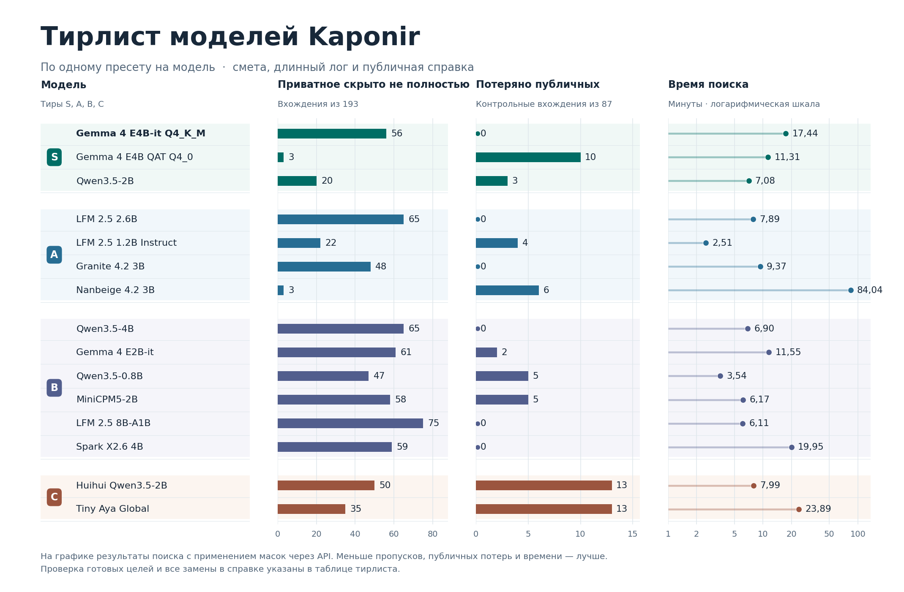

# Тирлист моделей Kaponir на 21 ноября

Итоговый рейтинг поиска от 22 ноября содержит по одному выбранному пресету каждой модели, с настройками, временем и баллом по шкале 60:30:15. [Финальная таблица 15 моделей](MODEL_RESEARCH_SUMMARY.md#итоговые-профили-поиска-для-15-моделей)

В отдельном сравнении скорости проверены свежие полные прогоны Nanbeige, Qwen3.5-4B и LFM 2.5 2.6B, включая сохранность ранее скрытых вхождений. [Время одного прохода и качество трёх моделей](THREE_MODEL_SPEED.md)

**Обновление поиска от 22 ноября.** Gemma E4B QAT заняла первое место по формуле 60:30:15, в отдельном отчёте приведены итоговые настройки четырёх моделей и проверка на новых документах. Тиры ниже учитывают также более ранние испытания A–D. [Свежие прогоны четырёх моделей](FOUR_MODEL_TUNING.md)

В срезе на 21 ноября **Gemma 4 E4B-it Q4_K_M с бюджетом рассуждений 2 048** лучше всего прошла отдельный D среди моделей, проверенных на одном пресете в обеих задачах. Она полностью скрыла 137 из 193 приватных вхождений, сохранила все 87 публичных контролей и приняла 32 верных решения в D. Поиск занял 17,44 минуты, в полностью публичной справке было две замены. [Сравнение на одном пресете](MODEL_RESEARCH_SUMMARY.md#выбор-одной-модели)

## Как читать тирлист

Каждая строка предлагает **одну модель с одним измеренным профилем**. Тиры отражают пригодность модели для всего сценария Kaponir. Сначала учитываются полнота скрытия, потери публичного текста и качество проверки готовых целей. Свежие прогоны показывают, насколько результат зависит от документов. Время влияет на место, когда выигрыш в качестве нужно сопоставить с реальной задержкой.

В основной таблице **2 оптимизированных профиля** (Gemma QAT и LFM 1.2B), **4 рекомендованных** и **9 исходных**. Для части этих моделей уже измерены альтернативы на полном корпусе или на короткой паре документов. [Измеренные альтернативы](#измеренные-альтернативы)

- **S — основные варианты для выбора.** У каждой модели есть сильный результат на полном корпусе. У E4B-it лучше всего проверены обе операции на одном пресете.
- **A — сильные альтернативы.** Их имеет смысл выбрать, если особенно важны полнота, публичный текст или скорость.
- **B — выбор при конкретном ограничении.** У моделей есть пригодный профиль и заметные ограничения по качеству, времени либо полноте проверки.
- **C — низкий приоритет для Kaponir.** В наших задачах другие модели убедительнее по сохранению публичного текста или решениям по приватным целям.

**Скрыто** — вхождения, закрытые полностью после применения масок модельного поиска и детекторов через API. Из 193 вычитаем это число, чтобы получить количество неполностью скрытых вхождений, включая частичные маски. **Потери /87** относятся к размеченному публичному тексту. **Замены в справке** учитывают все замены в одном полностью публичном документе, включая неразмеченный текст. Поисковое время — сумма HTTP-запросов по смете, длинному логу и публичной справке. Поиск /100 даёт до 50 баллов за полноту, до 20 за сохранение публичного и до 30 за скорость. [Документы и правила подсчёта](NEW_MODELS_RESULTS.md#что-именно-проверяется) · [Формула балла](NEW_MODELS_RESULTS.md#сводная-оценка-добавляющего-поиска)

В варианте **D** модели дали 16 готовых приватных и 16 публичных целей. Числа в колонке показывают, сколько модель верно решила скрыть и сохранить соответственно. **†** указывает на балл прежней серии A–D с другими или неподтверждёнными настройками поиска. Запись D · 69,3 означает 69,3 балла из 100 по формуле прежней серии с учётом времени. Прочерк отмечает пробел в данных к указанному профилю. [Исторические A–D](NEW_MODELS_RESULTS.md#отдельная-проверка-abcd-старых-моделей) · [Повтор A–D](NATIVE_MODEL_RETEST.md#abcd)

## Все 15 моделей

| Тир | Модель | Пресет поиска | Скрыто /193 | Потери /87 | Замены в справке | Мин | Поиск /100 | Проверка готовых целей |
|---|---|---|---:|---:|---:|---:|---:|---|
| **S** | **Gemma 4 E4B-it Q4_K_M** | Рекомендованный, рассуждения 2 048 | 137 | **0** | 2 | 17,44 | 64,11 | **D 16/16 · 16/16** |
| **S** | **Gemma 4 E4B QAT Q4_0** | Оптимизированный, температура 0, без рассуждений | **190** | 10 | 7 | 11,31 | 78,28 | — на прямом пресете |
| **S** | **Qwen3.5-2B** | Исходный, Q4_K_M | 173 | 3 | 4 | 7,08 | 78,90 | B · 59,0† |
| **A** | **LFM 2.5 2.6B** | Рекомендованный, рассуждения 2 048 | 128 | **0** | 2 | 7,89 | 67,65 | D 10/16 · 10/16 |
| **A** | **LFM 2.5 1.2B Instruct** | Оптимизированный, лог в 4 частях, сумма замеров | 171 | 4 | 6 | **2,51** | **83,96** | D 2/16 · 3/16¹ |
| **A** | **Granite 4.2 3B** | Исходный, Q4_K_M | 145 | **0** | 2 | 9,37 | 70,79 | D · 60,6† |
| **A** | **Nanbeige 4.2 3B** | Исходный, Q4_K_M, JSON по инструкции | **190** | 6 | 2 | 84,04 | 68,48 | — тайм-ауты в исходном A–D |
| **B** | **Qwen3.5-4B** | Рекомендованный, рассуждения выключены | 128 | **0** | 2 | 6,90 | 68,60 | D 2/16 · 16/16 |
| **B** | **Gemma 4 E2B-it** | Исходный, историческая строка | 132 | 2 | 4 | 11,55 | 64,85 | D · 69,3† |
| **B** | **Qwen3.5-0.8B** | Исходный, Q4_K_M | 146 | 5 | 6 | 3,54 | 75,64 | D · 30,2† |
| **B** | **MiniCPM5-2B** | Исходный, Q4_K_M | 135 | 5 | 6 | 6,17 | 69,38 | B · 60,5† |
| **B** | **LFM 2.5 8B-A1B** | Рекомендованный, рассуждения 1 024 | 118 | **0** | 2 | 6,11 | 66,85 | D 7/16 · 13/16 |
| **B** | **Spark X2.6 4B** | Исходный, рассуждения выключены | 134 | **0** | 2 | 19,95 | 62,38 | D · 33,8† |
| **C** | **Huihui Qwen3.5-2B** | Исходный, Q4_K_M | 143 | 13 | 15 | 7,99 | 67,85 | D · 60,5† |
| **C** | **Tiny Aya Global** | Исходный, JSON Schema | 158 | 13 | 12 | 23,89 | 63,85 | D · 37,2† |

¹ У LFM 1.2B веса и семплирование те же, что в D. Изменение касается деления длинного лога в поиске. Все строки таблицы относятся к одному корпусу из трёх документов. Одну модель используют 75 из 76 сохранённых поисковых профилей. Замер LFM 1.2B в таблице объединяет новый лог с прежними ответами на смету и справку. В полном свежем повторе получены 171/193, 4/87 публичных потерь и 2,22 минуты. В приложенном CSV есть и прежние, и новые результаты, включая исторический опыт с двумя разными моделями. [Все поисковые профили](model-search-summary.csv) · [Точные настройки ретеста](NATIVE_MODEL_RETEST.md#выбранные-профили)

## Почему модели получили эти места

### S

- **Gemma 4 E4B-it Q4_K_M** — самый обоснованный общий выбор. В D полностью закрыла обе половины задачи, а в поиске сохранила все размеченные публичные вхождения. Цена — 56 неполностью скрытых приватных вхождений и 17,44 минуты. Историческая Gemma E4B-it дала 150/193, но привязка того замера к тем же весам не подтверждена. Для пользовательского выбора опора — проверенный Q4_K_M с `temperature=1.0`, JSON Schema и бюджетом 2 048. [Повтор Gemma E4B-it](NATIVE_MODEL_RETEST.md)
- **Gemma 4 E4B QAT Q4_0** — самый быстрый из двух профилей, закрывших 190 из 193 вхождений. Прямой пресет `temperature=0` и `enable_thinking=false` дал **173 → 190/193** и **11,75 → 11,31 минуты** относительно исходной QAT при тех же десяти публичных потерях. Рекомендованный пресет давал 132/193 с нулём потерь и **D 14/16 · 15/16**. У прямого пресета пока открыт замер D. Два прохода той же QAT дали **180/193 с нулём потерь за 55,60 минуты**, с двумя заменами в справке. [Три основных пресета QAT](MODEL_SETTINGS_RESEARCH.md#прямой-режим-gemma-e4b-qat-на-трёх-документах) · [Два прохода](MODEL_SETTINGS_RESEARCH.md#гибридные-профили-на-сохранённых-ответах)
- **Qwen3.5-2B** — хороший выбор, когда нужен сильный поиск при умеренном времени. **173/193** за 7,08 минуты с тремя публичными потерями — лучший балл среди исходных профилей. В отдельной старой серии B верно закрыла 9/16 приватных целей, D — 5/16. В поисковом архиве закреплены температура 0, окно 4 096 и лимит выхода 1 600. [Исходный поиск Qwen2B](NEW_MODELS_RESULTS.md#qwen35-2b) · [Исторические A–D](NEW_MODELS_RESULTS.md#отдельная-проверка-abcd-старых-моделей)

### A

- **LFM 2.5 2.6B** — сильнейшая LFM по качеству на новой проверке. С бюджетом 2 048 закрыла **69/69** на двух новых документах, затронула 15 публичных вхождений и сохранила публичную справку целиком. На основном корпусе уменьшение бюджета до 384 сократило время **7,89 → 5,74 минуты**, полных скрытий стало 127 вместо 128, публичных потерь по-прежнему ноль. В тирлисте оставлен бюджет 2 048, потому что у него есть замеры D и свежих документов. [Полный корпус LFM](MODEL_SETTINGS_RESEARCH.md#проверка-lfm-на-трёх-больших-документах) · [Новая пара](MODEL_SETTINGS_RESEARCH.md#проверка-на-новых-документах)
- **LFM 2.5 1.2B Instruct** — лидер по поисковому баллу с учётом скорости. При `temperature=0.1` и разбиении лога на четыре части с `target_input_tokens=2432` весь корпус дал **171/193 за 2,51 минуты** против исходных **138/193 за 4,66**. Число публичных потерь в обоих прогонах — четыре. В D модель верно решила скрыть только 2 из 16 приватных целей. На новой паре она закрыла 55/69 за 59 секунд. [Длинный лог и пресет](MODEL_SETTINGS_RESEARCH.md#проверка-lfm-на-трёх-больших-документах) · [Новая пара](MODEL_SETTINGS_RESEARCH.md#проверка-на-новых-документах)
- **Granite 4.2 3B** — вариант с сохранением всех 87 публичных контролей. Исходный поиск дал **145/193 за 9,37 минуты**. Свежий поиск с температурой 1 на смете и справке и температурой 0 на разбитом логе дал **143/193 за 8,06 минуты**. В отдельном D у `low_effort` было 7/16 верных MASK и 16/16 верных KEEP. [Исходный поиск Granite](NEW_MODELS_RESULTS.md#granite42-3b) · [Сочетания пресетов Granite](MODEL_SETTINGS_RESEARCH.md#сочетания-пресетов-по-документам)
- **Nanbeige 4.2 3B** — сильный вариант по полноте. Исходный поиск дал **190/193, 6/87 потерь и 84,04 минуты**. Лучшее по баллу сочетание одного свежего фрагмента с архивными ответами сохранило **190/193**, снизило потери до **2/87** и дало **26,58 минуты** по сумме запросов. Схема на всех четырёх фрагментах с температурой 0 дала **188/193, 6/87 потерь и 31,02 минуты** на всём корпусе. В D на предыдущем прямом пресете было 8/16 верных MASK, 13/16 верных KEEP и восемь целей без ответа из-за тайм-аута. [Исходный поиск Nanbeige](NEW_MODELS_RESULTS.md#nanbeige42-3b) · [Сочетания пресетов Nanbeige](MODEL_SETTINGS_RESEARCH.md#сочетания-пресетов-по-документам)

### B

- **Qwen3.5-4B** в рекомендованном прямом режиме сократила время **32,25 → 6,90 минуты** и публичные потери **6 → 0**, при этом полное скрытие упало **173 → 128**. В архивной сборке с исходным профилем для лога получилось **162/193, одна потеря за 17,90 минуты**. Этот результат получен подбором ответов на тех же документах. В D фиксированного прямого режима всего 2/16 верных MASK. [Сравнение профилей](NEW_MODELS_RESULTS.md#сводная-оценка-добавляющего-поиска) · [Архивная сборка](MODEL_SETTINGS_RESEARCH.md#гибридные-профили-на-сохранённых-ответах)
- **Gemma 4 E2B-it** дала **132/193 с двумя публичными потерями за 11,55 минуты** по исторической строке. Старый балл D — 69,3. Снижение температуры до 0,25 на короткой паре сохранило 8/14 полных скрытий, а публичных потерь стало четыре вместо трёх. Доказанного выигрыша от этой настройки нет. [Поисковая таблица](NEW_MODELS_RESULTS.md#сводная-оценка-добавляющего-поиска) · [Короткая калибровка](NEW_MODELS_RESULTS.md#короткая-калибровка-добавляющего-поиска)
- **Qwen3.5-0.8B** — быстрый компактный профиль. **146/193 за 3,54 минуты**, пять публичных потерь. В старой серии модель выдала ноль верных MASK во всех A–D. Поэтому место определяется ограничением на ресурсы и скоростью поиска. [Исходный поиск Qwen0.8B](NEW_MODELS_RESULTS.md#qwen35-08b) · [Исторические A–D](NEW_MODELS_RESULTS.md#отдельная-проверка-abcd-старых-моделей)
- **MiniCPM5-2B** закрыла **135/193 за 6,17 минуты**, потеряла пять публичных вхождений. Исторический B дал 11/16 верных приватных MASK и шесть неприменимых решений. Полный поиск Qwen0.8B на том же корпусе закрыл на 11 вхождений больше с теми же пятью публичными потерями и занял меньше времени. [Исходный поиск MiniCPM](NEW_MODELS_RESULTS.md#minicpm5-2b) · [Исторические A–D](NEW_MODELS_RESULTS.md#отдельная-проверка-abcd-старых-моделей)
- **LFM 2.5 8B-A1B** оказалась чувствительна к инструкции и разбиению. На старом длинном логе после уточнения инструкции закрыла **108/113 с нулём публичных потерь**. На новой паре подтверждены **50/69**, пересчёт с дословными совпадениями в соседнем контексте дал **57/69**. 24 публичные потери сохранились. Раздельные потоки входа и генерации улучшили время на новой паре **5:03 → 3:45** при тех же ответах. Для штатного пресета на основном корпусе основание — 118/193 и D 7/16 · 13/16. [Длинный лог](MODEL_SETTINGS_RESEARCH.md#lfm-на-одном-длинном-логе-с-общей-инструкцией) · [Свежая пара](MODEL_SETTINGS_RESEARCH.md#проверка-на-новых-документах) · [Контекст фрагмента](MODEL_SETTINGS_RESEARCH.md#когда-модель-нашла-значение-в-контексте-соседнего-фрагмента)
- **Spark X2.6 4B** лучше всего ищет в исходном режиме. Рекомендованный `low` снизил покрытие **134 → 117**, добавил две публичные потери и увеличил время **19,95 → 21,97 минуты**. В D этот режим дал **11/16 · 15/16**, выше прежнего результата. На короткой паре оба запроса `low` достигли тайм-аута. В тирлисте выбран исходный профиль по результату поиска. [Ретест Spark](NATIVE_MODEL_RETEST.md#abcd) · [Короткий прогон](MODEL_SETTINGS_RESEARCH.md#короткий-прогон-восьми-моделей-на-одинаковых-документах)

### C

- **Huihui Qwen3.5-2B** скрыла **143/193** и потеряла 13 публичных вхождений за 7,99 минуты. Исходная Qwen3.5-2B при похожем времени скрыла **173/193** с тремя потерями. Улучшение на двух приватных целях в старом D у Huihui мало на фоне разницы в поиске. [Исходный поиск Huihui](NEW_MODELS_RESULTS.md#huihui-qwen35-2b-abliterated) · [Исторические A–D](NEW_MODELS_RESULTS.md#отдельная-проверка-abcd-старых-моделей)
- **Tiny Aya Global** в исходном поиске дала **158/193** и 13 публичных потерь. Рекомендованный профиль ускорился **23,89 → 7,16 минуты**, полных скрытий стало 132, публичных потерь — 17. Архивная сборка дала 160/193, также с 17 потерями. В рекомендованных A–D модель ни разу верно не решила скрыть приватную цель. Исходные ответы показали выбор KEEP, а выходной лимит оставался с запасом. [Исходный поиск Tiny Aya](NEW_MODELS_RESULTS.md#tiny-aya-global) · [Разбор исходных ответов](NEW_MODELS_RESULTS.md#влияние-валидатора-ad)

## Сравнение трёх LFM на свежих документах

В этом опыте у моделей совпали инструкция, фрагменты, схема и лимит ответа. Семплирование и бюджеты были индивидуальными. Из 69 приватных вхождений 18 представляют разные значения. Числа ниже получены после повторного применения общего правила для дословных совпадений в контексте соседнего фрагмента. Время взято из первоначальных запросов. [Условия и архив](MODEL_RESEARCH_SUMMARY.md#что-показало-прямое-сравнение-lfm)

| Модель | Скрыто /69 | Неполностью скрыто | Потери /46 | Неполностью скрыто + потери | Время |
|---|---:|---:|---:|---:|---:|
| LFM 1.2B | 55 | 14 | 11 | 25 | 0:59 |
| **LFM 2.6B** | **69** | **0** | 15 | **15** | 10:16 |
| LFM 8B-A1B | 57 | 12 | 24 | 36 | 5:03 |

Если пропуск приватного вхождения и лишняя маска одинаково дороги, **2.6B дала 15 ошибок против 25 у 1.2B**. Если считать каждое приватное значение один раз, 2.6B закрыла все вхождения 18 из 18 значений, 1.2B — 14, 8B — 15. У 8B перепроверка контекста вернула семь скрытий, и после неё по-прежнему затронуты 24 публичных вхождения. [Проверенный пересчёт](../../research/privacy-policy-phase2/checkpoints/lfm-context-grounding/comparison.json)

Ускоренный режим **2.6B с двумя группами и шагом уверенности 0,01** на старом длинном логе сохранил **112/113 и 0/32 потерь**, сократив ожидание с 16:34 до 8:35. На свежей паре этот же режим дал **55/69 и 1/46 потерь за 6:12**. Профили подходят под разный баланс полноты и сохранения публичного текста. [Парные замеры ускорения](MODEL_SETTINGS_RESEARCH.md#проверка-на-полном-логе) · [Результат на новых текстах](MODEL_SETTINGS_RESEARCH.md#проверка-на-новых-документах)

## Измеренные альтернативы

В таблице — полностью скрытые вхождения, потери публичных контролей и HTTP-время. Все варианты каждой строки используют один файл весов. В архивной сборке времена сложены из сохранённых запросов с разными пресетами по документам. [Методика сборки и применение через API](MODEL_SETTINGS_RESEARCH.md#гибридные-профили-на-сохранённых-ответах)

| Модель | Профиль в тирлисте | Уже измеренные варианты |
|---|---|---|
| **Qwen3.5-4B** | Без рассуждений · **128/193**, 0/87 потерь, 6,90 мин | Исходный · **173/193**, 6/87, 32,25 мин. Архивная сборка · **162/193**, 1/87, 17,90 мин. |
| **LFM 2.5 2.6B** | Бюджет 2 048 · **128/193**, 0/87, 7,89 мин | Бюджет 384 · **127/193**, 0/87, 5,74 мин. Бюджет 2 048 для сметы и 384 для лога и справки на сохранённых ответах · **128/193**, 0/87, 6,34 мин. |
| **Granite 4.2 3B** | Исходный · **145/193**, 0/87, 9,37 мин | Сочетание по документам · **143/193**, 0/87, 8,06 мин в свежем прогоне. Комбинация сохранённых ответов с тем же покрытием заняла 7,11 мин по сумме запросов. |
| **Nanbeige 4.2 3B** | Исходный · **190/193**, 6/87, 84,04 мин | Температура 0,6 со схемой на первом фрагменте и архивные ответы для остальных · **190/193**, 2/87, 26,58 мин. Температура 0 на первом фрагменте · **191/193**, 7/87, 29,76 мин. |
| **LFM 2.5 8B-A1B** | Бюджет 1 024 · **118/193**, 0/87, 6,11 мин | Бюджет 768 · **111/193**, 0/87, 6,17 мин. На новой паре раздельные потоки входа и генерации сократили время **5:03 → 3:45** при побайтно одинаковых ответах. |
| **Spark X2.6 4B** | Исходный · **134/193**, 0/87, 19,95 мин | Режим `low` · **117/193**, 2/87, 21,97 мин. На этом режиме получены D 11/16 верных MASK и 15/16 верных KEEP. |

[Полный корпус LFM](MODEL_SETTINGS_RESEARCH.md#проверка-lfm-на-трёх-больших-документах) · [Сочетания Granite и Nanbeige](MODEL_SETTINGS_RESEARCH.md#сочетания-пресетов-по-документам) · [Все поисковые профили](model-search-summary.csv)

## Что перепроверить кроме Gemma

1. **Qwen3.5-2B — первый кандидат для пересмотра общего выбора.** В поиске **173/193 при 3/87 публичных потерь за 7,08 минуты**. Исторический A–D запускали с окном 16 384, поисковый замер — с 4 096. Для сравнения с Gemma стоит измерить поиск и D на одном заранее выбранном пресете. [Исходный поиск](NEW_MODELS_RESULTS.md#qwen35-2b) · [Исторические решения](NEW_MODELS_RESULTS.md#отдельная-проверка-abcd-старых-моделей)
2. **Qwen3.5-4B — первый кандидат на настройку поиска.** Из 45 потерянных полных скрытий между исходным и рекомендованным профилями 34 пришлись на длинный лог. Достаточно начать с этого лога и сравнить один запрос с разбиением на фрагменты при том же семплировании. У прямого пресета в D **2/16** верных приватных MASK, поэтому для общего выбора нужен и замер решений. [Поиск по документам](NATIVE_MODEL_RETEST.md#добавляющий-поиск-по-документам) · [D](NATIVE_MODEL_RETEST.md#abcd)
3. **LFM 2.5 2.6B — проверить перенос ускорения.** На исходном корпусе бюджет 384 ускорил поиск на 2,15 минуты ценой одного полного скрытия. На новых документах совпадение качества надо проверить при одинаковом разбиении и бюджетах 384 и 2 048. [Полный корпус](MODEL_SETTINGS_RESEARCH.md#проверка-lfm-на-трёх-больших-документах)

## Границы выбора

Тиры — оценка для Kaponir по этим данным. На одинаковом основном корпусе пять прямых повторов с рекомендованными параметрами дали меньше полных скрытий, чем исходные режимы. Точный эффект лучше всего виден у настроенной QAT и при разбиении лога у LFM 1.2B. В исторических прогонах различались настройки запросов и рантайма. Короткая калибровка и новая пара LFM дополняют основной корпус, их числа относятся к своим документам. [Все сравнения и график профилей](MODEL_RESEARCH_SUMMARY.md#что-изменили-рекомендации-производителей)

Оценка D помогает понять, как модель решает судьбу уже найденной цели. Фактический пользовательский сценарий также зависит от полноты поиска и способа применения масок. По прямой QAT открыт D на том же пресете, а общего финала всех моделей на новых документах пока нет. Это главные ограничения при выборе постоянного профиля по умолчанию. [Шесть схем применения](NATIVE_MODEL_RETEST.md#шесть-схем) · [Что измеряет проверка решений](PRODUCT_FINDINGS.md#решение-модели-и-фактическое-скрытие--разные-измерения)
